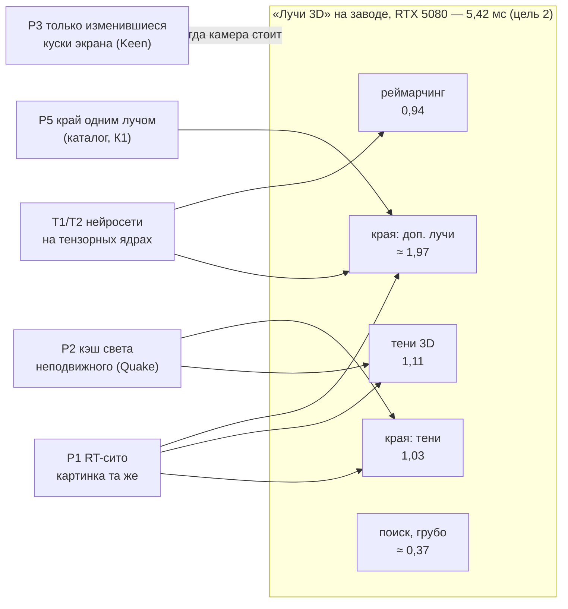

# 3D без треугольников: где схитрить

[← Дорожная карта](roadmap.md)

Разбор по вопросу Романа (2026-11-23): что взять из работ Кармака, можно ли запрячь тензорные и RT-ядра под наши формулы-формы (SDF), и что из свежего у NVIDIA нам подходит. Это исследование: **кода в движке нет**, всё ниже — оценки, а не замеры. Работу этапа 8 над краями (8.25 и дальше) разбор не повторяет, а продолжает.

## Суть в двух словах

Схитрить можно, и честнее всего — **RT-ядрами**. Они умеют не только треугольники: им можно дать коробки наших форм, и тогда железо само скажет лучу, к каким предметам он подходит. Шагать луч будет только по ним. Картинка остаётся той же до точки, а дешевеют тени и края, которые сейчас съедают больше половины «лучей 3D».

У Кармака полезнее всего общий принцип: **не считать то, что не изменилось**. Отсюда кэш света неподвижного (как в Quake) и перерисовка только изменившихся кусков экрана (как в Commander Keen).

**Тензорные ядра** сам шаг луча не ускорят: они умеют только перемножать большие таблицы чисел, а луч по формам — это ветвистая работа «по одному». Им есть дело в другом месте: увеличить картинку из меньшей одной нейросетью без истории кадров или заменить четыре доп. луча края угадыванием. Обе вещи меняют картинку, поэтому это опыты, которые решает Роман.

## Схема: куда уходят 5,4 мс и куда бьёт каждая идея

## Простыми словами

### Что вообще есть в видеокарте

В RTX 5080 три вида «рабочих»:

- **Обычные ядра** (их больше 10 тысяч). Считают всё, что мы пишем в шейдерах, включая наши формы. Сейчас вся 3D-графика движка живёт на них.
- **RT-ядра** (84 штуки, по одному на блок). Узкие специалисты: очень быстро ищут, какие коробки из дерева коробок пересекает луч. Игры дают им треугольники, но коробки им можно дать любые.
- **Тензорные ядра** (336). Ещё более узкие: перемножают таблицы чисел 16×16 за раз. Это сердце нейросетей и DLSS. Для работы «один луч — свои ветки» они не годятся.

Сравнение из жизни: RT-ядро — это библиотекарь с каталогом. Он не читает книги за тебя, но мгновенно говорит, на каких полках искать. Тензорное ядро — это бухгалтерская машина. Она гениально складывает колонки, но письмо за тебя не напишет.

### Что взять у Кармака

| Трюк Кармака | Где был | Что он делал | Что это для нас |
| --- | --- | --- | --- |
| Перерисовка только изменившихся плиток | Commander Keen, 1990 | Экран не рисовался заново: обновлялись только плитки, где что-то сдвинулось | **Р3**: камера стоит — пересчитываем только куски экрана, где двигалось что-то, его тень или его углы. Картинка та же до точки. На завод с конвейерами помогает меньше, чем кажется: движется много где |
| Кэш поверхностей | Quake, 1996 | Свет на стене считался один раз и хранился в маленькой картинке, пока свет не менялся | **Р2**: тень и затенение углов от неподвижных предметов при неподвижном солнце считаем один раз в объёмную картинку. Каждый кадр — только тени от движущегося |
| Заранее посчитанная видимость (PVS) | Quake | Для каждой комнаты заранее знали, какие комнаты из неё видны | Почти ничего: завод виден сверху и почти ничего не заслоняет; отсев по взгляду у нас уже есть (7.6к). Пригодится в будущих играх с коридорами |
| Дерево BSP | Doom, 1993 | Порядок стен «от ближней к дальней» без лишней перерисовки | Не нужно: луч по формам и так находит ближнее сам |
| Пробег луча по клеткам карты | Wolfenstein 3D, 1992 | Луч шагает по сетке клеток карты, а не по стенам | Уже есть в другом виде: сетка отсева со свободным расстоянием (7.18д4) |
| Мегатекстура с «заявками» | id Tech 5, 2011 | Кадр сам пишет, какие куски огромной текстуры ему нужны, и грузятся только они | Для полей шире 80 м (8.10): кадр пишет, какие страницы поля нужны |
| Разреженное дерево вокселей (SVO) | исследования id Tech 6, 2008 | Статичный мир — дерево кубиков, луч спускается по дереву | Для будущей игры из блоков (как Minecraft) — правильный инструмент. Для завода — частично, через запечённое поле (8.9) |

Главное у Кармака не трюки, а правило: **дорогое считай один раз, каждый кадр — только изменившееся, и меряй, а не верь**. Р2 и Р3 — прямо это правило.

### RT-ядра без треугольников (идея Р1, главная)

Сейчас луч края или тени на каждом шаге спрашивает сетку: «какие предметы рядом?», и считает формулы всех, кто в клетке. Сетка у нас хорошая, но она про **клетки**, а не про **луч**.

Предлагаю дать RT-ядрам дерево из коробок всех предметов завода (1000+ коробок, для железа это мелочь). Тогда:

1. Луч тени сначала спрашивает железо: «через какие коробки я пройду?».
2. Если ни через какую — свет, ни одной формулы не считаем. На заводе таких лучей много: открытый пол под солнцем.
3. Если через две — шагаем только внутри этих двух коробок, только по их формам.

Формулы те же, поэтому **картинка та же**. Меняется только «кого спрашивать». Это как раз то, что Роман назвал «использовать мощности под иные задачи»: RT-ядро работает поисковиком, а рисуют по-прежнему наши формы.

Честно о слабых местах:
- Мягкая тень зависит от предметов, мимо которых луч прошёл **рядом**, а не только сквозь. Коробки придётся раздуть на ширину полутени. Чем дальше тянется тень, тем толще коробка и тем меньше выигрыш.
- Доп. лучи краёв дороги не поиском, а тем, что ползут вдоль скруглённых углов (замер 8.23). Тут сито поможет меньше: только тем, что в шаге будет меньше чужих форм.
- Radeon тоже умеет RT, но медленно, а 3D на нём заморожено. Значит, сетка остаётся вторым путём. Два пути — больше кода, а Роман просит устойчивую систему, не гору костылей. Поэтому предлагаю сначала опыт с переключателем и только с тенями. Если не даст хотя бы −0,4 мс, убираем.

### Тензорные ядра: честно

Тензорное ядро выгодно, только когда работа — это перемножение таблиц: нейросеть, большая матрица. Шаг луча по формам — несколько десятков сложений, сравнений и ветвлений, у каждого луча свои. Перевести его в таблицы нельзя. Поэтому **ускорить наш реймарчинг тензорными ядрами напрямую нельзя**, и я не хочу обещать обратное.

Где они всё же могут помочь (оба опыта меняют картинку, решает Роман):

- **Т1. Увеличение картинки одной нейросетью, без истории кадров.** Считаем 3D в 50–70 % размера, маленькая сеть дорисовывает до полного по одному кадру и буферу геометрии. Это не TAA и не DLSS: прошлых кадров нет, размазывания и «призраков» нет. Но и стабильности от прошлых кадров нет: тонкие края при движении могут чуть мерцать. Плюс: учить сеть можно на наших же кадрах, где «правильный ответ» мы считаем сами в полном размере. Выигрыш большой (лучей в 2–4 раза меньше), риск тоже.
- **Т2. Край без доп. лучей.** Вместо четырёх доп. лучей сеть по соседним точкам буфера геометрии угадывает, какая доля пикселя чья. Сначала стоит попробовать то же самое формулой без сети (К1 в каталоге оптимизаций: «покрытие по промаху» из расстояния формы). Сеть — только если формула выглядит плохо.
- **Нейронные формы** (сеть вместо формулы) для нас почти бесполезны: наши формы и так дешёвые, а сложные мы уже кладём в «кирпич поля» (8.15), который читается железом текстур быстрее любой сети.

### Что нового у NVIDIA (2025–2026)

| Технология | Что делает | Для нас |
| --- | --- | --- |
| Кооперативные векторы (Vulkan `VK_NV_cooperative_vector`, DirectX SM 6.9) | Маленькая нейросеть прямо внутри любого шейдера, на тензорных ядрах | **Да, это путь для Т1/Т2.** Slang (наш язык шейдеров) их умеет. Только NVIDIA |
| RTX Mega Geometry (кластеры, «разделённое» дерево верхнего уровня) | Быстрая постройка и правка дерева коробок для огромных сцен | **Да, косвенно, для Р1**: дерево с тысячами движущихся коробок можно править по кусочкам каждый кадр |
| Линейно-протянутые сферы (LSS, Blackwell) | Железо само пересекает луч со сферами и «капсулами» (для волос) | Любопытно: сфера или капсула как оболочка формы без своего шейдера пересечения. Для Р1 хватит и коробок |
| Нейронные материалы, нейронное сжатие текстур | Сеть вместо сложного материала или большой текстуры | Нет: у нас мало текстур, материалы простые |
| Нейронный кэш излучения (NRC), ReSTIR | Отражённый свет и много ламп | Позже, для 3D-света. Оба копят данные между кадрами — это против правила «без временного» по духу, обсудим отдельно |
| DLSS 4, DLSS 5, Reflex 2 | Увеличение и дорисовка кадров по истории кадров | **Нет**: всё временное, с векторами движения |

Ни одна из свежих технологий NVIDIA не ускоряет SDF-реймарчинг напрямую: всё построено вокруг треугольников и нейросетей. Пригодны как «запчасти» две: дерево коробок (RT-ядра) и сети внутри шейдера (тензорные ядра).

### Дополнения после разговора с Романом (2026-11-23)

**Правило честной картинки** (Роман: «держаться философии честности картинки», без «болезни картинки из Unreal»). Приём, который заранее считает и хранит точный ответ или использует железо как поисковик (кэш света неподвижного, RT-сито), — честный, его берём смело. Приём, который угадывает или копит картинку по прошлым кадрам (TAA, шумоподавление, нейронный кэш света), — только опыт с флажком и сравнением рядом с честным вариантом; оставлять или нет, решает Роман по результату.

**Тензорные ядра: где ещё пригодятся.** Работа ложится в таблички, когда много входов проходят через одни и те же веса.
- Вода (этап 10): волны океана через FFT — табличная работа.
- Синтез ассетов: маленькие сети, которые при загрузке рождают текстуры, узоры и детали поверхности из нескольких чисел. Это не скорость кадра, а «графика из кода» — важная для Романа цель.
- Фильтры (свечение, увеличение), слияние каскадов света: можно, но они и так дешёвые и зависят от числа пикселей, а не от размера сцены. Опыт Р4 покажет, во сколько раз тензорные ядра быстрее на такой работе.

**Отражённый свет в 3D: опыт CryEngine.** SVOGI (CryEngine, 2016): конусы по разреженному дереву вокселей, без RT-ядер, без шума и без накопления по кадрам; Neon Noir (2019) — отражения лучами на Radeon без RT-ядер. Для нас это конус по запечённому полю расстояний: кандидат на отражённый свет в 3D рядом с каскадами излучения. Lumen без RT-ядер тоже идёт по полям расстояний, но держится на накоплении по кадрам — его эту часть не берём.

### Итоговый рейтинг для RTX 5080 (завод)

| # | Идея | Ожидаемый выигрыш «лучей 3D» | Картинка | Цена | Риск |
| --- | --- | --- | --- | --- | --- |
| Р1 | RT-сито: коробки форм в дереве RT, марш только в пересечённых | −0,8…−1,6 мс (тени, тени краёв; доп. лучи меньше) | та же | 2–3 PR | средний: раздутые коробки полутени, второй путь в коде |
| Р2 | Кэш света неподвижного (Quake) | −0,8…−1,3 мс (тени и тени краёв) | почти та же, мельче детали контактной тени | 2–3 PR, вместе с 8.9 | средний: смена солнца = перепекание |
| Р5 | Край одним лучом по промаху (каталог, К1) | −1,2…−1,8 мс (доп. лучи) | другая, похожая на MSAA | 1–2 PR | низкий в коде, решение за Романом |
| Т1 | Увеличение одной сетью без истории | −2…−3 мс (всё 3D) | другая, возможно мерцание | 4+ PR, обучение | высокий |
| Т2 | Край угадыванием сети | как Р5 | другая | 3+ PR | высокий; сначала Р5 |
| Р3 | Только изменившиеся куски экрана (Keen) | при стоящей камере до −50…−80 %, при движении 0 | та же | 2 PR | средний: «застрявшие» точки при ошибке |
| Р4 | Неподвижная масса в запечённом поле + дерево кирпичей (SVO) | реймарчинг и тени; цифру не даю без счётчиков | почти та же | уже в плане (8.9) | средний |

Цели этапа меряются на движущейся камере, поэтому Р3 цель не закрывает: это подарок для стоящей.

### Что предлагаю

1. **Сначала счётчик** (без смены картинки, полдня): сколько чужих форм луч тени и доп. луч считают на шаг и сколько лучей тени не задевают ни одной коробки. Это скажет, сколько реально даст Р1, до того как писать код RT.
2. **Р1 опытом, только для теней солнца**, с переключателем «Тени: поиск RT-ядрами». Роман меряет на 5080. Дало ≥ 0,4 мс — расширяем на тени краёв и доп. лучи, нет — убираем целиком.
3. **Р2 вместе с 8.9**: неподвижное в поле, свет от неподвижного — один раз.
4. **Р5 или Т2** — когда Роман посмотрит на картинку края одним лучом.
5. **Т1** — только если после всего этого завод всё ещё не в 2 мс и Роман согласен на «дорисованную» картинку.

## Технические детали

### Исходные числа

Завод, вид R, 100 %, MSAA 4×, лучи; RTX 5080, замер Романа 2026-11-22 после PR #223: «края 3D: тени» 1,029, «края 3D» 1,965, «тени 3D» 1,111, «реймарчинг» 0,943, «поиск» 0,206, «лучи 3D» 5,42, видеокарта 5,61 мс. Счётчики CI (lavapipe, тот же вид): доп. лучей краёв 769 тыс., из шагов только 16 % до глубины соседей (8.23), остальное — у поверхности; точных теней краёв 192 тыс. лучей. Сетка отсева по коробкам: клетка 0,69 м, длиннейший список 9 объектов (8.8а).

Параллельная работа этапа 8: 8.25 (общий плотный список «пиксель + доля» для теней краёв), затем грубее точность попадания доп. лучей и учёт кода краёв и теней. Р1 и Р2 бьют в те же проходы, поэтому их опыты идут после 8.25 и учёта кода, на чистой основе, а не параллельно.

### Р1. RT-сито для SDF

Устройство:
- Нижний уровень (BLAS): одна геометрия-коробка `VK_GEOMETRY_TYPE_AABBS_KHR` в объектных координатах, одна на вид формы (или одна единичная коробка на всех, размер через матрицу экземпляра).
- Верхний уровень (TLAS): экземпляр на каждый объект кадра; матрица = место объекта, `instanceCustomIndex` = номер объекта в снимке сцены. Неподвижные объекты (`SpaceFrame::still`, 8.8б) не меняются между кадрами, поэтому подходит обновление (`MODE_UPDATE`) или «разделённый» TLAS (`VK_NV_partitioned_acceleration_structure`, из набора Mega Geometry) с правкой только движущихся.
- В шейдере — `VK_KHR_ray_query` (без отдельного конвейера RT): `rayQueryProceedEXT` выдаёт кандидатов-коробки по мере обхода; для каждой кандидатки марш идёт только по её программе в отрезке `[t_enter, t_exit]`; найденное попадание подтверждается `rayQueryGenerateIntersectionEXT(t)`, что обрезает дальнейший обход. Для теней — `TerminateOnFirstHit` нельзя (нужен минимум полутени по всем рядом), поэтому полутень = минимум `k·h/t` по всем пройденным кандидаткам.
- Полутень: коробку экземпляра для теней раздуваем на `w(t_max) = t_max/k` в пределах дальности мягкой тени, либо держим два дерева: точное для глаза и краёв и раздутое для теней.
- Расширения: `VK_KHR_acceleration_structure`, `VK_KHR_ray_query`, `VK_KHR_deferred_host_operations`; `ash 0.38` их содержит; Slang компилирует `RayQuery<>` в SPIR-V. Весь `unsafe` — в `reyvec-gpu` (новый модуль постройки деревьев). Проверить до кода: есть ли `VK_KHR_ray_query` у lavapipe в CI; если нет, тест картинки «сито против сетки» идёт только на ПК Романа, и это слабое место.

Оценка (не замер):
- Тени 3D: лучи, не задевшие ни одной раздутой коробки, завершаются одним обходом. Доля таких лучей неизвестна — это и есть счётчик шага 1. При 40–60 % «пустых» лучей ожидаю 1,11 → 0,5–0,8 мс.
- Тени краёв: так же, 1,03 → 0,5–0,8 мс.
- Доп. лучи краёв: стоимость — сходимость вскользь у скруглений, не поиск. Сито уменьшает только число форм на шаг: −10…−30 %, 1,97 → 1,4–1,8 мс.
- Цена обхода RT на пиксель на 5080 — порядка десятков наносекунд на волну; постройка TLAS на 1–2 тыс. экземпляров — порядка 0,05–0,1 мс кадра. Это тоже надо мерить.
- Побочно: если сито покроет всё, сетка отсева на процессоре (`Grid`, `GridCache`) становится не нужна на 5080 — минус время упаковки снимка.

### Р2. Кэш света неподвижного

- Объёмная картинка R8 «видимость солнца от неподвижного» и R8 «затенение углов от неподвижного» поверх неподвижной части (в тех же кирпичах, что поле 8.9, клетка 2–4 см у камеры, дальше крупнее).
- Каждый кадр: тень = минимум (кэш, честная тень только по движущимся формам). Затенение углов — так же.
- Контактная тень (первые 3–5 см от поверхности) остаётся честной, иначе пропадает чёткость в местах касания — главный риск картинки.
- Солнце сдвинулось — перепекание кирпичей очередью по N за кадр (как 7.18г). Это задержка обновления, а не смешивание кадров; картинка между кадрами не размазывается.
- Ожидание: «тени 3D» 1,11 → 0,4–0,6, «края 3D: тени» 1,03 → 0,3–0,5 мс. Слабое место: память (весь завод 80×80×10 м при 4 см — 1 млрд клеток, значит только разреженные кирпичи у поверхностей) и урок 7.10: перепекание вокруг движущегося обходится дорого, поэтому в кэш идёт только `still`.

### Р3. Только изменившиеся куски экрана

- Экран — плитки 16×16. Плитка пересчитывается, если камера сдвинулась хоть на бит, или в неё попала экранная коробка движущегося объекта, его тени до земли или радиуса затенения углов, или изменился свет.
- Остальные плитки копируются из прошлого кадра как есть. Это повтор точных чисел, а не смешивание: размытия нет.
- Проверка: тест «каждый 30-й кадр полный пересчёт и сравнение до байта».
- Слабое место: на заводе с 1000+ движущихся вещей и тенями на половину экрана выигрыш может быть малым; цели этапа меряются на движущейся камере.

### Р4. Масса в поле и дерево кирпичей

Это план 8.9 и 8.10. От id Tech 6 / SVO берём только иерархию: пустые кирпичи верхнего уровня пропускаются целиком, луч спускается в занятые. Для будущей игры из блоков — полноценное дерево блоков (SVO/DAG) с обходом по клеткам. Отдельно стоит знать работу «Ray Tracing of Signed Distance Function Grids» (Söderlund, Evans, Akenine-Möller, JCGT 2022): каждый занятый кирпич поля — коробка в дереве RT, пересечение внутри кирпича считается точной формулой по трилинейной сетке. Это Р1 и Р4 вместе; брать после того, как Р1 покажет цифры.

### Т1/Т2. Сети внутри шейдера

- Путь: `VK_NV_cooperative_vector` (кооперативные векторы, матрица сети в буфере, `coopVecMatMulAddNV` в шейдере); общий запасной — `VK_KHR_cooperative_matrix` (есть и у AMD RDNA3, но неудобен для «сеть на пиксель»).
- Т1: вход — 3D в 50–70 % плюс буфер геометрии (глубина, нормаль, номер материала), выход — полный размер. Сеть в несколько слоёв по 32–64 нейрона на пиксель стоит порядка 0,3–0,6 мс на 1080p (оценка по опубликованным цифрам нейронных материалов, не замер). Обучение — офлайн, на парах «наш кадр в 50 % — наш кадр в 100 % с краями», значит нужен инструмент обучения вне движка (Python) и формат весов. Без истории кадров.
- Т2: вход — окрестность 3×3 буфера геометрии и расстояние формы в центре пикселя, выход — доли пикселя для 2–4 соседних объектов. Заменяет доп. лучи. Сначала аналитический К1.
- Только NVIDIA; на Radeon — без сети или обычными ядрами медленнее.

### Отвергнуто

| Что | Почему |
| --- | --- |
| TAA, DLSS 2–5, Ray Reconstruction, Reflex 2 frame warp | Временное; Роман против |
| Шум RT-теней с очисткой (NRD, ReSTIR) | Очистка опирается на прошлые кадры |
| BSP, PVS | Завод сверху почти ничего не заслоняет; отсев по взгляду уже есть |
| Нейронные формы вместо формул | Наши формы дешевле сети; сложные — в кирпиче поля |
| Нейронные материалы и сжатие текстур | У нас нет тяжёлых материалов и текстур |
| Гауссовы пятна (splatting) | Не синтез из кода; снимают реальный мир |
| Тензорные ядра для самого шага луча | Нет матричной работы |

### Слабые места этого разбора

- Ни одной цифры не мерено. Числа в рейтинге — прикидки по нашим счётчикам и опубликованным данным; урок 7.10 (симуляция обещала больше, чем дала видеокарта) здесь тоже действует.
- Не проверено, есть ли у lavapipe в CI `VK_KHR_ray_query` и кооперативные векторы.
- Р1 и Р2 бьют в одни проходы, их выигрыши не складываются полностью.
- Мягкая тень через сито — самое тонкое место; если раздутые коробки окажутся почти везде, выигрыш Р1 по теням пропадёт.

### Источники

- Fabien Sanglard, «Game Engine Black Book: Wolfenstein 3D» и «...: Doom» (рейкастинг, BSP).
- Michael Abrash, «Graphics Programming Black Book», главы про Quake (кэш поверхностей, PVS).
- Jon Olick, «Current Generation Parallelism in Games», SIGGRAPH 2008 (SVO в id Tech 6).
- Söderlund, Evans, Akenine-Möller, «Ray Tracing of Signed Distance Function Grids», JCGT 2022.
- Sebastian Aaltonen, «GPU-based clay simulation and ray tracing tech in Claybook», GDC 2018.
- NVIDIA RTX Kit (страница разработчика, 2026-10): кооперативные векторы, RTX Mega Geometry 2.0, LSS, NTC, нейронные шейдеры, NRC, RTXDI.
- Предложение расширения Vulkan `VK_NV_cooperative_vector` (docs.vulkan.org).
- Jon Peddie, «AMD, NVIDIA, and AI rework rendering», блог ACM SIGGRAPH, 2026-10 (DLSS 5, Mega Geometry 2.0).
- Наши документы: каталог оптимизаций графики (2026-11-16), разбор «где теряем скорость» (2026-11-07), [0019](decisions/0019-baked-distance-field.md), [0020](decisions/0020-level-field.md), [roadmap.md](roadmap.md) задачи 8.8–8.25.

## Заметки Романа

_Пока пусто._
