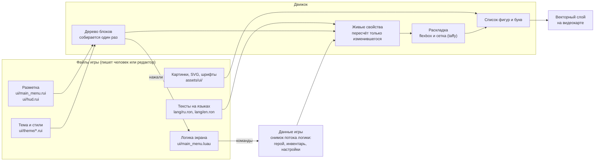
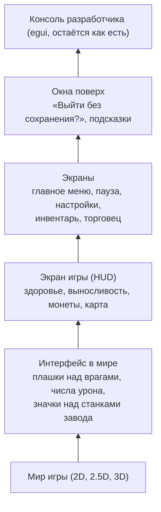

# Интерфейс игры: от главного меню до полоски выносливости

Дата: 2026-11-25. Статус: **предложение**, ждёт ответов Романа (вопросы в конце). Кода пока нет.

Вопрос Романа: «Сформировать то, как будет работать интерфейс игры от главного меню до внутриигровой полоски стамины. Для больших экранов — веб-логика: писать кодом на декларативном языке, как в Slint. Стилизовать и настраивать. Текстурировать. Привязывать к функциям движка легко и без лишней мороки».

## Коротко

✅ **Один язык разметки на весь интерфейс игры.** Главное меню, настройки, инвентарь, окно торговца, полоска выносливости, плашки над врагами — всё пишется в файлах `ui/*.rui` («ReyVec UI»). Язык похож на Slint: блоки в фигурных скобках, у блока свойства, свойства могут зависеть друг от друга и от данных игры. Правка файла сразу видна в запущенной игре, как сейчас со сценами и скриптами.

✅ **Стили отдельно от разметки, как CSS в вебе.** Цвета, шрифты, скругления, отступы берутся из темы. Сменил тему — сменилась вся игра. У кнопки есть состояния «наведена», «нажата», «выбрана геймпадом», «выключена», и для каждого свой вид.

✅ **Текстуры и рисунки — как оформление блока.** Фон блока может быть цветом, градиентом, картинкой, рамкой из картинки, которая растягивается без искажения углов («9 частей»), векторным рисунком SVG или Motif и даже маленькой программой видеокарты (лава, искры, шум) — это наша сильная сторона «графики из кода».

✅ **Привязка к игре в одну строку.** `value: game.hero.stamina` — полоска сама следит за выносливостью. `clicked => game.start()` — кнопка зовёт функцию. Функции — из движка (открыть экран, выйти, сохранить настройку) или из файла Luau рядом с экраном.

✅ **Рисует наш векторный слой, а не чужая библиотека.** Кнопки, рамки, тени и текст — это фигуры и буквы, которые движок уже умеет рисовать чёткими в любом размере. Процессор работает только тогда, когда что-то поменялось; неподвижное меню каждый кадр стоит почти ноль.

⚠️ **Главное слабое место:** свой язык — это большая работа (разбор файла, понятные ошибки, подсветка в редакторе, документация). Готовый Slint взять нельзя: его лицензия не подходит под наш `deny.toml`, и он рисует сам, своими средствами, а не нашим векторным слоем. Поэтому мы берём у Slint **идеи** (язык и «живые» свойства), а у веба — раскладку (flexbox и сетку через библиотеку `taffy`, MIT).

## Схема: что из чего состоит



## Простыми словами

### Весь интерфейс — это стопка слоёв

Представь игру как стопку прозрачных листов. Снизу — сам мир. Над ним листы интерфейса. Каждый лист живёт своей жизнью, а нажатие мышью или кнопкой геймпада получает верхний лист, которому оно нужно.



Слои «Экраны» работают как вкладки браузера с кнопкой «Назад»: из главного меню открыли «Настройки», из них «Управление» — получилась стопка из трёх. Esc или кнопка «B» на геймпаде снимает верхний. Переходы между экранами — плавные (сдвиг, растворение), это задаётся в разметке.

Пока открыт экран паузы, мир стоит (это уже работает с этапа 6). Инвентарь может ставить мир на паузу или нет — это свойство экрана.

### Как выглядит файл

Главное меню:

```
// ui/main_menu.rui
import { Button, Title } from "kit/base.rui";

export screen MainMenu {
    background: shader("ui/fx/forge_embers.slang");   // живой фон из кода

    VerticalLayout {
        align: center;
        spacing: 16px;

        Title { text: tr("menu.title"); }
        Button { text: tr("menu.continue"); visible: game.save.exists;
                 clicked => game.load_last(); }
        Button { text: tr("menu.new_game");  clicked => new_game(); }   // функция из main_menu.luau
        Button { text: tr("menu.settings");  clicked => open("Settings"); }
        Button { text: tr("menu.quit"); class: "danger";
                 clicked => ask("QuitDialog"); }
    }
}
```

Полоска выносливости:

```
// ui/hud.rui
export layer Hud {
    Bar {
        anchor: bottom-left;  margin: 24px;  width: 260px;  height: 10px;
        value: game.hero.stamina / game.hero.stamina_max;
        fill: theme.stamina;
        fill.when(value < 0.25): theme.danger;      // мало сил — красная
        opacity: value < 1.0 ? 1 : 0;               // полная — прячется
        animate opacity { duration: 400ms; }
        animate value   { duration: 120ms; easing: ease-out; }
    }
}
```

Что тут важно:

- **Никакого кода «каждый кадр».** Не надо писать «на каждом кадре возьми выносливость и подвинь полоску». Достаточно сказать «полоска равна выносливости», дальше движок следит сам. Так устроены Slint, XAML и современный веб.
- **Знакомые веб-понятия:** отступы (`margin`, `padding`), ряды и столбцы, выравнивание, проценты, классы (`class: "danger"`), состояния (`:hover`).
- **Тексты по ключам** (`tr("menu.title")`): сами слова лежат в `lang/ru.ron` и `lang/en.ron`, язык переключается в настройках.

### Стили и темы

Тема — это набор «токенов»: цвета, размеры, шрифты, скругления. Стиль говорит, как выглядит каждый вид блока в каждом состоянии.

```
// ui/theme/forge.rui
theme Forge {
    color  panel:    #171A21;
    color  accent:   #F5A54A;     // цвет раскалённого металла
    color  stamina:  #7FD36B;
    color  danger:   #E5484D;
    font   body:     "Inter" 18px;
    font   title:    "Cinzel" 48px;
    radius normal:   6px;
}

style Button {
    background: frame("assets/ui/iron_plate.png", slice: 12px);   // рамка «9 частей»
    font: theme.body;
    padding: 10px 24px;
    :hover   { glow: theme.accent 8px; }
    :pressed { offset: 0 2px; }
    :focus   { outline: theme.accent 2px; }    // выбрана геймпадом
    :disabled{ opacity: 0.4; }
}
style Button.danger { :hover { glow: theme.danger 8px; } }
```

Это меньше, чем настоящий CSS: нет длинных цепочек правил, которые перебивают друг друга. Правило простое — **ближнее побеждает**: свойство прямо у блока сильнее стиля класса, стиль класса сильнее стиля вида, тот сильнее темы. Так проще понять, «откуда взялся этот цвет».

### Текстуры и оформление

Каждый блок может иметь фон, рамку, тень и свечение. Варианты фона:

| Что | Пример | Когда |
| --- | --- | --- |
| Цвет и градиент | `#171A21`, `linear-gradient(...)` | Простое и чистое оформление |
| Картинка | `image("assets/ui/map.png")` | Иконки предметов, портреты |
| Рамка «9 частей» | `frame("iron_plate.png", slice: 12px)` | Кнопки и окна, которые растягиваются, а углы остаются как нарисованы |
| Векторный рисунок | `shape("assets/ui/shield.svg")`, файлы Motif | Иконки, рамки с завитками; чёткие на 4K |
| Программа видеокарты | `shader("ui/fx/lava.slang")` | Живые фоны, огонь, шум, искры — «всё из кода» |
| Окно в мир | `view(camera: "map_cam")` | Мини-карта, портрет героя в 3D |

Скругления, обводки, тени и свечение у прямоугольных блоков считаются формулой расстояния прямо на видеокарте — это тот же приём, что у наших SDF-фигур. Поэтому тень мягкая и ровная при любом размере, и её не надо рисовать картинкой.

### Привязка к движку

Три вида связей, и все — одной строкой:

1. **Данные игры → интерфейс.** `game.hero.hp`, `game.inventory`, `settings.audio.volume`. Движок публикует «модель игры» — набор полей, которые видит интерфейс. Поле поменялось — пересчитались только те блоки, которые от него зависят.
2. **Интерфейс → движок.** Готовые команды без всякого кода: `open("Settings")`, `back()`, `ask("QuitDialog")`, `quit()`, `set(settings.audio.volume, value)`, `play_sound("click")`.
3. **Интерфейс → Luau.** Если нужно что-то своё (собрать предмет, начать новую игру с выбором класса) — функция в файле `ui/main_menu.luau` рядом с разметкой: `clicked => new_game()`.

Двусторонняя связь для настроек: ползунок громкости `Slider { value <=> settings.audio.volume; }` — тянешь ползунок, меняется громкость; громкость поменяли командой из консоли — ползунок сдвинулся сам.

### Геймпад, клавиатура, мышь

- Мышь: наведение, нажатие, перетаскивание (предмет из ячейки в ячейку), колесо для прокрутки.
- Клавиатура и геймпад: **фокус**. Один блок «выбран» (подсвечен `:focus`), стрелки и стик переводят фокус на соседний блок по направлению — движок находит соседа сам по расположению на экране. Для хитрых экранов порядок можно задать руками.
- Нажатия идут через действия управления (решение 0014): «Принять», «Назад», «Вкладка влево/вправо». Поэтому смена клавиш в настройках сразу меняет и управление меню.
- Подсказки кнопок («Ⓐ Принять  Ⓑ Назад») сами меняются, когда игрок берёт геймпад или клавиатуру.

### Интерфейс в мире

Плашка здоровья над врагом, число урона, значок «нет угля» над печью на заводе — это тоже разметка, но привязанная к предмету мира: `anchor: entity(me)`. Место на экране считает видеокарта из положения предмета, поэтому 1000 значков над станками не нагружают процессор. Плашки за стеной можно прятать или показывать (настройка плашки).

Позже — экраны **внутри** мира: табло на кузнице, терминал на заводе. Тот же интерфейс рисуется в картинку, а картинка ложится на 3D-поверхность.

### Что увидит Роман в редакторе

Рабочее пространство «Интерфейс» (оно уже заявлено в решении 0017): слева дерево блоков экрана, в центре живой экран (можно переключать размер: 1080p, 1440p, 4K, 16:10, «телевизор»), справа свойства выбранного блока. Правка в редакторе записывает тот же файл `.rui`, сохраняя комментарии, — как сейчас правится файл сцены. Можно писать руками, можно мышкой, можно попросить Claude: это один и тот же файл.

## Сравнение подходов

Как это делают другие движки и библиотеки. ✅ — сильная сторона, ⚠️ — слабая.

| Подход | Как пишется | Что хорошо | Что плохо для нас | Что берём |
| --- | --- | --- | --- | --- |
| **Slint** | Свой язык `.slint`, живые свойства | ✅ Чистый декларативный язык, свойства сами следят друг за другом, есть версия «без сборки» (интерпретатор) | ⚠️ Лицензия GPL-3 или бесплатная с обязательной надписью «сделано на Slint» — не из `deny.toml`. ⚠️ Рисует своими средствами (femtovg, Skia, программно), подключить наш векторный слой нельзя. ⚠️ Сделан для приложений, а не игр: нет интерфейса в мире, фокуса геймпада, шейдерных фонов | Синтаксис, живые свойства, `<=>`, `animate` |
| **HTML/CSS** (CEF, Coherent Gameface, Ultralight, RmlUi) | HTML + CSS + JavaScript | ✅ Все знают. ✅ Огромная экосистема, инструменты разработчика браузера | ⚠️ Полный браузер — сотни мегабайт и свой процесс. Gameface и Ultralight платные. ⚠️ Каскад CSS сложен и медленный для игры. RmlUi (MIT) — лёгкий, но на C++ и рисует сам | Flexbox и сетку (через `taffy`), классы и состояния `:hover`, единицы `px` / `%` |
| **Unity UI Toolkit** | UXML (разметка) + USS (урезанный CSS) | ✅ Очень близко к нашему плану: разметка отдельно, стили отдельно, flexbox (библиотека Yoga), визуальный UI Builder, привязка данных в Unity 6 | ⚠️ Интерфейс в мире и шейдерные эффекты появились поздно и ограничены | Деление «разметка / стиль / тема», урезанный CSS без длинных каскадов |
| **Godot Control** | Узлы в дереве сцены, ресурс Theme | ✅ Просто, контейнеры раскладки, «StyleBox» — оформление блока (плоское или текстурное), сигналы в GDScript | ⚠️ Нет текстового языка разметки: экраны — это файлы сцен, руками их не пишут | Идею «оформления блока» (фон, рамка, тень как отдельный объект стиля) |
| **Unreal UMG + Slate + Common UI** | Визуальный дизайнер + Blueprints; Slate — C++ | ✅ Common UI хорошо решает фокус геймпада и маршрутизацию нажатий | ⚠️ Привязки «каждый кадр» печально медленные, поэтому позже добавили MVVM | Урок: фокус и маршрутизация ввода — самое трудное, проектировать сразу. Привязки только по изменению |
| **Noesis (XAML)** | XAML как в WPF, MVVM | ✅ Векторное рисование на видеокарте (как у нас), стили и шаблоны, анимации, используется во многих играх | ⚠️ Платная, закрытый C++, со своим рисованием | Модель «экран ↔ модель данных» (MVVM), шаблоны элементов списков |
| **Immediate mode** (egui, Dear ImGui) | Код, который каждый кадр «рисует» кнопки | ✅ Идеально для инструментов и отладки, уже у нас (редактор, панель, консоль) | ⚠️ Красивое оформление, анимации, переходы и работа художника — трудно. Процессор работает каждый кадр | Оставляем egui для редактора, панели и консоли. Игре — новый интерфейс |

**Итог сравнения.** Ближе всего к цели — Unity UI Toolkit по устройству и Slint по языку. Ни один готовый вариант не рисует через наш векторный слой и не подходит по лицензии целиком, поэтому собираем своё из проверенных кусков: язык как у Slint, стили как USS, оформление как StyleBox у Godot, модель данных как MVVM у XAML, фокус как Common UI у Unreal, раскладка — настоящий веб-flexbox из `taffy`.

## Технические детали

### Крейты и где что живёт

| Что | Где | Видеокарта нужна? |
| --- | --- | --- |
| Язык: разбор `.rui`, ошибки с файлом и строкой, импорт, темы и стили | новый крейт `reyvec-ui` | нет |
| Дерево блоков, живые свойства, выражения, состояния, анимации | `reyvec-ui` | нет |
| Раскладка: flexbox и сетка | `reyvec-ui` + `taffy` (MIT) | нет |
| Модель игры для интерфейса (поля героя, инвентаря, настроек) | `reyvec-scene` (публикует снимок), `reyvec-ui` (читает) | нет |
| Ввод: фокус, навигация, слой в стопке схем управления (0015) | `reyvec-app` | нет |
| Рисование: новый примитив «блок интерфейса», проход «интерфейс» | `reyvec-gpu` (`vector.rs`, `ui.slang`) | да |
| Рабочее пространство «Интерфейс» | `apps/editor` (через `for_editor.rs`) | да |

`reyvec-ui` — чистый расчёт, как `reyvec-vector`: его можно проверять тестами без окна (разбор, свойства, раскладка, итоговый список фигур).

### Язык `.rui`

- **Синтаксис** в духе Slint: `component`, `screen`, `layer`, `theme`, `style`, свойства `имя: выражение;`, дочерние блоки в `{ }`, `import { … } from "…"`.
- **Свойства:** `in` (задаёт снаружи), `out` (читают снаружи), `in-out`; типы `bool`, `int`, `float`, `length` (`px`, `%`, `fr`), `color`, `brush`, `string`, `image`, списки и записи.
- **Выражения:** арифметика, сравнения, `a ? b : c`, `tr("ключ", арг)`, форматирование чисел. Своя маленькая машина выражений (дерево → компактный код), без Luau: выражения считаются в потоке кадра сотни раз, Luau для этого слишком тяжёл. Luau — только для обработчиков событий.
- **Привязки:** `a: выражение` — одна сторона; `a <=> b` — две стороны. Зависимости собираются при первом вычислении (как в Slint и SolidJS), при изменении источника помечаются «грязными» только зависимые свойства, пересчёт ленивый — когда свойство нужно раскладке или рисованию.
- **Состояния и анимации:** `:hover`, `:pressed`, `:focus`, `:disabled`, `:checked`, `.when(условие)`; `animate свойство { duration; easing; delay; }`, `transition` для входа и выхода экрана.
- **Повтор и условия:** `for предмет in game.inventory.items: Slot { … }`, `if условие: Блок { … }`. Длинные списки — виртуальные: создаются только видимые строки.
- **Правка на лету:** файлы `.rui` проверяются раз в 0,25 с, как скрипты (решение 0013). Ошибка разбора не ломает игру: остаётся прежняя версия, текст ошибки — на экране и в консоли. Состояние экранов (открытые вкладки, прокрутка, фокус) по возможности сохраняется по именам блоков.
- **Порядок «кто сильнее»:** свойство у блока → стиль класса → стиль вида → тема → значение по умолчанию. Состояние (`:hover`) сильнее того же уровня без состояния. Без селекторов потомков (`A B C`) — главной причины запутанного CSS.

### Блоки из коробки

`Rect`, `Text`, `Image`, `Shape` (SVG и Motif), `VerticalLayout`, `HorizontalLayout`, `Grid`, `Stack` (друг на друге), `Scroll`, `Button`, `Toggle`, `Slider`, `Select`, `TextInput`, `Tabs`, `List`, `Bar`, `Tooltip`, `Dialog`, `View` (картинка камеры). Набор «kit» пишется на самом `.rui`, кроме базовых `Rect`, `Text`, `Image`, `Shape`, `View` и раскладок — их делает движок.

### Модель игры и потоки

- Интерфейс живёт в потоке кадра (решение 0010): он рядом с вводом и рисованием, задержка нажатия минимальна.
- Поток логики после каждого шага уже отдаёт снимок мира. К снимку добавляется маленькая «модель интерфейса»: поля, помеченные для интерфейса (`hp`, `stamina`, `coins`, инвентарь, задания). У каждого поля номер версии; интерфейс сравнивает номера и пересчитывает только изменившееся.
- Нажатия идут обратно **очередью команд** в поток логики, как команды консоли (6.11). Результат виден через один шаг логики (16,7 мс) — для меню незаметно.
- Обработчики на Luau (`ui/*.luau`) выполняются в потоке логики, в той же песочнице и с тем же пределом работы, что скрипты поведения (решение 0013). Чисто интерфейсное (открыть вкладку, показать подсказку) делается без Luau, прямо в потоке кадра.
- Настройки (`settings.*`) живут в потоке кадра и пишутся в `settings/*.ron`, как `controls.ron` сейчас.

### Рисование

- **Примитив «блок»** — одна запись на видеокарту (около 96 байт): прямоугольник, скругление каждого угла, обводка, заливка (цвет, градиент, картинка, 9 частей, шейдер), тень и свечение, прозрачность, прямоугольник обрезки. Шейдер считает расстояние до скруглённого прямоугольника и из него — край без ступенек, обводку, тень. Нарезки на треугольники нет вообще.
- **Текст** — существующий атлас MSDF (`reyvec-text`, раскладка `parley`). **Рисунки** — существующий набор фигур (`ShapeLibrary`), SVG и Motif. **Картинки** — общий список текстур (bindless, этап 2.1).
- **Одна команда на весь интерфейс:** все блоки, буквы и фигуры в порядке слоёв уходят одним `vkCmdDrawIndirect`, как векторный слой сейчас. Обрезка (прокрутка, скруглённые окна) — в шейдере по прямоугольнику обрезки, без смены состояния. Отдельный слой-картинка — только для прозрачности группы целиком и масок.
- **Проход «интерфейс»** идёт после всей сцены и обработки кадра (свечение, тонмаппинг), в полном разрешении окна, даже если «Разрешение 3D» ниже 100 %. Поэтому интерфейс всегда чёткий.
- **Масштаб:** `px` — пиксели экрана 1920×1080; на других размерах умножаются на `высота / 1080 × масштаб интерфейса` (ползунок в настройках). Зона безопасности для телевизоров — настройка темы.
- **Интерфейс в мире:** запись блока может нести номер предмета; вершинный шейдер берёт его место из буфера мест предметов (уже есть у сцены) и проецирует камерой. Процессор не трогает такие плашки каждый кадр.

### Что процессор делает каждый кадр

| Случай | Работа процессора |
| --- | --- |
| Меню стоит, ничего не меняется | Только проверка версий полей модели: почти ноль |
| Полоска выносливости тает | Пересчёт одного свойства, правка одной записи на видеокарте (без раскладки: размер полоски от значения не зависит) |
| Открыли инвентарь на 500 ячеек | Раскладка один раз, видимые ячейки → записи. Цель — до 0,3 мс на эталонном ПК |
| Анимация переходов | Пересчёт анимируемых свойств; сдвиг и прозрачность без новой раскладки |

### Цели скорости (не замерены, цели для приёмки)

| Что | RTX 5080 | Radeon |
| --- | --- | --- |
| Проход «интерфейс», экран игры | до 0,05 мс | до 0,3 мс |
| Проход «интерфейс», большой экран (инвентарь) | до 0,1 мс | до 0,5 мс |
| Процессор, неподвижный экран | до 0,02 мс | — |

### Проверки

- Тесты без окна в `reyvec-ui`: разбор, ошибки, свойства, раскладка, итоговый список фигур.
- Кадры CI (lavapipe): интерфейс рисуется нашим слоем, поэтому, в отличие от egui (решение 0014, «Чего пока нет»), он попадает в эталонные картинки.
- Глазами на ПК Романа: главное меню, пауза, настройки, полоска выносливости в песочнице.

### Шаги

| Шаг | Что | Что Роман видит |
| --- | --- | --- |
| И.0 | Ответы на вопросы, решение 0022 | — |
| И.1 | `reyvec-ui`: разбор `.rui`, блоки `Rect`/`Text`/раскладки, `taffy`; примитив «блок» и проход «интерфейс»; правка на лету | В песочнице экран из файла `ui/demo.rui`, правка файла сразу видна |
| И.2 | Темы и стили, состояния, мышь, кнопки | Кнопки подсвечиваются, тема меняется клавишей |
| И.3 | Модель игры: `game.hero.*`, команды движка, обработчики Luau | Полоска выносливости и здоровья из файла, кнопка зовёт функцию Luau |
| И.4 | Стопка экранов, фокус, геймпад, подсказки кнопок | Меню паузы и настройки управления на новом интерфейсе (egui уходит из игры) |
| И.5 | Анимации и переходы | Экраны плавно въезжают, полоска тает плавно |
| И.6 | Оформление: картинки, 9 частей, SVG, шейдерные фоны, тени и свечение | Главное меню в стиле кузницы с живыми искрами |
| И.7 | Списки и сетки, повтор, виртуальные списки, перетаскивание | Инвентарь на сотни ячеек, предметы перетаскиваются |
| И.8 | Интерфейс в мире | Плашки над врагами, значки над станками завода |
| И.9 | Языки (`tr`), ввод текста (IME), масштаб интерфейса | Переключение RU/EN, ползунок масштаба |
| И.10 | Рабочее пространство «Интерфейс» в редакторе | Экран правится мышкой, файл `.rui` меняется |
| И.11 | Экраны внутри мира (интерфейс в картинку на 3D-поверхности) | Табло на кузнице |

## Слабые места — честно

- **Свой язык — это много работы и много мелочей.** Разбор, понятные ошибки по-русски, подсветка синтаксиса в VS Code (позже отдельным расширением), справка. Пока подсветки нет, файлы пишутся «вслепую». Первая полезная версия — шаги И.1–И.4, примерно 8–10 PR.
- **Это не настоящий CSS.** Человек из веба узнает flexbox, отступы и `:hover`, но не найдёт селекторов потомков, `!important` и сотен свойств CSS. Это осознанно: так проще и быстрее, но готовую вёрстку с сайта перенести нельзя.
- **Мелкий текст.** Буквы MSDF при 10–12 пикселях мягче, чем в Windows (известное слабое место этапа 3). Для подписей мелким шрифтом, возможно, понадобится второй способ — растровые буквы под точный размер.
- **Задержка обработчиков Luau** — один шаг логики (16,7 мс). Для меню незаметно; для «быстрого» интерфейса (ритм-игра) потребуется исполнять Luau в потоке кадра — это отдельное решение.
- **Модель игры надо открыть.** Сейчас у скриптов нет даже `hero.hp` (решение 0014). Какие поля видит интерфейс, придётся описывать в движке — для новой игры с новыми полями это правка кода или описание в файле игры.
- **Анимации размеров дороже анимаций сдвига.** Блок, меняющий ширину, заставляет пересчитывать раскладку соседей каждый кадр. В стилях будем советовать сдвиг и прозрачность.
- **`taffy` — новая библиотека**, она быстро развивается и иногда меняет API. Лицензия MIT подходит. Версию закрепим и будем обновлять осознанно.
- **Доступность для незрячих** (чтение экрана) не планируется: в играх это редкость и большая отдельная работа. Масштаб интерфейса, крупный шрифт и цветовые темы для дальтоников — планируются.
- **Без готового визуального редактора на старте.** Мышкой интерфейс собирается только с шага И.10; до этого — текстом (или через Claude).

## Вопросы Роману

1. **Синтаксис.** Предлагаю вид как у Slint (блоки в фигурных скобках, примеры выше). Есть вариант как в HTML (`<Button text="Играть" />`). Какой тебе приятнее читать? Совет — как у Slint: короче и в нём проще писать выражения.
2. **Кто будет писать экраны чаще всего: ты руками, Claude или визуальный редактор?** От этого зависит, когда делать шаг И.10 — в конце или раньше.
3. **Какой вид у первого настоящего меню?** Например, «кузница»: тёмный металл, раскалённый оранжевый, искры на фоне. Или другое. Можно сделать макет до кода.
4. **Геймпад — главный способ управления или запасной?** Если главный, фокус и подсказки кнопок идут раньше (шаг И.4 сразу после И.2).
5. **Языки.** Русский и английский с первого шага, или пока только русский?
6. **Должен ли интерфейс в мире освещаться лампами** (плашка над врагом в тени темнее)? Совет — нет, по умолчанию плашки всегда ясные, а освещение — галочкой у отдельной плашки для «экранов внутри мира».

## Связанные решения

- [0009. Векторный слой](decisions/0009-vector-layer.md) — на нём рисуется интерфейс
- [0010. Многопоточность](decisions/0010-multithreading.md) — снимки и очереди между потоками
- [0013. Скрипты на Luau](decisions/0013-scripts.md) — обработчики событий интерфейса
- [0014. Интерфейс игры и настройка клавиш](decisions/0014-game-ui-and-controls.md) — нынешний интерфейс на egui, который будет заменён
- [0015. Схемы управления](decisions/0015-controls-schemes.md) — стопка схем ввода, в неё встаёт интерфейс
- [0017. Редактор](decisions/0017-editor.md) — рабочее пространство «Интерфейс»

## Заметки Романа

_Пока пусто._
