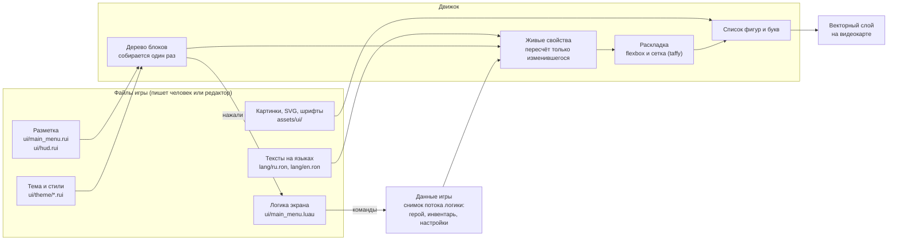
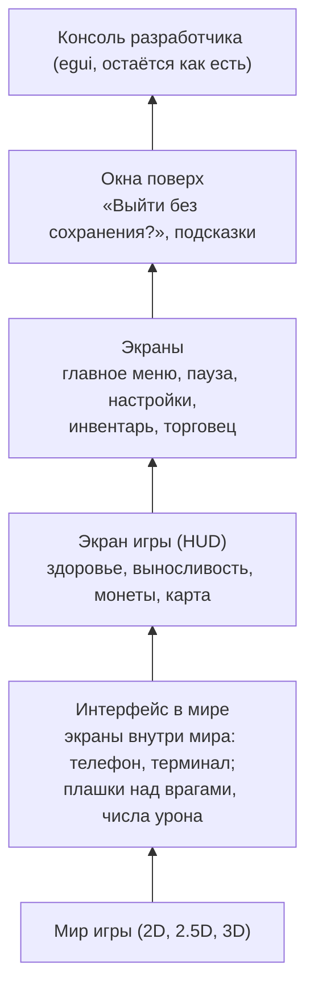
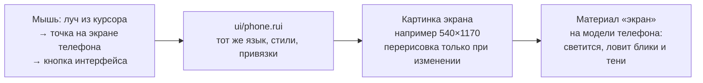

# Интерфейс игры: от главного меню до полоски выносливости

Дата: 2026-11-25. Статус: **принято** 2026-11-25 (ответы Романа — в разделе «Ответы Романа»), решение [0022](decisions/0022-game-ui.md). Раздел о стилях переписан 2026-11-26 по ответам Романа. Сделаны шаги И.1 (PR #257), И.2а (PR #268), И.2б (PR #270), И.2в (PR #275), И.3а (PR #279) и И.3б, дальше И.3в–И.12.

Вопрос Романа: «Сформировать то, как будет работать интерфейс игры от главного меню до внутриигровой полоски стамины. Для больших экранов — веб-логика: писать кодом на декларативном языке, как в Slint. Стилизовать и настраивать. Текстурировать. Привязывать к функциям движка легко и без лишней мороки».

## Коротко

✅ **Один язык разметки на весь интерфейс игры.** Главное меню, настройки, инвентарь, окно торговца, полоска выносливости, плашки над врагами — всё пишется в файлах `ui/*.rui` («ReyVec UI»). Вид языка — как у SwiftUI от Apple (выбор Романа): блок с главными данными в скобках, оформление цепочкой «модификаторов» через точку, свойства «живые», как в Slint, — сами следят за данными игры. Правка файла сразу видна в запущенной игре, как сейчас со сценами и скриптами.

✅ **Стили отдельно от разметки, как CSS в вебе.** Цвета, шрифты, скругления, отступы берутся из темы. Сменил тему — сменилась вся игра. У кнопки есть состояния «наведена», «нажата», «выбрана геймпадом», «выключена», и для каждого свой вид.

✅ **Текстуры и рисунки — как оформление блока.** Фон блока может быть цветом, градиентом, картинкой, рамкой из картинки, которая растягивается без искажения углов («9 частей»), векторным рисунком SVG или Motif и даже маленькой программой видеокарты (лава, искры, шум) — это наша сильная сторона «графики из кода».

✅ **Привязка к игре в одну строку.** `Bar(game.hero.stamina)` — полоска сама следит за выносливостью. `Button("Играть") { new_game() }` — кнопка зовёт функцию. `Slider($settings.volume)` — ползунок и громкость связаны в обе стороны. Функции — из движка (открыть экран, выйти, сохранить настройку) или из файла Luau рядом с экраном.

✅ **Экраны и в мире тоже (диегетический интерфейс).** Тот же экран можно нарисовать не на мониторе, а на поверхности в мире: телефон в руке героя, как в GTA, терминал на заводе, табло на кузнице. Свет, блики и отражения на нём работают сами, кнопки нажимаются мышью прямо по экрану в мире.

✅ **Код и визуальный редактор — два равных способа.** Один и тот же файл `.rui` пишется руками и правится мышкой в редакторе.

✅ **Рисует наш векторный слой, а не чужая библиотека.** Кнопки, рамки, тени и текст — это фигуры и буквы, которые движок уже умеет рисовать чёткими в любом размере. Процессор работает только тогда, когда что-то поменялось; неподвижное меню каждый кадр стоит почти ноль.

⚠️ **Главное слабое место:** свой язык — это большая работа (разбор файла, понятные ошибки, подсветка в редакторе, документация). Готовый Slint взять нельзя: его лицензия не подходит под наш `deny.toml`, и он рисует сам, своими средствами, а не нашим векторным слоем. Поэтому мы берём **идеи**: вид языка у SwiftUI, «живые» свойства у Slint, а у веба — раскладку (flexbox и сетку через библиотеку `taffy`, MIT).

## Схема: что из чего состоит



## Простыми словами

### Весь интерфейс — это стопка слоёв

Представь игру как стопку прозрачных листов. Снизу — сам мир. Над ним листы интерфейса. Каждый лист живёт своей жизнью, а нажатие мышью или кнопкой геймпада получает верхний лист, которому оно нужно.



Слои «Экраны» работают как вкладки браузера с кнопкой «Назад»: из главного меню открыли «Настройки», из них «Управление» — получилась стопка из трёх. Esc или кнопка «B» на геймпаде снимает верхний. Переходы между экранами — плавные (сдвиг, растворение), это задаётся в разметке.

Пока открыт экран паузы, мир стоит (это уже работает с этапа 6). Инвентарь может ставить мир на паузу или нет — это свойство экрана.

### Как выглядит файл

Вид — как у SwiftUI. Правило одно: **блок, в скобках главное, дальше через точку — как он выглядит и что делает.**

Главное меню:

```
// ui/main_menu.rui
head {
    theme("themes/forge")
    styles("styles/menu")
    import("kit/base", Button, Title)
}

screen MainMenu {
    Column(spacing: 16) {
        Title(tr("menu.title"))
        Button(tr("menu.continue")) { game.load_last() }
            .visible(game.save.exists)
        Button(tr("menu.new_game")) { new_game() }      // функция из main_menu.luau
        Button(tr("menu.settings")) { open(Settings) }
        Button(tr("menu.quit")) { ask(QuitDialog) }
            .class(danger)
    }
    .align(center)
    .background(shader("ui/fx/forge_embers.slang"))      // живой фон из кода
}
```

Полоска выносливости:

```
// ui/hud.rui
layer Hud {
    Bar(game.hero.stamina / game.hero.stamina_max)
        .size(260, 10)
        .anchor(bottom_left, margin: 24)
        .fill(value < 0.25 ? var(danger) : var(stamina))   // мало сил — красная
        .opacity(value < 1 ? 1 : 0)                         // полная — прячется
        .animate(opacity, 400ms)
        .animate(value, 120ms, ease_out)
}
```

Что тут важно:

- **Никакого кода «каждый кадр».** Не надо писать «на каждом кадре возьми выносливость и подвинь полоску». Достаточно сказать «полоска равна выносливости», дальше движок следит сам. Так устроены SwiftUI, Slint, XAML и современный веб.
- **Фигурные скобки после кнопки — что она делает**, после `Column` или `Row` — что внутри. Модификаторы читаются сверху вниз, как фраза: «кнопка „Выйти“, стиль опасный».
- **Знакомые веб-понятия:** отступы (`.padding`, `.margin`), ряды и столбцы, выравнивание, проценты, классы и стили (`.class(danger)`), переменные (`var(accent)`), состояния (`.hover`).
- **Тексты по ключам** (`tr("menu.title")`, И.2в, сделано): сами слова лежат в `ui/lang/ru.ron` и `ui/lang/en.ron`, по файлу на язык; имя файла — код языка, тот же, что в `.when(lang: en)`. Русский — главный: если в другом языке ключа нет, видно русское слово, а пропуски пишутся в консоль. Ключа нет и в русском — ошибка с местом `tr` в экране и подсказкой похожего ключа. `{n}` в тексте заменяется значением из скобок: `tr("hud.coins", n: 5)` и «Монеты: {n}». Язык меняется на лету: экран собирается заново, наведение и фокус остаются. Формы чисел («1 монета, 5 монет») — шаг И.10.
- **Короткие записи** там, где нечего настраивать: `Text("Монеты: \(game.hero.coins)")` — число вставлено прямо в строку, как в Swift.

### Стили и темы

Стили устроены по образцу CSS (Роман 2026-11-26: «гибкость как у CSS, CSS как вдохновение, механику делаем по-своему»). Стили пишутся теми же модификаторами, что и блоки, поэтому второй язык учить не нужно. Лежат они отдельно от экранов, и каждый экран **сверху, в блоке `head`, как в HTML**, перечисляет, откуда берёт тему и стили. Открыл файл и сразу видишь, откуда что взялось.

**1. Подключение: блок `head` в начале файла**

```
// ui/main_menu.rui
head {
    theme("themes/forge")          // переменные: цвета, шрифты, размеры
    styles("styles/base")          // общие стили всей игры
    styles("styles/menu")          // стили меню
    import("kit/base", Button, Title)
}

screen MainMenu { ... }
```

Пути считаются от папки `ui/`. Порядок важен: при равенстве побеждает файл, который подключён ниже. Стили, записанные прямо в файле экрана, действуют только на экраны этого файла и считаются подключёнными последними.

**2. Переменные и тема**

Тема — это набор переменных. Читаются они через `var(имя)`, как `var(--имя)` в CSS.

```
// ui/themes/forge.rui
theme Forge {
    panel   = #171A21
    accent  = #F5A54A          // цвет раскалённого металла
    danger  = #E5484D
    gap     = 12
    gap_big = var(gap) * 2     // переменная из переменной
    body    = font("Inter", 18)
    radius  = 6
}
```

Главное, что берём из CSS: **переменную можно переопределить для части экрана.** `.var(accent: #6BB8F5)` у окна меняет `accent` для всего, что внутри него, и только там. Кнопки в «ледяном» окне сами станут голубыми, их стиль править не нужно.

Смена темы — это смена набора переменных. Одна строка в настройках, и вся игра другого цвета.

**3. Стили: по виду блока, по классу и вложенные**

```
// ui/styles/menu.rui
style Button {                         // все кнопки
    .background(var(panel)).radius(var(radius))
    .padding(var(gap), var(gap_big))
}

style danger {                         // любой блок с .class(danger)
    .border(var(danger), 2)
}

style Button.big {                     // только кнопки с классом big
    .font(32)
}

style MainMenu {                       // внутри экрана MainMenu
    .var(accent: #FFB347)
    Column {                           // столбцы внутри него, на любой глубине
        .spacing(var(gap))
        Button { .width(100%) }        // кнопки в этих столбцах
    }
}
```

Правило записи одно: **имя с большой буквы — вид блока или экран** (`Button`, `Column`, `MainMenu`), **с маленькой — класс** (`danger`, `big`). Класс блоку даётся модификатором `.class(danger, big)`. Вложенный стиль означает «внутри», как `.menu button` в CSS, только записан в одном месте, а не разбросан по файлу.

**4. Наследование**

Цвет, шрифт, размер и выравнивание текста передаются детям, как в CSS. `Column { ... }.color(#C8D0DC)` красит все тексты столбца, если у них нет своего цвета. Фон, отступы, рамки и размеры не наследуются.

**5. Кто сильнее: лестница вместо «веса» CSS**

В CSS сила правила считается по сложной формуле, и из-за этого трудно понять, откуда взялся цвет. У нас лестница, снизу вверх:

1. значение блока по умолчанию;
2. унаследованное от родителя (только текст);
3. стиль вида: `style Button`;
4. стиль класса: `style danger`, `style Button.big`;
5. вложенный стиль: `style MainMenu { Button { } }`;
6. модификатор прямо у блока.

Верхняя ступень всегда сильнее нижней. На одной ступени побеждает то, что записано позже: ниже в файле или в файле, подключённом ниже. Состояние (`.hover { }`, шаг И.2б) сильнее того же правила без состояния, но ступень важнее: наведение из `style Button` не перебьёт `.background` у самого блока. `!important` нет.

В редакторе и в консоли у каждого свойства будет видна цепочка «откуда взялось»: `background = #262B36 ← style Button (styles/menu.rui, строка 3)`.

**6. Позже, тем же языком**

- **Состояния** (И.2б, сделано): `.hover { }` под мышью, `.pressed { }` нажата, `.focus { }` выбрана клавиатурой (наведённая мышью кнопка тоже становится выбранной, как в меню игр), `.disabled { }` и `.checked { }` для блоков с `.disabled()` и `.checked()`. Состояние кнопки действует и на всё внутри неё: `.hover { .color(…) }` у кнопки красит её надпись. Сочетание пишется вложением: `.hover { .focus { … } }`. Порядок среди соседей: `.first`, `.last`, `.odd`, `.even`, `.nth(3)`. Размер текста (`.font`) в состояниях пока менять нельзя: текст раскладывается заранее.
- **Условия, как `@media`** (И.2б, сделано): `when(width < 1280) { ... }` в стиле или `.when(…) { … }` у блока; `width` и `height` — окно в пикселях; `lang: en`; `input: keyboard` (мышь и клавиши интерфейса переключают его сами, геймпад — с И.12). Части через запятую должны выполняться все.
- **Переходы и анимации** (И.4): `.transition(background, 0.15)`, именованные `animation Pulse { ... }`.
- **Единицы и формулы**: `%`, `em`, доли окна, `100% - 32`.
- **Оформление** (И.6): градиенты, тени, свечение, размытие под окном, поворот и масштаб.

### Текстуры и оформление

Каждый блок может иметь фон, рамку, тень и свечение. Варианты фона:

| Что | Пример | Когда |
| --- | --- | --- |
| Цвет и градиент | `#171A21`, `linear-gradient(...)` | Простое и чистое оформление |
| Картинка | `.background(image("assets/ui/map.png"))` | Иконки предметов, портреты |
| Рамка «9 частей» | `frame("iron_plate.png", slice: 12)` | Кнопки и окна, которые растягиваются, а углы остаются как нарисованы |
| Векторный рисунок | `shape("assets/ui/shield.svg")`, файлы Motif | Иконки, рамки с завитками; чёткие на 4K |
| Программа видеокарты | `shader("ui/fx/lava.slang")` | Живые фоны, огонь, шум, искры — «всё из кода» |
| Окно в мир | `View(camera: map_cam)` | Мини-карта, портрет героя в 3D |

Скругления, обводки, тени и свечение у прямоугольных блоков считаются формулой расстояния прямо на видеокарте — это тот же приём, что у наших SDF-фигур. Поэтому тень мягкая и ровная при любом размере, и её не надо рисовать картинкой.

### Привязка к движку

Три вида связей, и все — одной строкой:

1. **Данные игры → интерфейс.** `game.hero.hp`, `game.inventory`, `settings.audio.volume`. Движок публикует «модель игры» — набор полей, которые видит интерфейс. Поле поменялось — пересчитались только те блоки, которые от него зависят.

   Сделано в И.3а: путь пишется в любом значении, как есть: `Bar(game.hero.hp / game.hero.hp_max)`, `Text("\(game.hero.hp) / \(game.hero.hp_max)")` (вставка `\( )` в строку), `tr("hud.coins", n: game.hero.coins)`, `.when(game.hero.hp <= 1) { … }`, `.visible(game.hero.hp > 0)`, выбор `a ? b : c`, сравнения `< > <= >= == !=`. Игра кладёт значения через `UiScreen::set_number`, `set_text`, `set_flag`. Пока игра не дала ни одного значения, путь считается нулём (экран можно смотреть без игры); когда дала, а пути нет — плашка ошибки с подсказкой похожего пути. Поменялось значение — пересчитывается вид экрана без разбора файла, а заново раскладываются только поменявшиеся тексты. В песочнице это `ui/hud.rui`: полоска здоровья и монеты героя вместо прежних сердечек на egui. Пока пересчитывается весь экран, а не только зависимые блоки, — для HUD из десятка блоков это доли миллисекунды; точечный пересчёт — когда экраны станут большими (И.8).
2. **Интерфейс → движок.** Готовые команды без всякого кода: `open(Settings)`, `back()`, `ask(QuitDialog)`, `quit()`, `set(settings.audio.volume, 0.5)`, `play_sound(click)`.
3. **Интерфейс → Luau.** Если нужно что-то своё (собрать предмет, начать новую игру с выбором класса) — функция в файле `ui/main_menu.luau` рядом с разметкой: `Button("Новая игра") { new_game() }`.

   Сделано в И.3б: в фигурных скобках кнопки имя с маленькой буквы — действие, с большой — блок: `Button(tr("menu.settings")) { open(Settings) }`. Действия идут по порядку. Готовые команды: `open(Экран)` — открыть другой экран этого файла, `back()` — вернуться, `close()` — спрятать интерфейс, `quit()` — выйти из игры, `log("…")` — в консоль, `next_lang()` и `next_theme()`. Неизвестный экран или лишние значения — ошибка с номером строки, как у любого модификатора. Любое другое имя — функция из файла `.luau` рядом с экраном (в песочнице `ui/demo.luau`); у неё есть таблицы `ui.*` (те же команды) и `game.*` (`game.respawn()`, `game.heal(n)` — пока только эти, через ту же дорогу, что команды консоли). Функции интерфейса выполняются на потоке кадра, а не на потоке логики: они только складывают команды, мир получает их, как от консоли. Если функции нет — плашка ошибки со списком тех, что есть. `ask(…)`, `set(…)`, `play_sound(…)` — позже (И.3в, И.4).

Двусторонняя связь для настроек — знак `$`, как в SwiftUI: ползунок громкости `Slider($settings.audio.volume)` — тянешь ползунок, меняется громкость; громкость поменяли командой из консоли — ползунок сдвинулся сам.

### Мышь, клавиатура, потом геймпад

Главное управление — клавиатура и мышь (ответ Романа). Геймпад добавляется позже, но место под него закладываем сразу, чтобы потом не переделывать.

- Мышь: наведение, нажатие, перетаскивание (предмет из ячейки в ячейку), колесо для прокрутки, подсказки при наведении.
- Клавиатура: Tab и стрелки переводят **фокус** (выбранный блок подсвечен `.focus`), Enter нажимает, Esc закрывает. Движок сам находит соседа по направлению по расположению на экране; для хитрых экранов порядок можно задать руками.
- Нажатия идут через действия управления (решение 0014): «Принять», «Назад», «Вкладка влево/вправо». Поэтому смена клавиш в настройках сразу меняет и управление меню, а геймпад потом встанет на те же действия без правки экранов.
- Позже, с геймпадом: подсказки кнопок («Ⓐ Принять  Ⓑ Назад»), которые сами меняются, когда игрок берёт геймпад или клавиатуру.

### Интерфейс в мире

Плашка здоровья над врагом, число урона, значок «нет угля» над печью на заводе — это тоже разметка, но привязанная к предмету мира: `.anchor(entity(me))`. Место на экране считает видеокарта из положения предмета, поэтому 1000 значков над станками не нагружают процессор. Плашки за стеной можно прятать или показывать (настройка плашки).

### Экраны внутри мира (диегетический интерфейс)

Это когда интерфейс — часть самого мира: телефон в руке героя, как в GTA, терминал на заводе, табло на кузнице, планшет с картой. Главное правило: **экран не привязан к монитору, он рисуется в любую «цель»** — на монитор, в слой поверх игры или в картинку на поверхности в мире.



Как работает телефон:

1. Экран телефона — обычный файл `ui/phone.rui` с теми же блоками, стилями и привязками (`game.phone.contacts`, `call(contact)`).
2. Движок рисует его в картинку, и только тогда, когда на экране что-то поменялось.
3. В файле сцены у модели телефона материал «экран»: `Screen(ui: "phone", size: (540, 1170), glow: 1.0)`. Свет мира, блики, тень от руки и отражение в стекле работают сами — это обычный материал. Читать картинки в материалах наш 3D уже умеет (так раскрашены модели).
4. Мышь: луч из курсора попадает в экран, точка на экране превращается в точку интерфейса, кнопки нажимаются как обычные. Клавиатура тоже работает, пока экран «в руках» (у него фокус).
5. Режим «поднести к лицу»: камера подходит ближе, экран становится крупным и читаемым, как в GTA. Это настройка экрана, а не отдельный код.

То же для 2D-игр: экран ложится на векторную фигуру уровня (вывеска, монитор в комнате) и освещается 2D-светом.

### Что увидит Роман в редакторе

Рабочее пространство «Интерфейс» (оно уже заявлено в решении 0017): слева дерево блоков экрана, в центре живой экран (можно переключать размер: 1080p, 1440p, 4K, 16:10, «телевизор»), справа свойства выбранного блока. Правка в редакторе записывает тот же файл `.rui`, сохраняя комментарии, — как сейчас правится файл сцены. **Код и редактор — два равных способа** (ответ Романа): что сделал мышкой — видно строкой в файле, что написал руками — сразу видно в редакторе. Поэтому вид языка должен быть таким, чтобы редактор мог дописывать и менять строки, не ломая ручное оформление: каждый модификатор — отдельная строка, порядок и комментарии сохраняются. Экраны пишет Роман сам; Claude — для тестов и примеров.

## Сравнение подходов

Как это делают другие движки и библиотеки. ✅ — сильная сторона, ⚠️ — слабая.

| Подход | Как пишется | Что хорошо | Что плохо для нас | Что берём |
| --- | --- | --- | --- | --- |
| **Slint** | Свой язык `.slint`, живые свойства | ✅ Чистый декларативный язык, свойства сами следят друг за другом, есть версия «без сборки» (интерпретатор) | ⚠️ Лицензия GPL-3 или бесплатная с обязательной надписью «сделано на Slint» — не из `deny.toml`. ⚠️ Рисует своими средствами (femtovg, Skia, программно), подключить наш векторный слой нельзя. ⚠️ Сделан для приложений, а не игр: нет интерфейса в мире, фокуса геймпада, шейдерных фонов | Живые свойства, ленивый пересчёт, интерпретатор для правки на лету |
| **SwiftUI** (Apple), Jetpack Compose (Android), Flutter | Код на Swift / Kotlin / Dart: блок и цепочка модификаторов | ✅ Читается как фраза, порядок оформления виден. ✅ `@State` и `$` для связи в обе стороны — то же, что наши живые свойства. Это общий путь больших платформ | ⚠️ Это настоящий язык программирования, экран собирает компилятор: правки на лету и визуальный редактор поверх такого кода трудны. ⚠️ Только для своих платформ | **Вид языка целиком** (выбор Романа): блок, скобки, модификаторы через точку, `$` для двусторонней связи |
| **HTML/CSS** (CEF, Coherent Gameface, Ultralight, RmlUi) | HTML + CSS + JavaScript | ✅ Все знают. ✅ Огромная экосистема, инструменты разработчика браузера | ⚠️ Полный браузер — сотни мегабайт и свой процесс. Gameface и Ultralight платные. ⚠️ Каскад CSS сложен и медленный для игры. RmlUi (MIT) — лёгкий, но на C++ и рисует сам | Flexbox и сетку (через `taffy`), классы и состояния `:hover`, единицы `px` / `%` |
| **Unity UI Toolkit** | UXML (разметка) + USS (урезанный CSS) | ✅ Очень близко к нашему плану: разметка отдельно, стили отдельно, flexbox (библиотека Yoga), визуальный UI Builder, привязка данных в Unity 6 | ⚠️ Интерфейс в мире и шейдерные эффекты появились поздно и ограничены | Деление «разметка / стиль / тема», урезанный CSS без длинных каскадов |
| **Godot Control** | Узлы в дереве сцены, ресурс Theme | ✅ Просто, контейнеры раскладки, «StyleBox» — оформление блока (плоское или текстурное), сигналы в GDScript | ⚠️ Нет текстового языка разметки: экраны — это файлы сцен, руками их не пишут | Идею «оформления блока» (фон, рамка, тень как отдельный объект стиля) |
| **Unreal UMG + Slate + Common UI** | Визуальный дизайнер + Blueprints; Slate — C++ | ✅ Common UI хорошо решает фокус геймпада и маршрутизацию нажатий | ⚠️ Привязки «каждый кадр» печально медленные, поэтому позже добавили MVVM | Урок: фокус и маршрутизация ввода — самое трудное, проектировать сразу. Привязки только по изменению |
| **Noesis (XAML)** | XAML как в WPF, MVVM | ✅ Векторное рисование на видеокарте (как у нас), стили и шаблоны, анимации, используется во многих играх | ⚠️ Платная, закрытый C++, со своим рисованием | Модель «экран ↔ модель данных» (MVVM), шаблоны элементов списков |
| **Immediate mode** (egui, Dear ImGui) | Код, который каждый кадр «рисует» кнопки | ✅ Идеально для инструментов и отладки, уже у нас (редактор, панель, консоль) | ⚠️ Красивое оформление, анимации, переходы и работа художника — трудно. Процессор работает каждый кадр | Оставляем egui для редактора, панели и консоли. Игре — новый интерфейс |

**Итог сравнения.** Ближе всего к цели — Unity UI Toolkit по устройству, SwiftUI по виду языка (выбор Романа) и Slint по тому, как язык работает внутри. Ни один готовый вариант не рисует через наш векторный слой и не подходит по лицензии целиком, поэтому собираем своё из проверенных кусков: вид языка как у SwiftUI, живые свойства как у Slint, стили как USS, оформление как StyleBox у Godot, модель данных как MVVM у XAML, фокус как Common UI у Unreal, раскладка — настоящий веб-flexbox из `taffy`.

## Технические детали

### Крейты и где что живёт

| Что | Где | Видеокарта нужна? |
| --- | --- | --- |
| Язык: разбор `.rui`, ошибки с файлом и строкой, импорт, темы и стили | новый крейт `reyvec-ui` | нет |
| Дерево блоков, живые свойства, выражения, состояния, анимации | `reyvec-ui` | нет |
| Раскладка: flexbox и сетка | `reyvec-ui` + `taffy` (MIT) | нет |
| Модель игры для интерфейса (поля героя, инвентаря, настроек) | `reyvec-scene` (публикует снимок), `reyvec-ui` (читает) | нет |
| Ввод: фокус, навигация, слой в стопке схем управления (0015) | `reyvec-app` | нет |
| Рисование: новый примитив «блок интерфейса», проход «интерфейс» | `reyvec-gpu` (`vector.rs`, `ui.slang`) | да |
| Рабочее пространство «Интерфейс» | `apps/editor` (через `for_editor.rs`) | да |

`reyvec-ui` — чистый расчёт, как `reyvec-vector`: его можно проверять тестами без окна (разбор, свойства, раскладка, итоговый список фигур).

### Язык `.rui`

- **Синтаксис** в духе SwiftUI. Объявления верхнего уровня: `head` (подключения: `theme`, `styles`, `import`), `screen`, `layer`, `component`, `theme`, `style`. Блок: `Имя(главные аргументы) { содержимое }` и после него модификаторы `.имя(аргументы)`, каждый можно с новой строки. Точки с запятой и запятые между блоками не нужны.
- **Что в фигурных скобках:** у раскладок (`Column`, `Row`, `Grid`, `Stack`, `Scroll`) — дочерние блоки; у нажимаемых (`Button`, `Toggle`, пункт меню) — действие. Явная форма для любого блока: `.on_click { … }`, `.on_hover { … }`, `.on_change { … }`.
- **Компоненты:** `component Bar(value: float, fill: color = var(stamina)) { … }` — свои блоки с параметрами и значениями по умолчанию; внутри видны как обычные имена.
- **Состояние экрана:** `state tab = 0` — своё живое поле экрана (как `@State`), `$tab` — связь в обе стороны для `Tabs($tab)`.
- **Типы:** `bool`, `int`, `float`, длины (число = пиксели 1080p, `50%`, `1fr`), `color` (`#RRGGBB`), `brush` (цвет, градиент, картинка, рамка, шейдер), `string`, `image`, списки и записи.
- **Выражения:** арифметика, сравнения, `a ? b : c`, вставка в строку `"\(выражение)"`, `tr("ключ", арг)`, форматирование чисел. Своя маленькая машина выражений (дерево → компактный код), без Luau: выражения считаются в потоке кадра сотни раз, Luau для этого слишком тяжёл. Luau — только для действий.
- **Привязки:** любое выражение от `game.*`, `settings.*` или `state` живое. `$путь` — две стороны. Зависимости собираются при первом вычислении (как в SwiftUI, Slint и SolidJS), при изменении источника помечаются «грязными» только зависимые свойства, пересчёт ленивый — когда свойство нужно раскладке или рисованию.
- **Состояния и анимации:** `.hover { … }`, `.pressed { … }`, `.focus { … }`, `.disabled { … }`, `.checked { … }` — модификаторы, которые действуют только в этом состоянии; `.animate(свойство, время, кривая)`, `.transition(slide_left)` для входа и выхода экрана.
- **Повтор и условия:** `for item in game.inventory.items { Slot(item) }`, `if game.hero.hp < 20 { Text("Мало здоровья") }`. Длинные списки — виртуальные: создаются только видимые строки.
- **Правка на лету:** файлы `.rui` проверяются раз в 0,25 с, как скрипты (решение 0013). Ошибка разбора не ломает игру: остаётся прежняя версия, текст ошибки по-русски с файлом и строкой — на экране и в консоли. Состояние экранов (вкладки, прокрутка, фокус, `state`) по возможности сохраняется по путям блоков.
- **Правка из редактора:** разбор хранит «дерево с пробелами» — отступы, переносы и комментарии каждой строки. Редактор меняет только нужные узлы (аргумент, модификатор), остальное файла остаётся байт в байт. Тот же приём, что у правки файлов сцены сейчас.
- **Стили:** правило — это путь из звеньев «вид или класс» (`MainMenu > Column > Button` при вложенности; звено «внутри» значит на любой глубине) и список модификаторов. Сопоставление — один раз после разбора и при смене классов или состояния, а не каждый кадр: у каждого блока хранится итоговый набор свойств и список «откуда». Лестница силы: умолчание → наследование (только текст) → вид → класс → вложенный → модификатор у блока; на ступени — позже записанное; состояние сильнее того же правила без состояния. Подсчёта «веса» селекторов, как в CSS, и `!important` нет.
- **Переменные:** `theme` — именованный набор переменных; `var(имя)` ищет ближайшее `.var(имя: …)` вверх по дереву, потом в теме. Переменная может ссылаться на другие (`var(gap) * 2`); цикл — ошибка разбора с путём цикла. Смена переменной пересчитывает только блоки, которые её читают.
- **Файлы стилей** (`ui/styles/*.rui`, `ui/themes/*.rui`) следятся так же, как экраны: правка темы сразу видна во всех экранах, которые её подключают.

### Блоки из коробки

`Rect`, `Text`, `Image`, `Shape` (SVG и Motif), `Column`, `Row`, `Grid`, `Stack` (друг на друге), `Scroll`, `Button`, `Toggle`, `Slider`, `Select`, `TextInput`, `Tabs`, `List`, `Bar`, `Tooltip`, `Dialog`, `View` (картинка камеры). Набор «kit» пишется на самом `.rui`, кроме базовых `Rect`, `Text`, `Image`, `Shape`, `View` и раскладок — их делает движок.

### Модель игры и потоки

- Интерфейс живёт в потоке кадра (решение 0010): он рядом с вводом и рисованием, задержка нажатия минимальна.
- Поток логики после каждого шага уже отдаёт снимок мира. К снимку добавляется маленькая «модель интерфейса»: поля, помеченные для интерфейса (`hp`, `stamina`, `coins`, инвентарь, задания). У каждого поля номер версии; интерфейс сравнивает номера и пересчитывает только изменившееся.
- Нажатия идут обратно **очередью команд** в поток логики, как команды консоли (6.11). Результат виден через один шаг логики (16,7 мс) — для меню незаметно.
- Обработчики на Luau (`ui/*.luau`) выполняются в потоке логики, в той же песочнице и с тем же пределом работы, что скрипты поведения (решение 0013). Чисто интерфейсное (открыть вкладку, показать подсказку) делается без Luau, прямо в потоке кадра.
- Настройки (`settings.*`) живут в потоке кадра и пишутся в `settings/*.ron`, как `controls.ron` сейчас.

### Рисование

- **Примитив «блок»** — одна запись на видеокарту (около 96 байт): прямоугольник, скругление каждого угла, обводка, заливка (цвет, градиент, картинка, 9 частей, шейдер), тень и свечение, прозрачность, прямоугольник обрезки. Шейдер считает расстояние до скруглённого прямоугольника и из него — край без ступенек, обводку, тень. Нарезки на треугольники нет вообще.
- **Текст** — существующий атлас MSDF (`reyvec-text`, раскладка `parley`). **Рисунки** — существующий набор фигур (`ShapeLibrary`), SVG и Motif. **Картинки** — общий список текстур (bindless, этап 2.1).
- **Одна команда на весь интерфейс:** все блоки, буквы и фигуры в порядке слоёв уходят одним `vkCmdDrawIndirect`, как векторный слой сейчас. Обрезка (прокрутка, скруглённые окна) — в шейдере по прямоугольнику обрезки, без смены состояния. Отдельный слой-картинка — только для прозрачности группы целиком и масок.
- **Проход «интерфейс»** идёт после всей сцены и обработки кадра (свечение, тонмаппинг), в полном разрешении окна, даже если «Разрешение 3D» ниже 100 %. Поэтому интерфейс всегда чёткий.
- **Масштаб:** `px` — пиксели экрана 1920×1080; на других размерах умножаются на `высота / 1080 × масштаб интерфейса` (ползунок в настройках). Зона безопасности для телевизоров — настройка темы.
- **Цели рисования:** у дерева экрана есть цель — окно, слой поверх игры или своя картинка (`Screen` в материале). Картинка экрана рисуется тем же проходом «интерфейс» в свой размер, с мипами для чтения под углом, и только при изменении. Материал «экран» в 3D читает её через общий список текстур (как текстуры моделей), с собственным свечением; в 2D — заливка фигуры картинкой.
- **Попадание мышью в экран в мире:** луч из курсора пересекает сцену (на процессоре по формам, как выбор деталей мышью в «Формах», М.4); у попавшей точки берутся координаты на поверхности экрана, переводятся в пиксели картинки и уходят в интерфейс как обычное движение мыши. У экрана в мире свой фокус клавиатуры.
- **Интерфейс в мире:** запись блока может нести номер предмета; вершинный шейдер берёт его место из буфера мест предметов (уже есть у сцены) и проецирует камерой. Процессор не трогает такие плашки каждый кадр.

### Что процессор делает каждый кадр

| Случай | Работа процессора |
| --- | --- |
| Меню стоит, ничего не меняется | Только проверка версий полей модели: почти ноль |
| Полоска выносливости тает | Пересчёт одного свойства, правка одной записи на видеокарте (без раскладки: размер полоски от значения не зависит) |
| Открыли инвентарь на 500 ячеек | Раскладка один раз, видимые ячейки → записи. Цель — до 0,3 мс на эталонном ПК |
| Анимация переходов | Пересчёт анимируемых свойств; сдвиг и прозрачность без новой раскладки |

### Цели скорости (не замерены, цели для приёмки)

| Что | RTX 5080 | Radeon |
| --- | --- | --- |
| Проход «интерфейс», экран игры | до 0,05 мс | до 0,3 мс |
| Проход «интерфейс», большой экран (инвентарь) | до 0,1 мс | до 0,5 мс |
| Процессор, неподвижный экран | до 0,02 мс | — |

### Проверки

- Тесты без окна в `reyvec-ui`: разбор, ошибки, свойства, раскладка, итоговый список фигур.
- Кадры CI (lavapipe): интерфейс рисуется нашим слоем, поэтому, в отличие от egui (решение 0014, «Чего пока нет»), он попадает в эталонные картинки.
- Глазами на ПК Романа: главное меню, пауза, настройки, полоска выносливости в песочнице.

### Шаги

Порядок учитывает ответы Романа: клавиатура и мышь первыми, геймпад позже; код и редактор — равные способы, поэтому редактор не откладывается в самый конец; экраны в мире заложены с первого шага (цель рисования), а сам телефон — отдельным шагом посередине.

| Шаг | Что | Что Роман видит |
| --- | --- | --- |
| И.0 | Ответы Романа, решение 0022 (сделано 2026-11-25) | — |
| И.1 | `reyvec-ui`: разбор `.rui` в виде SwiftUI, блоки `Rect`/`Text`/`Column`/`Row`, `taffy`; примитив «блок» и проход «интерфейс» с целями рисования; правка на лету | В песочнице экран из файла `ui/demo.rui`, правка файла сразу видна |
| И.2а | Стили, основа: `head`, файлы стилей и тем, стили по виду, классу и вложенные, переменные с областью, наследование текста, лестница силы, цепочка «откуда взялось» | Пример меню из файлов стилей и темы; тема меняется клавишей; правка файла стилей сразу видна |
| И.2б | Состояния, мышь и клавиатура, кнопки (`Button`, `.id`), порядок среди соседей; условия `when` (сделано) | Кнопки подсвечиваются под мышью, по меню можно ходить Tab и стрелками, Enter нажимает |
| И.2в | Тексты по ключам `tr` с файлами `lang/ru.ron` и `lang/en.ron` (сделано) | Язык игры RU/EN переключается |
| И.3а | Данные игры в разметке: пути `game.*`, формулы, выбор `? :`, вставки `\( )`, `Bar`, `.visible`, `.when` по данным (сделано) | Полоска здоровья и монеты героя из файла `ui/hud.rui` |
| И.3б | Действия: команды движка (`open`, `back`, `quit`), функции Luau рядом с экраном (сделано) | Кнопка зовёт функцию Luau |
| И.3в | Связь в обе стороны `$`, `Slider`, `Toggle`, `settings.*` | Ползунок громкости |
| И.4 | Стопка экранов, переходы, анимации | Меню паузы и настройки управления на новом интерфейсе (egui уходит из игры), экраны плавно въезжают |
| И.5 | Рабочее пространство «Интерфейс» в редакторе: дерево, живой экран, свойства, правка файла без потери оформления | Экран правится мышкой, файл `.rui` меняется строками |
| И.6 | Оформление: картинки, 9 частей, SVG, шейдерные фоны, тени и свечение | Главное меню в стиле кузницы с живыми искрами |
| И.7 | Экраны внутри мира: материал `Screen`, мышь по экрану в мире, «поднести к лицу» | Телефон в руке героя в сцене 3D, кнопки на нём нажимаются мышью |
| И.8 | Списки и сетки, повтор, виртуальные списки, перетаскивание | Инвентарь на сотни ячеек, предметы перетаскиваются |
| И.9 | Интерфейс над предметами мира | Плашки над врагами, значки над станками завода |
| И.10 | Локализация дальше: формы чисел («1 монета, 2 монеты, 5 монет»), длина строк в разных языках, запасные шрифты для других алфавитов; ввод текста (IME), масштаб интерфейса | Новый язык добавляется одним файлом `lang/*.ron`, ползунок масштаба |
| И.11 | Редактор дальше: перетаскивание блоков мышью, просмотр на разных размерах, библиотека готовых блоков | Экран собирается мышкой с нуля |
| И.12 | Геймпад: фокус стиком, подсказки кнопок | Меню работает с геймпада |

## Слабые места — честно

- **Свой язык — это много работы и много мелочей.** Разбор, понятные ошибки по-русски, подсветка синтаксиса в VS Code (позже отдельным расширением), справка. Пока подсветки нет, файлы пишутся «вслепую». Первая полезная версия — шаги И.1–И.4, примерно 8–10 PR.
- **Это не настоящий CSS.** Человек из веба узнает flexbox, классы, вложенные стили, переменные и наведение, но не найдёт подсчёта «веса» селекторов, `!important`, соседних селекторов (`A + B`) и сотен свойств CSS. Готовую вёрстку с сайта перенести нельзя. Вложенные стили дают ту же ловушку, что в CSS: правило «внутри меню» может неожиданно задеть кнопку в окне, вложенном в меню. Поэтому нужна цепочка «откуда взялось» в консоли и редакторе с первого шага стилей.
- **Мелкий текст.** Буквы MSDF при 10–12 пикселях мягче, чем в Windows (известное слабое место этапа 3). Для подписей мелким шрифтом, возможно, понадобится второй способ — растровые буквы под точный размер.
- **Задержка обработчиков Luau** — один шаг логики (16,7 мс). Для меню незаметно; для «быстрого» интерфейса (ритм-игра) потребуется исполнять Luau в потоке кадра — это отдельное решение.
- **Модель игры надо открыть.** Сейчас у скриптов нет даже `hero.hp` (решение 0014). Какие поля видит интерфейс, придётся описывать в движке — для новой игры с новыми полями это правка кода или описание в файле игры.
- **Анимации размеров дороже анимаций сдвига.** Блок, меняющий ширину, заставляет пересчитывать раскладку соседей каждый кадр. В стилях будем советовать сдвиг и прозрачность.
- **`taffy` — новая библиотека**, она быстро развивается и иногда меняет API. Лицензия MIT подходит. Версию закрепим и будем обновлять осознанно.
- **Доступность для незрячих** (чтение экрана) не планируется: в играх это редкость и большая отдельная работа. Масштаб интерфейса, крупный шрифт и цветовые темы для дальтоников — планируются.
- **Без готового визуального редактора на старте.** Правка мышкой появляется на шаге И.5, сборка с нуля мышкой — на И.11; до этого — текстом.
- **Экраны в мире стоят памяти и работы.** Каждый живой экран — своя картинка: десяток нормально, сотне нужны правила (рисовать только видимые и близкие, остальные — застывшей картинкой). Мелкий текст под острым углом размывается: нужны мипы и запас по разрешению, а для чтения — режим «поднести к лицу».
- **Вид SwiftUI у нас — не Swift.** Похоже по виду, но это не язык программирования: циклы и условия только для блоков, своя логика — в Luau. Кто знает SwiftUI, узнает вид, но код из Swift-проекта не перенесётся.

## Ответы Романа (2026-11-25)

- **Синтаксис** — вид как у SwiftUI (вариант «Г»): «раньше уже видел их синтаксис, и он довольно приятный».
- **Кто пишет экраны** — Роман сам; Claude — для тестов и примеров. Визуальный редактор и код — два равных рабочих способа.
- **Управление** — главное клавиатура и мышь, геймпад позже.
- **Диегетический интерфейс нужен**: например, телефон как в GTA. Поэтому экраны в мире заложены с первого шага.

- **Вид первого меню** — пока простые цвета: «главное — начать с основы». Оформление картинками и шейдерами остаётся шагом И.6.
- **Языки** — сразу русский и английский, и задел на любую локализацию: тексты только по ключам, слова в файлах `lang/*.ron`.
- **Освещение плашек над предметами** — «возможно, на потом»: по умолчанию плашки не освещаются, освещение — возможная настройка после шага И.9. Экраны внутри мира освещаются всегда.

**2026-11-26, стили.** Роман: «стилизация — важный аспект, хочу систему, похожую на CSS по гибкости». Ответы на вопросы:

- Внутри `style` пишем так же, как у блоков (модификаторы), а не `свойство: значение` как в CSS.
- Стили лежат в отдельных файлах и подключаются **в блоке сверху, как в HTML**, чтобы сразу было видно, откуда берутся. Стили внутри файла экрана тоже можно.
- Лестница силы вместо «веса» CSS подходит: «CSS тут скорее как вдохновение, а механику мы можем делать по-своему».
- Сначала вложенность и переменные («начнём с базы»), переходы и анимации позже.

## Связанные решения

- [0022. Интерфейс игры: язык `.rui`](decisions/0022-game-ui.md) — что принято по этому документу

- [0009. Векторный слой](decisions/0009-vector-layer.md) — на нём рисуется интерфейс
- [0010. Многопоточность](decisions/0010-multithreading.md) — снимки и очереди между потоками
- [0013. Скрипты на Luau](decisions/0013-scripts.md) — обработчики событий интерфейса
- [0014. Интерфейс игры и настройка клавиш](decisions/0014-game-ui-and-controls.md) — нынешний интерфейс на egui, который будет заменён
- [0015. Схемы управления](decisions/0015-controls-schemes.md) — стопка схем ввода, в неё встаёт интерфейс
- [0017. Редактор](decisions/0017-editor.md) — рабочее пространство «Интерфейс»

## Заметки Романа

_Пока пусто._
