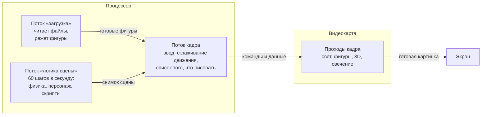
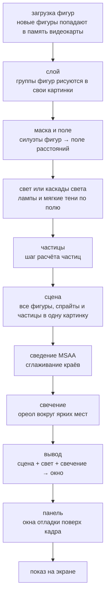

# 1. Путь кадра

[← Оглавление](README.md)

## Суть в двух словах

Экран — это не фильм, а быстрая смена картинок. 60 раз в секунду, а на твоём мониторе до 144. Каждую такую картинку движок рисует **с нуля**, и на одну у него по нашей цели всего 4 миллисекунды (на RTX 5080).

Одному не успеть. Поэтому работа поделена между несколькими «работниками», и они **не ждут друг друга**: каждый делает своё и передаёт готовое дальше, как эстафетную палочку.

## Схема: кто чем занят

## Простыми словами

Проще всего представить кухню ресторана.

> 🥕 **Заготовщик — поток «загрузка».**
> Сохранил файл сцены или в кадр попал новый рисунок? Заготовщик в сторонке читает файл и режет фигуры на треугольники. Кухня его не ждёт: пока фигура не готова, кадр просто рисуется без неё, а через мгновение она появляется.

> ⏱️ **Повар по таймеру — поток «логика сцены».**
> Ровно 60 раз в секунду делает шаг игры: двигает персонажа, считает физику, удары, поведение врагов. В конце шага выставляет на раздачу **снимок**: где что стоит прямо сейчас.

> 🍽️ **Официант — поток кадра.**
> Берёт два последних снимка. Если монитор показывает 144 кадра, а повар выдаёт только 60 снимков, официант «додумывает» промежуточные положения. Поэтому движение плавное. Потом он пишет видеокарте заказ: что нарисовать.

> 🎨 **Художник — видеокарта.**
> Рисует кадр по заказу, слой за слоем. Каждый слой работы называется **проходом**: свет, фигуры, свечение и так далее.

И главный трюк: **пока художник рисует один кадр, официант уже несёт заказ на следующий.** Больше двух кадров в работе не бывает, иначе картинка начала бы опаздывать за нажатиями клавиш.

**Где это увидеть самому:**
- в песочнице нажми **F1**: на панели время каждого прохода видеокарты, а в сцене из файла ещё и шаг физики;
- в программе **Tracy** все работники видны на одной ленте времени, и сразу понятно, кто сколько трудился.

## Схема: проходы одного кадра

Вот как художник рисует один кадр 2D-сцены со светом, например «лаборатории мага». Сверху вниз, по порядку. Если сцене какой-то шаг не нужен, его просто нет.

В 3D-сцене и в виде 2.5D между «частицами» и «сценой» добавляются проходы лучей: «поле», «лучи 3D грубо», «полигоны 3D», «реймарчинг», «тени 3D», «края 3D», «освещение 3D». Они описаны в разделе 7.

## Технические детали

### Потоки

| Поток | Где в коде | Что делает |
| --- | --- | --- |
| Поток кадра (главный) | `crates/reyvec-app/src/app.rs` | Окно и ввод (`winit`), панель egui, сборка кадра, отправка на видеокарту |
| «логика сцены» | `crates/reyvec-scene/src/logic.rs` | Фиксированный шаг 60 Гц: мир `bevy_ecs`, физика, персонаж, скрипты; снимок `Scene` в конце шага |
| «загрузка» | `crates/reyvec-scene/src/loader.rs` | Разбор файлов сцены, SVG и Motif, нарезка кривых (`lyon`), уровни детализации; назад приходят пачки `ShapeBatch` |
| «reyvec-sounds» и поток звука | `crates/reyvec-audio` | Синтез звуков-заготовок и смешивание для звуковой карты (`cpal`) |

Обмен между потоками только готовыми данными: снимки под коротким замком, очереди (`channel`) и атомарные счётчики. Общих изменяемых данных посреди кадра нет, так устроено по решению 0010.

Сглаживание между снимками — `Scene::lerp` в `logic.rs`. Цена: картинка отстаёт от логики на один шаг (16,7 мс). Если логика отстала больше чем на 5 шагов (например, окно тянули мышкой), она не догоняет, а продолжает с текущего момента.

Без окна (снимки кадра, тесты) логика шагает прямо в кадре в заданный момент, чтобы картинка каждый раз выходила одинаковой.

### Процессор и видеокарта параллельно

`FRAMES_IN_FLIGHT = 2` в `crates/reyvec-gpu/src/window.rs`: у каждого кадра в работе свои буферы (слоты), поэтому процессор пишет данные кадра N+1, пока видеокарта читает данные кадра N.

### Граф кадра

Проходы складываются в граф кадра (`crates/reyvec-gpu/src/graph.rs`). Каждый проход объявляет, какие картинки читает и в какие пишет, а барьеры Vulkan между проходами граф ставит сам. Временные картинки берутся из пула и переиспользуются. Граф собирается заново каждый кадр: это дёшево и позволяет включать и выключать проходы на лету.

Список проходов песочницы собирает `Demo::add_passes` в `crates/reyvec-gpu/src/demo.rs`. Панель egui добавляет свой проход (`crates/reyvec-gpu/src/ui.rs`), а по F12 в конце добавляется проход «снимок», который копирует кадр в файл.

Когда в кадре только 3D, промежуточной картинки сцены нет: «освещение 3D» красит прямо окно (при разрешении 3D 100 %) или «вывод» растягивает в окно уменьшенную картинку (задача 7.20а).

Окно просмотра (`WindowRenderer::set_view_rect`, для редактора): сцена рисуется в свою картинку размером с прямоугольник окна просмотра, а проход «в окно просмотра» заливает окно чёрным и копирует её в этот прямоугольник; панели рисуются поверх. Под панелями пиксели сцены не считаются. Нужна копия в картинки окна (`TRANSFER_DST` у swapchain); если видеокарта её не умеет, сцена, как раньше, на всё окно.

### Цвет

Сцена рисуется в линейном цвете в картинку `R16G16B16A16_SFLOAT`, а окно имеет формат sRGB: перевод в цвет экрана делает сама видеокарта при записи в «выводе». Подробнее в решении 0004.

## Слабые места и планы

- **Поток загрузки один.** Одно большое задание не делится между ядрами. Сейчас хватает (картина из ~3900 фигур режется в фоне за 60 мс). Делить будем, когда замер покажет долгие загрузки.
- **Подготовка кадра на процессоре идёт в одном потоке.** Цель — до 1 мс при 10 000 фигур. Пока укладываемся; если перестанем, раскладку кадра поделим между ядрами (решение 0010, пункт 4).
- **Проходы идут строго по порядку добавления**, на одной очереди видеокарты. Перестановку проходов и параллельные очереди сделаем, только если замер покажет пользу (решение 0006).
- **Задержка в один шаг логики** (16,7 мс) — плата за плавность на 144 Гц. Для платформера это незаметно, но для очень быстрых игр может понадобиться логика 120 Гц.

## Связанные решения

- [0004. Соглашения: координаты, цвет, время](../decisions/0004-conventions.md)
- [0006. Граф кадра](../decisions/0006-render-graph.md)
- [0007. Замеры и Tracy](../decisions/0007-profiling.md)
- [0010. Многопоточность](../decisions/0010-multithreading.md)

## Заметки Романа

_Пока пусто._
