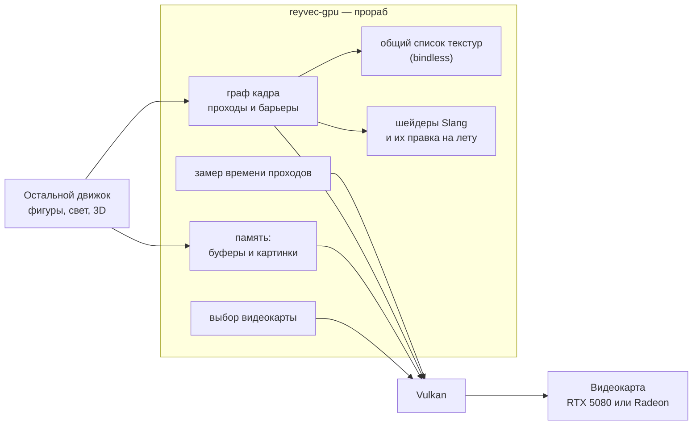

# 2. Основа видеокарты

[← Оглавление](README.md)

## Суть в двух словах

Видеокарта — это огромная бригада из тысяч простых рабочих. Каждый умеет немного, зато все работают **одновременно**. Чтобы бригада работала, ей нужен прораб: он раздаёт задания, следит, чтобы никто не взял краску раньше, чем её привезли, и убирает мусор после смены.

Прораб в ReyVec — часть `reyvec-gpu`. Она разговаривает с видеокартой на языке **Vulkan**, а всем остальным частям движка даёт простые и безопасные кнопки: «загрузи картинку», «нарисуй проход».

## Схема

## Простыми словами

**Какую видеокарту взять.** У тебя их две: мощная RTX 5080 и встроенная в процессор Radeon. Движок сам берёт отдельную (мощную), а флагом `--gpu` можно попросить другую. `.\run.bat --list-gpus` покажет, какие видеокарты он видит и почему какая-то не подходит.

**Память.** У видеокарты своя память, процессор туда напрямую не пишет. Всё, что нужно нарисовать (фигуры, текстуры, положения ламп), сначала туда **отправляется**. А выбрасывать ненужное надо осторожно: видеокарта отстаёт от процессора на кадр-два и, может быть, ещё рисует старым. Поэтому ненужное кладётся «в корзину» и выносится, только когда все кадры, где оно могло понадобиться, закончены.

**Общий список текстур.** Вместо того чтобы перед каждым рисованием говорить видеокарте «возьми вот эту картинку», движок кладёт все картинки в **одну большую полку с номерами** (до 4096). Фигуре достаточно сказать номер. Так тысячи разных спрайтов рисуются одной командой.

**Шейдеры.** Шейдер — это маленькая программа, которую выполняет каждый рабочий видеокарты: «посчитай цвет своего пикселя». Пишем их на языке **Slang**. Самое приятное: если поправить файл шейдера и сохранить, картинка в песочнице поменяется **без перезапуска**. А если в шейдере ошибка, продолжает работать старая версия, а вокруг окна появляется красная рамка.

**Граф кадра.** Кадр рисуется проходами (свет, фигуры, свечение…). Один проход пишет картинку, другой её читает. Между ними видеокарте надо сказать «подожди, пока первый допишет» — это называется **барьер**. Если забыть барьер, получится мусор на экране, если поставить лишний — потеря скорости. Граф расставляет барьеры **сам**: каждый проход только говорит, что он читает и что пишет.

**Проверка ошибок.** Vulkan не прощает ошибок молча, поэтому в отладке включены **слои валидации**: они проверяют каждую команду. Цель каждого этапа — ноль ошибок валидации.

## Технические детали

### Требования к видеокарте

Vulkan 1.3 с `dynamicRendering`, `synchronization2`, индексированием дескрипторов, адресами буферов (buffer device address) и `multiDrawIndirect`. Проверка и объяснение отказа — `crates/reyvec-gpu/src/adapter.rs`.

### Файлы

| Файл `crates/reyvec-gpu/src/` | Что делает |
| --- | --- |
| `context.rs` | Экземпляр Vulkan, слои валидации, логическое устройство, счётчик ошибок валидации |
| `adapter.rs` | Список видеокарт, `pick_adapter` по флагу `--gpu` (номер или часть названия) |
| `resources.rs` | Буферы и текстуры через `gpu-allocator`, загрузка данных, очередь отложенного удаления |
| `bindless.rs` | Общая раскладка дескрипторов (set 0) для всех конвейеров |
| `shaders.rs`, `slangc.rs` | Библиотека SPIR-V, сборка в `build.rs`, перезагрузка на лету через `notify` |
| `pipeline.rs` | Сборка графических конвейеров, режимы смешивания |
| `graph.rs` | Граф кадра: проходы, автоматические барьеры, пул временных картинок |
| `timing.rs` | Метки времени Vulkan на каждый проход, передача в Tracy |
| `window.rs` | Swapchain, `FRAMES_IN_FLIGHT = 2`, сборка и отправка кадра |
| `headless.rs` | Тот же кадр без окна: снимки и тесты по эталонам |

Шейдеры: `crates/reyvec-gpu/shaders/*.slang`, общие части в `shaders/include`.

### Раскладка bindless (set 0)

| binding | Что | Размер |
| --- | --- | --- |
| 0 | `texture2D textures[]` | 4096; последние 256 ячеек — временные картинки графа |
| 1 | `sampler samplers[2]` | 0 — сглаживающий, 1 — без сглаживания (пиксели) |
| 2 | `RWTexture2D images[]` | запись из шейдеров во временные картинки графа (если видеокарта умеет) |
| 3 | `Texture3D<float> field_volumes[]` | слои запечённого поля расстояний 3D |
| 4 | `SamplerState field_sampler` | сглаживающий с повтором: слои поля лежат кольцом |

Буферы шейдеры читают по адресу; адрес передаётся в push constants (128 байт, гарантированный минимум Vulkan).

### Шейдеры и перезагрузка

- `build.rs` собирает все `.slang` в SPIR-V при компиляции движка.
- `slangc` ищется так: переменная `REYVEC_SLANGC` → Vulkan SDK → `PATH`. На ПК Романа — `slangc` 2026.17 из Vulkan SDK, CI закреплён на той же версии.
- Если рядом лежат исходники (папка репозитория, из которой собрана программа), `notify` следит за ними. После сохранения шейдер пересобирается; при ошибке остаётся прошлый SPIR-V, ошибка видна в заголовке окна, красной рамкой и в логе.

### Граф кадра

- Проход объявляет картинки и доступ к ним (`Access::Sampled`, `ColorAttachment`, `TransferSrc` и т. д.); граф выводит раскладки и барьеры `synchronization2`.
- Граф пересобирается каждый кадр. Проходы идут в порядке добавления, одна очередь, память временных картинок не перекрывается.
- Пересоздание swapchain без `vkDeviceWaitIdle`: старый передаётся в `oldSwapchain` и удаляется после заборов показа (`VK_EXT_swapchain_maintenance1`) и первого кадра после него. Без расширения — запасной путь с остановкой видеокарты (`REYVEC_NO_PRESENT_FENCES=1` включает его для проверки).

### Замер времени

Метки времени после каждого прохода; время прохода — от конца прошлого до конца этого (с барьерами), поэтому сумма проходов равна кадру. Читаются с опозданием на `FRAMES_IN_FLIGHT` кадров.

## Слабые места и планы

- **Граф простой.** Не переставляет проходы, не выкидывает лишние, не делит память временных картинок. Это экономит сложность, но тратит память видеокарты. Сделаем, когда замер покажет, что надо (решение 0006).
- **Одна очередь видеокарты.** Тяжёлые расчёты (например, запекание поля) не идут параллельно с рисованием. Пробуем, только если замер покажет выигрыш.
- **Перезагрузка шейдеров работает только из копии репозитория.** В собранной для чужого ПК игре шейдеры только встроенные — это нормально, но стоит помнить.
- **Windows-машины CI без Vulkan.** Картинку проверяет программная видеокарта lavapipe на Linux, а скорость — только твой ПК.

## Связанные решения

- [0001. Стек](../decisions/0001-stack.md)
- [0006. Граф кадра](../decisions/0006-render-graph.md)
- [0007. Замеры и Tracy](../decisions/0007-profiling.md)
- [0008. Снимки и эталонные картинки](../decisions/0008-reference-images.md)

## Заметки Романа

_Пока пусто._
