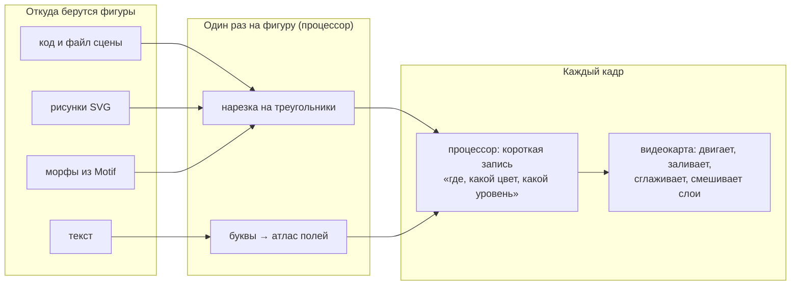

# 3. Векторный слой

[← Оглавление](README.md)

## Суть в двух словах

Обычная картинка (PNG, JPG) — это мозаика из цветных квадратиков-пикселей. Увеличишь — увидишь квадратики.

Векторная картинка — это **рецепт**: «здесь круг такого радиуса, залей его градиентом, обведи линией толщиной 2». Рецепт можно выполнить в любом размере, и края всегда останутся гладкими. На этом построена вся 2D-графика ReyVec: персонажи, предметы, интерфейс, текст.

Главное правило, твоё требование с этапа 3: **процессор не работает над картинкой каждый кадр.** Он будет занят физикой и игрой. Всё тяжёлое делается один раз, а каждый кадр работает видеокарта.

## Схема

## Простыми словами

**Нарезка один раз.** Видеокарта умеет рисовать только треугольники, зато невероятно быстро. Поэтому каждую фигуру один раз режем на треугольники и кладём на видеокарту. Дальше каждый кадр процессор пишет про фигуру одну короткую записку (64 байта): где стоит, как повёрнута, какого оттенка. Видеокарта получает записки **всех** фигур одной командой и рисует.

**Два способа заливки.**
- 🔺 **Треугольники** — по умолчанию. Быстро везде. Если сильно приблизить, можно заметить грани.
- 🎯 **Трафарет** — для перетекающих и сильно увеличенных фигур. Кривые точные при любом увеличении, но каждая фигура стоит чуть дороже.

Можно сравнить в песочнице: клавиша **F** переключает способ, **Z** включает лупу ×8.

**Уровни детализации.** Если фигуру сильно приблизить, её один раз перерезают подробнее (в фоне, без рывка). Если отдалить — грубее, чтобы не тратить силы на невидимые мелочи.

**Перетекание (морфинг).** Круг плавно становится звездой, звезда сердцем. Видеокарта сама смешивает соседние формы, процессору достаточно сказать «сейчас 1,5 — посередине между второй и третьей». Такие фигуры рисует художник в Motif, а движок читает файл `*.reyvec.json`.

**Слои и маски** — как в Photoshop или Figma:
- группу фигур можно сделать полупрозрачной **целиком** (а не каждую часть отдельно, иначе сквозь тело будет видна рука);
- наложить умножением, экраном или сложением;
- обрезать по форме другой фигуры или по яркости.

**Текст.** Каждая буква один раз превращается в маленькую карту «как далеко до края буквы». По такой карте буква остаётся чёткой при любом размере и повороте.

**Сглаживание краёв.** Видеокарта берёт несколько точек на пиксель (MSAA, по умолчанию 4×) и усредняет их, поэтому края гладкие. Клавиша **M** переключает.

**Где посмотреть в песочнице:** клавиши 1–9 и 0 — сцены этапа 3 (фигуры, градиенты, перетекание, слои, маски, SVG, Motif, поток фигур, текст, стресс-тест на 10 000 фигур). Колесо мыши приближает, перетаскивание двигает, R возвращает камеру.

## Технические детали

### Крейты

| Крейт | Что | Видеокарта нужна? |
| --- | --- | --- |
| `reyvec-vector` | Модель: `Shape` (контур `kurbo::BezPath`, заливка `NonZero`/`EvenOdd` или обводка), `Paint`, `Instance`, `ShapeLibrary` (нарезка `lyon`, уровни детализации, перетекание), `SceneItem` (фигуры, слои, маски, текст), `Camera2D` | нет |
| `reyvec-svg` | `load_svg` через `usvg` → `SvgDrawing` (список `SceneItem`) | нет |
| `reyvec-motif` | `load_morph_file`: формат `reyvec-morph` из `docs/motif-morph.md` → перетекающие фигуры и `MorphAnimation` | нет |
| `reyvec-text` | `TextLibrary`, раскладка блоков, атлас MSDF (`fdsm`, контуры `skrifa`, встроенный шрифт Inter) | нет |
| `reyvec-gpu` | `vector.rs`: `VectorRenderer`, оба способа заливки, слои, маски, текст, загрузка фигур | да |

### Что делает процессор каждый кадр

- Раскладка `SceneItem` по целям (сцена и картинки слоёв).
- Отсечение по рамке на экране (рамки посчитаны при загрузке), выбор уровня детализации.
- Запись экземпляров (64 байта) и команд рисования; подряд идущие экземпляры одной фигуры дают одну команду; всё уходит одним `vkCmdDrawIndirect` (нужны `multiDrawIndirect` и `drawIndirectFirstInstance`).
- Перетекающие копии собираются пачками по «этажам» непересекающихся рамок.

### Способы заливки

| Способ | Как | Цена |
| --- | --- | --- |
| Треугольники (`FillMethod` по умолчанию) | Нарезка `lyon` с допуском ¼ пикселя на итоговом размере | одна общая команда на все фигуры |
| Трафарет (stencil-then-cover, кривые по Кокоджиме) | `curves.rs::curve_mesh`: кубические → квадратичные, веер + треугольники кривых; проход трафарета (±1 или младший бит для EvenOdd), проход заливки по маске | две команды на фигуру; на Radeon около 0,015 мс на фигуру |

Обводки всегда треугольниками; lyon режет их шире на ~1 пиксель, край сглаживает шейдер по расстоянию от середины линии.

### Перетекание

`morph.rs`: все ключевые контуры приводятся к одному устройству (всё в кубические, недостающие куски — точки, деление по длине). Вершинный шейдер смешивает соседние контуры по числу `morph` в экземпляре. Только заливки, рисуется трафаретом.

### Слои и маски

- Слой — отдельный проход графа в свою картинку размером с прямоугольник его фигур (округление вверх до 128 пикселей), наложение одним треугольником (`vector_layer.slang`).
- Режимы: обычное, умножение, экран, сложение.
- Маска — ещё один слой; режимы по прозрачности и по яркости (коэффициенты sRGB 0,2125 / 0,7154 / 0,0721, как в `resvg`), есть обратная.

### Загрузка во время игры

Шесть растущих буферов (точки, треугольники, точки веера и кривых, их треугольники, градиенты, точки цвета). Рост вдвое от 64 КБ; копирование старого содержимого видеокартой в проходе «загрузка фигур»; не больше 2 МБ за кадр. Удалённая фигура — дыра; буфер переписывается без дыр, когда мусора больше половины. Номера фигур не переиспользуются.

### Цвет и сглаживание

- Смешивание полупрозрачного — в линейном свете (твоё решение 2026-11-01). Градиенты интерполируются в sRGB, как в SVG.
- MSAA выкл / 2× / 4× / 8×; на встроенной видеокарте по умолчанию меньше. Кадр сцены компактный B10G11R11, если видеокарта умеет его с MSAA (клавиша P — точный RGBA16F).

### Замеры этапа 3 (ПК Романа)

| Что | RTX 5080 | Radeon |
| --- | --- | --- |
| 10 000 движущихся фигур, проход «сцена» | 0,125 мс | кадр 3,6 мс |
| 10 000 перетекающих | 0,171 мс | кадр 5,3 мс |
| Процессор, 10 000 фигур | ~0,3 мс (перетекающие 0,844 мс) | — |

## Слабые места и планы

- **Полупрозрачное из SVG и Motif чуть светлее, чем в редакторе** (до 4,5 из 255): плата за физически точное смешивание. Режим «как в редакторах» — переключателем, если художники наткнутся.
- **Мелкий текст 10–12 пикселей мягче, чем в Windows.** Отложено.
- **SVG поддержан не весь:** нет текста внутри SVG, встроенных картинок, узоров, фильтров (размытие, тени) и редких режимов смешивания.
- **Метки соответствия Motif читаются, но не учитываются:** промежуточные формы перетекания иногда выглядят не так, как нарисовал бы художник.
- **Процессор пишет записи всех видимых фигур каждый кадр, даже неподвижных.** Пока дёшево; если логика игры станет тесной — писать только изменившиеся.
- Полный список с замерами: [`docs/vector-bottlenecks.md`](../vector-bottlenecks.md).

## Связанные решения

- [0009. Векторный слой](../decisions/0009-vector-layer.md)
- [Договор с Motif](../motif-morph.md)
- [Итог этапа 3](../stage-3-summary.md)

## Заметки Романа

_Пока пусто._
