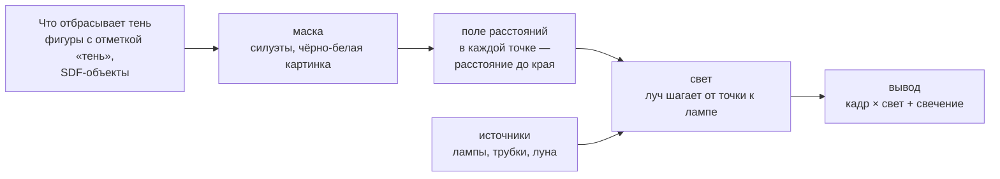

# 4. 2D-свет и тени

[← Оглавление](README.md)

## Суть в двух словах

В плоской 2D-сцене свет — не нарисованные заранее пятна, а **настоящий расчёт**: лампа светит, предметы загораживают, тень мягко размывается к краю. Сдвинул лампу — тени поехали следом. Всё это каждый кадр считает видеокарта.

Секрет — **поле расстояний** (по-английски SDF, signed distance field). Это карта, где в каждой точке записано: «до ближайшего предмета вот столько». С такой картой луч света может шагать к лампе большими прыжками и не пропустить препятствие.

## Схема

## Простыми словами

**Шаг 1. Маска.** Всё, что отбрасывает тень, рисуется чёрно-белым силуэтом в уменьшенную картинку.

**Шаг 2. Поле.** Из силуэтов видеокарта строит поле: в каждой точке — расстояние до ближайшего края. Строит хитро, «прыжками» (jump flooding): сначала каждая точка смотрит далеко, потом всё ближе и ближе. Десяток проходов — и поле готово для всего экрана.

**Шаг 3. Свет.** Для каждой точки экрана и для каждой лампы луч идёт к лампе. На каждом шаге он спрашивает поле: «сколько можно пройти, ничего не задев?» — и прыгает ровно на столько. Упёрся в предмет — точка в тени. А если луч прошёл **впритирку** к краю предмета, точка в полутени. Так получаются мягкие тени.

> 💡 Это тот же приём, что в 3D-реймарчинге (раздел 7), только на плоскости. Поэтому 2D-свет и 3D у нас «родственники».

**Шаг 4. Вывод.** Кадр с фигурами умножается на свет. Яркие места получают ореол (**свечение**). То, что ярче белого, мягко переходит в белый, а не обрезается. Лёгкий шум убирает полосы на плавных переходах.

**SDF-объекты.** Слизь, капли, зелья, магический шар — это не векторные фигуры, а формулы: «круг здесь, капсула там, слить плавно». Где части близко, между ними сама вырастает перемычка, как у капель воды. Светящиеся объекты сами светят.

**Где посмотреть в песочнице:**
- **H** — «лаборатория мага», первая демонстрация движка;
- **K** — лампы и тени, **J** — слизь и магия, **L** — само поле расстояний;
- **B** — свечение, **D** — шум против полос.

## Технические детали

### Файлы

| Файл | Что |
| --- | --- |
| `crates/reyvec-sdf/src/lib.rs` | Формулы 2D SDF на процессоре — зеркало `shaders/include/sdf2d.slang` |
| `crates/reyvec-gpu/src/lights.rs` | Источники: лампа / отрезок-трубка (гаснет к `reach`), свет издалека; до 16 за кадр |
| `crates/reyvec-gpu/src/blobs.rs` | SDF-объекты из кругов и капсул с плавным слиянием; до 16 объектов за кадр |
| `crates/reyvec-gpu/src/lab.rs` | Демо-сцена «лаборатория мага» |
| `shaders/light_mask*.slang` | Маска теней (фигуры и слои) |
| `shaders/jfa_seed.slang`, `jfa_step.slang`, `jfa_field.slang` | Поле расстояний jump flooding |
| `shaders/light.slang` | Свет: шагание по полю к каждому источнику, мягкая полутень |
| `shaders/bloom_down.slang`, `bloom_up.slang` | Свечение: цепочка уменьшений и растяжений |
| `shaders/present.slang` | Вывод: кадр × свет, свечение, мягкий пересвет, дизеринг |

### Разрешения

- Поле: половина кадра; на встроенной видеокарте — четверть.
- Свет: всегда половина кадра (из четверти края теней шли лесенкой).
- При растяжении света смешиваются только точки с той же стороны края предмета (по полю), чтобы тень не заползала на край.

### Свойство поля

После плавных операций (`op_smooth_*`) и обводки поле остаётся «полем снизу»: расстояние не больше настоящего. Шагать по нему безопасно (луч не проскочит край), но точным оно бывает не везде.

### Замеры этапа 4 (ПК Романа, кадр видеокарты)

| Сцена | RTX 5080 | Radeon |
| --- | --- | --- |
| Лаборатория (H) | 1,23 мс | 8,1 мс (119 кадров) |
| Лампы и тени (K) | 0,3–0,9 мс | 8,0 мс (121) |
| Слизь и магия (J) | 0,3–0,9 мс | 6,9 мс (139) |

## Слабые места и планы

- **Отражённого света нет.** Свет освещает только напрямую, от стен не отскакивает. Опыт со светом каскадами лучей (radiance cascades, 4.6) это давал, но на Radeon стоил 16,4 мс (на RTX 5080 — 0,83 мс) и по умолчанию не включался; при чистке графики (2026-11-25) его код убран, он остался в истории репозитория (PR #59).
- **На Radeon свет, вывод и свечение вместе — около 4 мс.** Укладываемся, но с игрой, частицами и интерфейсом запас надо беречь. План: проверять сторону края только у края, начинать свечение с четверти кадра.
- **Фон и SDF-фигуры считаются в каждом пикселе своего прямоугольника.** Для больших объектов из десятков частей дорого. План: части по плиткам, неподвижное рисовать один раз в картинку.
- **Слой с отметкой «тень» платит своё наложение.** План: рисовать такие фигуры прямо в маску.
- Полный список: [`docs/light-bottlenecks.md`](../light-bottlenecks.md).

## Связанные решения

- [Итог этапа 4](../stage-4-summary.md)
- [0003. Цели скорости](../decisions/0003-performance-targets.md)

## Заметки Романа

_Пока пусто._
