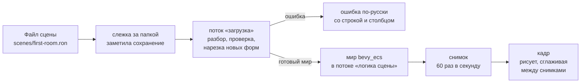

# 5. Сцена и данные

[← Оглавление](README.md)

## Суть в двух словах

Сцена — это всё, что есть в комнате: стены, стол, лампы, банки на полке. В ReyVec она записана **обычным текстовым файлом**. Открыл в блокноте, поменял цифру, сохранил — и окно сразу показывает новую сцену. Без перезапуска и без программирования.

Внутри движка файл превращается в **мир**: набор «сущностей» (предметов, фигур, ламп), которые живут своей жизнью 60 раз в секунду в отдельном потоке.

## Схема



## Простыми словами

**Файл сцены.** Формат RON — что-то среднее между списком покупок и записью в Rust. Поля по именам, вложенные скобки, комментарии после `//`. Пример из `scenes/first-room.ron`:

```ron
background: Lab,           // каменная стена и дощатый пол
ambient: "#3c4048",        // тусклый свет, который есть везде
```

**Ошибся — ничего страшного.** Если файл не читается, на экране остаётся прошлая сцена, а в заголовке окна и на панели написано, **на какой строке** и **что не так**. Опечатка в имени поля — тоже ошибка: движок не станет молча её игнорировать.

**Предметы вложены друг в друга, как матрёшки.** На столе банки, книги и магический шар со своим светом. Сдвинул стол — всё поехало вместе с ним. Всё внутри предмета записано относительно него.

**Глубина.** Вместо «слой 1, слой 2» у предмета есть `depth`: больше — ближе к тебе и рисуется поверх. В 3D та же глубина становится настоящим расстоянием.

**Движение прямо в файле:** вращение (`spin`), качание как маятник (`swing`), покачивание (`bob`). Настоящее поведение — через скрипты (раздел 6).

**Без рывков.** Сохранение, загрузка рисунков SVG и Motif, нарезка форм — всё уходит в фоновый поток «загрузка». Кадр забирает готовое, когда оно есть. Знакомые формы второй раз не режутся: если ты сдвинул или перекрасил фигуру, новой не появится.

**Где посмотреть:**
- клавиша **N** — сцена из файла; открой `scenes/first-room.ron` в блокноте и правь;
- **U** — картина из ~3900 фигур грузится в фоне, **Shift+U** — то же «по-старому» в кадре (на графике виден пик);
- уведи камеру в коридор справа — увидишь, что лампы за экраном не считаются.

> ⚠️ `update.bat` возвращает файлы папки `scenes` к исходному виду. Свою сцену держи в другой папке и запускай песочницу с `--scene-file путь`.

## Технические детали

### Крейт `reyvec-scene` (без видеокарты)

| Файл | Что |
| --- | --- |
| `lib.rs` | `SceneFile::parse` (RON + проверка пределов, `SceneError` со строкой и столбцом), `SceneFile::build` → `SceneItem`, источники, SDF-объекты; `ShapeCache`; `SceneWatcher` |
| `world/mod.rs` | `SceneWorld`: мир `bevy_ecs` и расписание систем шага, команды консоли, снимок. С 9.1 мир разделён на части по системам: |
| `world/parts.rs` | Компоненты предметов (`Placement`, `Solid`, `Player`, `Scripted`, `PhysBody`…) и ресурсы шага |
| `world/spawn.rs` | Сборка мира из файла: предмет за предметом, с фигурами, светом, телами, скриптами |
| `world/places.rs` | Движение по времени, позы костей, твёрдые прямоугольники, итоговые места (`ChildOf`) |
| `world/play.rs` | Герой и враги: шаги контроллера, удар, попадания |
| `world/physics.rs`, `world/phys.rs` | Шаг Rapier, обломки; полигон: сочленения, мягкие тела, мышь |
| `world/scripts.rs` | Скрипты Luau и сюжет на шаге логики |
| `world/draw.rs` | Снимок для рисования (`Scene`) |
| `logic.rs` | Поток «логика сцены»: фиксированный шаг 60 Гц, догон не больше 5 шагов, `Scene::lerp` |
| `loader.rs` | Поток «загрузка»: `LoadJob` → `LoadResult` / `ShapeBatch`, выброс удалённых форм (`ShapeTrash`) |
| `assets.rs` | `pictures` (SVG) и `morphs` (Motif) в предметах; кеш по пути, размеру и времени изменения файла |
| `tiles.rs` | Уровень из тайлов буквами: `#` блок, `/` `\` склоны 45°, `=` доска |
| `physics_desc.rs` | Описание физики в файле (раздел 6) |

### Формат файла

- Заголовок: `format: "reyvec-scene", version: 1`. Несовместимое изменение формата — новая версия и перевод старых файлов.
- Неизвестные поля — ошибка (`deny_unknown_fields`).
- Координаты: x вправо, y вверх; кадр по высоте от −1 до 1 (1 единица = 1 м, решение 0004). Углы в градусах против часовой. Цвета `"#rrggbb"` / `"#rrggbbaa"` в sRGB.
- Предмет (`nodes`): `at`, `angle`, `scale`, `depth`, `shadow`, `opacity`, `shapes`, `lights`, `objects`, `pictures`, `morphs`, `children`, движение `spin` / `swing` / `bob`.
- Фигуры: `Rect`, `Circle`, `Polygon`, `Line`, `Path` (запись SVG, y вверх); `stroke` — только контур.
- 3D-сцены — отдельные файлы `scenes/3d/*.ron` (раздел 7). Заготовки для редактора — `assets/prefabs/*.ron`.

### Слежка за файлом

`SceneWatcher` следит за папкой (редакторы сохраняют через новый файл и переименование); текст читается, когда запись стихла на 120 мс. Файл: `--scene-file`, иначе `scenes/first-room.ron` рядом с `dist`, иначе встроенная копия без слежки.

### Слои для тени

Подряд идущие фигуры одной «группы» (ближайший предмет с явной тенью или прозрачностью) собираются в один слой: стол и полка — два небольших слоя, а не один на всю сцену.

### Отсечение

В кадр идут только источники и объекты, которые достают до экрана: на экране до 16 источников и 16 объектов, в сцене до 1024 источников.

### Замеры этапа 5 (ПК Романа)

| Что | RTX 5080 | Radeon |
| --- | --- | --- |
| Сцена N, кадр видеокарты | 1,08 мс | 6,8 мс |
| Шаг логики | 0,05 мс | 0,09–0,10 мс |
| Картина U: в фоне / в кадре | 17,5–22,7 / 0,4–1,0 мс | 19,6–22,8 / 0,7–1,0 мс |
| Подготовка кадра (3956 фигур) | 0,13–0,21 мс | 0,12–0,13 мс |

## Слабые места и планы

- **Сцена — один файл.** Нет разбиения на части и ссылок на другие файлы. Нужно для больших уровней (этап 8) и редактора.
- **За файлами рисунков сцена не следит:** правка SVG видна после следующего сохранения сцены.
- **Номера фигур не переиспользуются:** около 80 байт учёта на каждую когда-либо созданную фигуру. Опасно только для игр, которые часами создают и удаляют фигуры. План — номера с поколением, этап 8.
- **Больше 16 ламп на экране — дальние гаснут.** План — свет по плиткам экрана, этап 8.
- **Отсечение и снимок проходят весь список каждый кадр.** Для тысяч предметов — доли миллисекунды. План — сетка по частям уровня, этап 8.

## Связанные решения

- [0010. Многопоточность](../decisions/0010-multithreading.md)
- [0011. Файл сцены](../decisions/0011-scene-file.md)
- [Итог этапа 5](../stage-5-summary.md)

## Заметки Романа

_Пока пусто._
