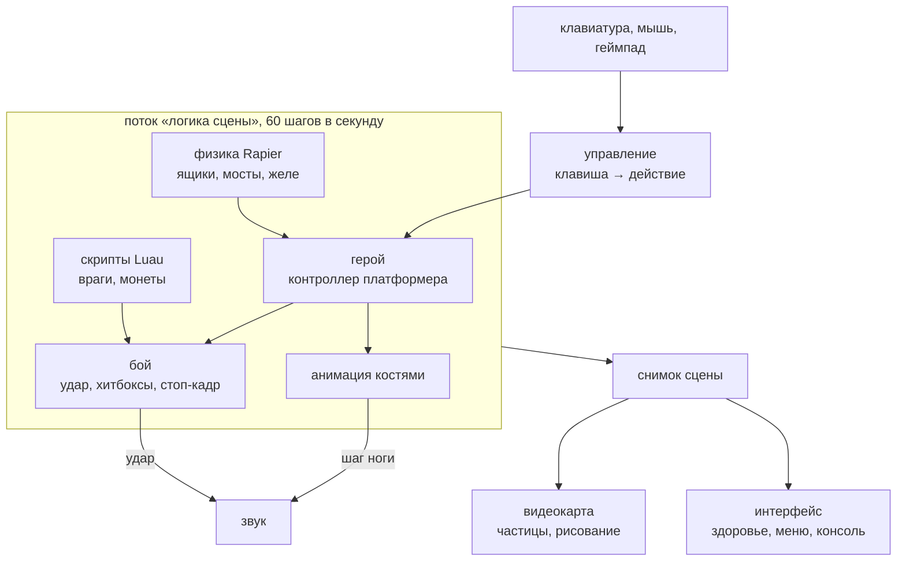

# 6. Игровые системы

[← Оглавление](README.md)

## Суть в двух словах

Это всё, что превращает красивую картинку в **игру**: герой бегает и прыгает, бьёт врагов, ящики падают, искры летят, шаги звучат, а в углу экрана видно здоровье.

Каждая система — отдельный «кирпичик». Большая часть из них — чистые расчёты без видеокарты и окна, поэтому их легко проверять автотестами.

## Схема

## Простыми словами

**🎮 Управление.** Игра никогда не знает про конкретные клавиши. Она знает **действия**: «влево», «прыжок», «удар». А какая клавиша, кнопка мыши или геймпада к действию привязана — решает игрок в меню (Esc → «Управление»). Для меню, игры, консоли и песочницы свои **схемы**, они не мешают друг другу.

**🏃 Герой.** Это не физическое тело, а специальный «контроллер платформера», который движется так, как **удобно игроку**, а не как настоящий ящик. В нём все приёмы, без которых платформер кажется деревянным:
- разгон и торможение (на земле тормозит сильнее, в воздухе управление слабее);
- высота прыжка зависит от длины нажатия;
- «время койота»: прыжок срабатывает, даже если нажал чуть позже, чем сошёл с края;
- нажал прыжок чуть раньше приземления — прыжок случится в момент касания;
- рывок, скольжение по стене и прыжок от неё, склоны, ступеньки, вис на краю.

С 9.2 герой видит **один мир столкновений** вместе с физикой: уровень, ящики, доски на шарнирах, шары — всё настоящей формой. Можно стоять на повёрнутом ящике и на шаре, доска на качелях везёт стоящего, ящик толкается плечом (герой идёт со скоростью ящика), по слишком крутой грани герой съезжает, а не стоит. С 9.3 твёрдой может быть любая фигура сцены (`solid: true` у круга, многоугольника, линии, контура, SDF-объекта): форма та же, что на экране, — вращающаяся звезда, холм, банка со скруглённой крышкой. Ящики физики тоже ударяются о настоящую форму и съезжают по дуге. С 9.4 в этом мире и **мягкие тела**: на желе можно встать, и оно сминается под героем (мягкое сильнее твёрдого), гамак прогибается под ним и выпрямляется, когда герой уходит, висящую верёвку герой отодвигает плечом. Герой и враги теперь **весят**: качели наклоняются под стоящим, а прыжок на доску или желе ударяет по ним.

**⚔️ Бой.** Удар идёт по фазам: замах → удар (только тут хитбокс бьёт) → возврат. При попадании игра на миг замирает (стоп-кадр), камера трясётся, цель вспыхивает. Манекенов отбрасывает, и через время они появляются снова.

**📦 Физика.** Ящики, мосты на шарнирах, маятники, желе, верёвки — это **Rapier**, готовая физическая библиотека. Её копия лежит прямо в репозитории, чтобы обновления не ломали движок внезапно. Посмотреть на всё сразу: полигон физики (N, потом ещё раз N), держи **Q** — тащишь тело мышью, **Y** — взрыв. С 9.6 у тела есть **материал** (`material: Wood`, `Metal`, `Stone`, `Rubber`): дерево стучит и роняет щепки, металл звенит и искрит, камень бухает пылью, резина шлёпает и прыгает. Чем сильнее и тяжелее удар, тем громче. Тяжёлое тело, влетевшее в героя или врага (ящик с полки, ядро пушки), ранит; лёгкое и лежащее — нет. Уголок «Материалы» — в конце полигона слева от героя. С 9.6а есть **слои столкновений**: в файле сцены называешь слои и с чем каждый не сталкивается (`collision: [(name: "призрак", ignores: ["решётка"])]`), а предмету даёшь `layer: "призрак"`. Так призрак проходит сквозь стены, пули врагов не бьют врагов, а герой и ящики упираются как обычно. Уголок «Слои» — ещё левее материалов: жук-призрак бежит к герою сквозь решётку. С 9.6б есть **зоны**: невидимые прямоугольники `zone: (size, wind, gravity, magnet)`. Зона замечает, что герой вошёл и вышел, и может быть полем сил: ветер или течение сдувает ящики и героя, в зоне слабой тяжести герой прыгает выше, магнит тянет железо. В полигоне: голубая зона слева от героя (тяжесть втрое слабее), ветер над мельницей, магнит у железного бруска. С 9.6в герой умеет **взять и бросить** (C или E, на геймпаде B): лёгкую вещь он поднимает над головой и несёт, второе нажатие бросает её вперёд (со стрелкой вниз — кладёт перед собой). Брошенная вещь ранит врага, даже лёгкая. Тяжёлую он берёт за край и тянет волоком, сам идёт медленнее; совсем неподъёмная не берётся. В полигоне: каменная плита справа от героя (тянуть) и деревянный ящик у манекена в «Материалах» (бросить в манекен). С 9.6г разбитый враг может **осесть тряпичной куклой**: `dummy: (..., fall: Ragdoll)`. Кукла собирается из его же фигур: крупные (мешок, голова, подставка) падают телами на шарнирах, мелкие (полоски, глаза) едут за ними. Кукла лежит, пока враг не появится снова, и гаснет. Без `fall` (или `fall: Break`) враг разлетается квадратными обломками, как раньше. Куклой падают манекены и жук в первой комнате и манекен под полкой на полигоне. С 9.8 у любого предмета есть **свойства и метки**: в файле сцены `props: { "damage": 2 }` или `tags: ["дверь"]`. Несколько свойств движок понимает сам: `damage` — касание ранит, `burns` — горит (ранит и мерцает), `grab: false` — руками не взять, `glow` — светится. Остальные придумываешь сам, их читает скрипт предмета: один скрипт на три шара, а качаются они по-разному, потому что размах у каждого свой. Посмотреть: новая сцена «комната логики» (N, она перед полигоном физики). С 9.7 есть **сцена-нагрузка** на 2 000 тел (N ещё раз после полигона): стена ящиков, высокая пирамида, корзина резиновых шаров и куча капсул и камней. Сначала всё падает и толкается — это самый дорогой миг, потом тела **засыпают** и почти ничего не стоят; взрыв (Y) будит только тех, кто рядом. На панели F1 видно, сколько тел спит и сколько миллисекунд занял шаг.

**🐞 Скрипты.** Поведение врагов и предметов пишется на маленьком языке **Luau** в отдельных файлах (`scenes/scripts/beetle.luau` — жук, `coin.luau` — монета). Каждый шаг игры движок спрашивает скрипт: «вот где ты и где герой — что делаешь?». Поправил скрипт, сохранил — враг ведёт себя по-новому, игра не перезапускается. Ошибка в скрипте игру не роняет.

**✨ Частицы.** Пыль из-под ног, искры от ударов, фонтан. До 100 000 штук одновременно, и считает их **видеокарта**: процессор только говорит «здесь родились 20 искр». С 9.5 частицы отскакивают от того же, обо что ударяется герой: от повёрнутых ящиков, шаров, звезды, холма, желе, тел физики. Едущий ящик отбрасывает пыль, лифт везёт её на себе, пыль скатывается с шара и съезжает по наклонной доске.

**🔊 Звук.** Шаги, прыжки, удары **синтезируются** (собираются из формул), а не берутся из файлов. Есть музыка (клавиша O).

**🦴 Анимация костями.** Герой собран из «костей»: тело, голова, руки, ноги, плащ. Позы плавно перетекают друг в друга, а удар накладывается поверх бега: ноги бегут, руки бьют. Шаги совпадают с пройденным путём, поэтому ноги не скользят.

**🖥️ Интерфейс и консоль.** Здоровье, монеты, числа урона над целью, меню паузы. Клавиша **~** (Ё) открывает консоль разработчика: переставить героя, бессмертие, замедлить время, показать столкновения. Команды по-русски, «помощь» покажет список.

**🧩 Интерфейс из файла (новый, И.1).** Экраны игры пишутся в файлах `ui/*.rui` на языке, похожем на SwiftUI: `Column { Text("Меню") }.padding(20).background(#171A21)`. В песочнице **F3** показывает пример `ui/demo.rui` — меню и полоску выносливости. Поправил файл и сохранил — окно сразу показывает новое. Ошибка в файле видна плашкой вверху окна с номером строки. С шага И.2а у экрана есть **темы и стили, как CSS**: сверху файла блок `head` подключает тему (`ui/themes/base.rui`) и стили (`ui/styles/demo.rui`), **F4** меняет тему, **Shift+F3** пишет в консоль (~), откуда взялось каждое свойство. С И.2б кнопки отвечают: под мышью подсвечиваются, Tab и стрелки выбирают, Enter нажимает, что нажато — видно в консоли, «Выход» прячет экран. Вид в каждом состоянии пишется в стиле: `.hover { .background(…) }`. С И.2в тексты пишутся ключами, `Button(tr("menu.save"))`, а слова лежат в `ui/lang/ru.ron` и `ui/lang/en.ron`; кнопка «Язык» в примере меняет язык на лету. С И.3а разметка читает данные игры: `Bar(game.hero.hp / game.hero.hp_max)` — полоска сама следит за здоровьем. В сцене с героем полоска здоровья и монеты теперь из файла `ui/hud.rui`. С И.3б кнопки делают дела: в фигурных скобках кнопки пишется, что делать, `Button("Настройки") { open(Settings) }`. В примере «Настройки» открывают второй экран (язык, тема, «Назад»), а «Новая игра» зовёт функцию из `ui/demo.luau`, и в сцене с героем (N) он возвращается в начало уровня. С И.3в в «Настройках» есть ползунок громкости и переключатель музыки: `Slider($settings.audio.volume)` — знак `$` значит «связь в обе стороны»: тянешь ползунок — меняется громкость, включил музыку клавишей O — переключатель сдвинулся сам.

## Технические детали

### Где что лежит

| Система | Файл | Видеокарта нужна? |
| --- | --- | --- |
| Действия и ввод | `crates/reyvec-game/src/input.rs`; привязки и схемы — `crates/reyvec-app/src/controls.rs`, геймпад — `gamepad.rs` (`gilrs`) | нет |
| Контроллер героя | `crates/reyvec-game/src/controller.rs` (`Tuning`: `coyote`, `buffer` и др.); мир столкновений — `space.rs` (`Space`, `Surface`, `Filter`), формы фигур — `form.rs` (`Form`) | нет |
| Бой | `crates/reyvec-game/src/combat.rs` (`Fighter`, `Dummy`) | нет |
| Анимация | `crates/reyvec-game/src/anim.rs` (`Bone`, `Pose`, `Clip`) | нет |
| Физика | `crates/reyvec-game/src/physics/` (тела, `joints.rs`, `soft.rs`); копия `third_party/rapier2d` 0.36.1 + `parry2d` 0.31.1 | нет |
| Скрипты | `crates/reyvec-script` (`mlua` + Luau, `Scripts::reload_changed`) | нет |
| Сюжет (Сю.1, Сю.5, Сю.7–Сю.13) | `crates/reyvec-story` (`format.rs`, `cond.rs`, `check.rs`, `play.rs`, `quest.rs`, `rename.rs`, `memory.rs`, `writer.rs`, `life.rs`, `text.rs`); для скриптов и игры — `crates/reyvec-script/src/story.rs`; окно диалога — `crates/reyvec-app/src/story_window.rs`; пример — папка `story/`, `scenes/scripts/kuznec.luau`, `scenes/scripts/ruda.luau` | нет |
| Звук | `crates/reyvec-audio` (`synth.rs`, `mixer.rs` поверх `cpal`) | нет |
| Частицы | `crates/reyvec-gpu/src/particles.rs`, `shaders/particles.slang` | да |
| Интерфейс игры (старый) | `crates/reyvec-app/src/game_ui.rs` (egui) | да |
| Интерфейс игры из `.rui` (И.1–И.3в) | язык и раскладка — `crates/reyvec-ui` (`syntax.rs`, `model.rs`, `style.rs`, `lang.rs`, `data.rs`, `lib.rs`); видеокарта — `crates/reyvec-gpu/src/game_ui.rs`, `shaders/game_ui.slang`; песочница — `crates/reyvec-app/src/rui_demo.rs`; пример — `ui/demo.rui`, `ui/demo.luau`, `ui/hud.rui`, `ui/themes/base.rui`, `ui/styles/*.rui`, `ui/lang/*.ron` | раскладка нет, рисование да |
| Консоль | `crates/reyvec-app/src/console.rs` | да |
| Свойства и метки предметов (9.8) | `crates/reyvec-scene/src/world/props.rs` (`Props`, `Hazard`, система `hazards`); чтение и проверка — `Prop`, `check_props` в `crates/reyvec-scene/src/lib.rs`; пример — `scenes/logic-room.ron`, `scenes/scripts/props-demo.luau` | нет |

### Ввод

Окно пишет нажатия, поток логики читает их на каждом шаге и не теряет короткие нажатия между шагами. Прицел — курсор в координатах сцены (`SceneLogic::set_aim`); нажатие с мыши запоминает, где был курсор (`press_aimed`). Источники привязываются по месту клавиши, а не по букве. Настройки клавиш сохраняются в файл сразу.

### Скрипт Luau

Функция `update(me, hero, dt)` зовётся 60 раз в секунду для каждого предмета со скриптом.

| В `me` пишет движок | В `me` пишет скрипт |
| --- | --- |
| `x`, `y`, `vx`, `vy`, `on_ground`, `wall`, `hp`, `alive`, `touching`, `time`; один раз при сборке — `props` и `tags` (9.8) | `move` (−1…1), `jump`, `hidden`, `collected`, свои поля |

Свойства и метки предмета из файла сцены лежат в `me.props` и `me.tags` (`Scripts::set_props`). Русское имя в Luau — в скобках: `me.props["размах"]`, `if me.tags["прячется"] then … end`; латинское можно через точку (`me.props.damage`).

`hero` только для чтения. При ошибке работает прошлая версия скрипта, текст ошибки со строкой — на панели.

### Интерфейс из файла `.rui` (И.1)

Устройство описано в [game-ui.md](../game-ui.md) и решении 0022; здесь — что уже сделано.

- **Разбор.** `syntax::parse` превращает текст в дерево `Node` (имя, аргументы, дети, модификаторы); `model::screen` проверяет имена и значения и строит `Element` с раскладкой (`Placement`) и видом (`Look`). Ошибки — `UiError` с местом «строка N, столбец M», на опечатку в модификаторе — подсказка «Может, .padding?». Состояния (`.hover { … }`) уже разбираются, но до И.2 не действуют; `theme.` и `tr()` дают ошибку «шаг И.2».
- **Стили и темы (И.2а).** `UiScreen::load(папка, файл)` читает экран и файлы из его `head` (`theme("…")`, `styles("…")`, путь от `ui/`); у каждого места в файле есть номер файла (`Pos::file`), поэтому ошибка в стиле называет свой файл. `style::StyleSet` разворачивает вложенные стили в пути селекторов и сопоставляет их с блоком по цепочке предков (корень экрана — по имени экрана). Модификаторы применяются по лестнице: стили вида → класса → вложенные (на ступени — по порядку записи), потом значения в скобках у `Column`/`Row`, потом свои модификаторы блока. `var(имя)` подставляется при сборке: переменные темы считаются один раз (цикл — ошибка), `.var(имя: …)` даёт новую область для блока и всего внутри. `.font` и `.color` у контейнера наследуются текстами. Смена темы (`set_theme`) собирает экраны заново и увеличивает `generation`, по нему видеокарта берёт новый атлас букв. «Откуда взялось» — `Element::origins` и `UiScreen::explain`.
- **Состояния и нажатия (И.2б).** У каждого блока хранится `script` — его модификаторы по лестнице с подставленными переменными. Когда меняется наведение, нажатие, фокус, окно, язык или способ ввода, `model::restyle` проигрывает `script` всего дерева заново: модификатор состояния (`.hover { }`, `.nth(3) { }`, `.when(…) { }`) применяет вложенные, только если условие выполнено. Состояния кнопки передаются всем блокам внутри неё. Это дёшево (без разбора и без раскладки текста), после него раскладка `taffy` и список рисования — заново. Модификаторы в состояниях проверяются при сборке, поэтому ошибка видна сразу после сохранения файла. Нажимаемые блоки (`Button`) после раскладки попадают в `UiDraw::targets` с прямоугольником в пикселях окна: по ним `UiScreen::pointer_move`/`pointer_down`/`pointer_up` ищут кнопку под мышью, а `key(UiKey)` ходит по ним по порядку файла. Нажатие — `UiEvent::Click(id или надпись)`.
- **Языки (И.2в).** `lang::Texts` читает `ui/lang/*.ron` (`( name: "English", texts: { "ключ": "слово" } )`), главный язык — первый. `Text(tr("ключ", n: 5))` превращается в строку при сборке элемента (`model::words`): слово на языке `Env::lang`, при пропуске — главного, `{n}` заменяется значением. Поэтому `UiScreen::set_lang` и `set_texts` собирают экраны заново, как смена темы (у текста другая длина, буквы — в новый атлас); пути в дереве те же, поэтому наведение и фокус не сбрасываются. Без файлов языков `tr` показывает сам ключ. `Texts::gaps` — ключи, которых нет в других языках, песочница пишет их в консоль.
- **Данные игры (И.3а).** `data::UiData` — значения по путям `game.…` и `settings.…`, лежит в `Env` рядом с окном и языком. Значение с путём «живое» (`data::is_live`): `style::eval` подставляет переменные, но формулу с путём не считает, а оставляет до пересчёта. В `model::run` у модификатора с живыми значениями они считаются `data::compute` перед применением; у `Text` с живыми кусками (`\( )` или `tr` с путём в подстановке) куски лежат в `TextSpec::parts` и собираются в `replay`. `UiScreen::set_number`/`set_text`/`set_flag` при изменении ставят `restyle`, после пересчёта `sync_text` отдаёт `TextLibrary::set` поменявшиеся тексты (атлас дорастает новыми буквами, `generation()` учитывает его ревизию). Ошибка пересчёта (нет пути) не роняет экран: она в `UiScreen::problem`, песочница показывает плашку. `Bar` — лист раскладки, рисуется фоном и вторым прямоугольником на долю `look.value`.
- **Действия кнопок (И.3б).** В `model::element` дети кнопки с маленькой буквы становятся `model::Action` (имя, значения, место), с большой — блоками; `model::COMMANDS` — команды движка с числом значений, `open` проверяет, что такой экран есть в файле. Нажатие (`UiScreen::click`) считает значения по данным и отдаёт `UiEvent::Click { name, actions }`; `open`/`back` экран делает сам (`UiScreen::open`, `back`, стопка `history`, при переходе сбрасываются наведение и фокус). Остальное делает песочница (`rui_demo.rs`, `RuiDemo::run`): команды — сама, другие имена — `Scripts::call` у своего экземпляра `reyvec-script` с модулем `ui/demo.luau` (`load_module`: `update` не обязателен). Таблицы `ui.*` и `game.*` из `Scripts::add_commands` складывают вызовы в `CommandSink`; песочница разбирает его после каждой функции, а игровые команды отдаёт в `app.rs` как `Request::World(DebugCommand)` — в логику сцены, той же дорогой, что консоль.
- **Связь в обе стороны (И.3в).** `$путь` разбирается в `Value::Bind`. `Slider` и `Toggle` собираются в `model::element` как `Kind::Bar` со связью `Element::bind` (`model::Bind`, `Control::Slider { from, to, step }` или `Control::Toggle`): им подставляется `.value(…)` из пути — `(путь - from) / (to - from)` или `путь ? 1 : 0`, так что вид следует за данными, как у `Bar`. Мышь и клавиши (`UiScreen::pointer_down`/`pointer_move` с `drag`, `UiKey::Left`/`Right`, нажатие переключателя в `click`) зовут `set_bound`: значение в `env.data` и в `changes`, которые игра забирает `take_changes`. Рисуется кружок (`look.knob`) поверх заполнения. В песочнице `RuiDemo::take_requests` превращает перемены в `Request::Volume`/`Music`, `app.rs` отдаёт их звуку (`Audio::set_volume` — общая громкость в смесителе, `Command::Volume`), а `frame` каждый кадр пишет на экран громкость и музыку из звука — так ползунок видит и чужие перемены. Нажатие и колесо мыши мимо кнопок, но по окну (у блока есть фон или рамка, `UiDraw::solid`), тоже забирает интерфейс (`UiScreen::pointer_down`, `pointer_over`): камера за меню не тянется.
- **Раскладка.** `taffy` 0.15: `Column` и `Row` — flex, `Stack` (и `Rect`) — сетка 1×1, где дети лежат друг на друге. Размеры в файле — пиксели экрана 1920×1080, на другом окне всё умножается на `высота / 1080`. Текст раскладывается один раз (`reyvec-text`), при смене размера окна только масштабируется. Раскладка пересчитывается только при смене размера окна или файла.
- **Рисование.** Список `UiDraw` — прямоугольники `UiQuad` двух видов: блок (заливка, скругление, обводка) и буква (место в атласе MSDF). Видеокарта рисует весь список одной командой (6 вершин на прямоугольник), скругление и сглаженный край считает шейдер по расстоянию до скруглённого прямоугольника. Проход «интерфейс» идёт после обработки кадра, в полном разрешении окна, поверх сцены и под панелями egui. Атлас букв загружается заново только при правке файла.
- **Песочница.** `RuiDemo` проверяет время изменения файла экрана и всех подключённых файлов раз в 0,25 с; если файла нет рядом, берёт пример, вшитый в программу. При ошибке разбора рисуется плашка ошибки, прежний экран ждёт исправления.
- **Проверки.** Разбор, раскладка и упаковка прямоугольников проверяются на процессоре (`cargo test -p reyvec-ui`); кадр с блоком и буквой — в CI на lavapipe (`game_ui_draws_blocks_and_text`).

### Сюжет (Сю.1)

Устройство описано в [story.md](../story.md) и решении 0023; здесь — что уже сделано. В редакторе сюжет правится во вкладке «Сюжет» (Сю.2–Сю.6), в песочнице его видно в первой комнате: кузнец в коридоре (Сю.7).

- **Файлы.** `story/vars.ron` (переменные мира со значениями в начале игры), `characters/`, `dialogs/`, `quests/`, `lang/<язык>.ron`. Имена — латиница в нижнем регистре, цифры, `_` и `.`; заголовки и тексты — на любом языке. Карточки диалога: `Line` (с вариантами ответа и настройками: вид, настроение, голос, камера, пауза), `Check`, `Set`, `Event`, `Run`, `Jump`, `Random`, `Chance`, `Wait`, `End`; у каждой место `at` на схеме.
- **Условия** — выражения Luau в своей песочнице (`cond.rs`): разбираются один раз, перед проверкой получают окружение из переменных (`kuznec.znakom` → вложенные таблицы) и заданий (`quest.mech.state`, `quest.mech.stage`). Ответ не «да/нет» — ошибка, предел работы — 10 000 прерываний.
- **Проверка** (`check.rs`): стрелки в никуда, неизвестные персонажи, переменные, задания и цели, подстановки `{имя}`, ошибки условий (каждое проверяется на начальном мире), неверные имена, карточки, до которых не дойти (предупреждение).
- **Проигрыватель** (`play.rs`): `Story::talk` → `Story::step` до реплики, события, паузы или конца → `Talk::choose`. События `quest.*` выполняет сам сюжет, остальные получает игра. Ошибка в данных мягко заканчивает разговор и пишет причину в `Talk::error`; больше 1000 «тихих» карточек подряд — обрыв. Случайные карточки берут число из зерна в `State` (одно зерно — один путь).
- **Состояние** `State` (переменные, задания, выбранные варианты, язык, зерно) — часть будущего сохранения.
- **Задания (Сю.6).** У задания `description` (для журнала), `rewards` (изменения переменных, как у карточки «Переменная»; выдаются, когда задание выполнено) и `fail_when` (условие провала); у стадии `done_when` — условие, которое должно стать верным вместе с целями. Условия проверяет `Story::quest_tick`: его зовёт `Story::step` после каждого шага разговора, а у скриптов — `story.set` и `quest.add`; игра зовёт его через те же `story.set`/`quest.add`. Проверка сюжета разбирает эти условия и пробует награды на начальном мире.
- **Скрипты (Сю.5).** Сцена при сборке ищет папку `story/` рядом с собой или до трёх папок выше (`SceneWorld::new` → `find_story_dir`) и отдаёт сюжет скриптам: `Scripts::set_story` кладёт в Luau таблицы `story` (`talk`, `busy`, `get`, `set`, `seen`) и `quest` (`start`, `add`, `stage`, `state`, `complete`, `fail`), только для чтения. Сюжет, его `State` и начатый разговор лежат в `StoryHost` под общим замком (`SharedStory`, `SceneWorld::story()`): скрипты меняют его, а ведёт разговор и сохраняет игра (Сю.7, ниже). Неизвестное имя или значение не того вида — ошибка Luau со строкой скрипта (`kuznec.luau:4: нет диалога «…»`), как любая ошибка скрипта. Список функций с описаниями — `STORY_FUNCS`/`QUEST_FUNCS`, по нему подсказывает редактор кода; тест `story_functions_match_engine` сверяет его с таблицами.
- **Память и отношения (Сю.9).** `memory.rs`: у персонажа в `State::memory` — факты (`Fact`: имя, текст, важность 1–10, время) и отношения (`relations`: к кому → число). Время игры — `State::time`, его двигает `Story::memory_tick` (зовёт `StoryHost::advance` каждый шаг логики, и без разговора). Сила факта — важность минус прошедшее время в единицах `FORGET_STEP` (600 с); факт с силой ≤ 0 забывается, важность 10 — никогда; больше `MAX_FACTS` (64) — вытесняется самый слабый. Пишут события карточки «Событие» (`memory.add`, `memory.forget`, `relation.add`, `relation.set` — их выполняет сам сюжет, как `quest.*`) и таблица `npc` в Luau (`NPC_FUNCS`). В условиях `memory.<персонаж>` и `relation.<персонаж>` есть у каждого персонажа (`Conditions::characters` заполняет проверка сюжета); чего не помнит — `false`, отношения без записи — 0, а не `nil`. Отношения в начале игры — `Character::relations`, их кладёт `Story::new_state`. Имена `memory` и `relation` для переменных заняты.
- **Живые реплики (Сю.10).** Карточка `Node::Generate`: кто говорит, задача, предел слов (`words`), разрешённые события (`allowed`), запасной текст (`fallback`, его переводят как реплику). `writer.rs`: `Story::request` собирает для модели `Request` — имя и характер персонажа, до `MEMORY_IN_PROMPT` (8) самых сильных фактов, отношения, задачу, рамки и язык; `prompt` превращает его в текст задания. Модель — что угодно с `trait Writer` в `Story::writer` (облако, своя на ПК, заглушка `Canned` для тестов). Ответ проверяет `accept`: пустой или длиннее предела в 1,5 раза — ошибка, кавычки срезаются, события не из `allowed` отбрасываются; разрешённые выполняет сам сюжет (`quest_event`, `memory_event`), так что модель не может дать денег или открыть задание, если автор не отметил. Ошибка или нет модели — звучит запасной текст; `Shown::generated` говорит, что прозвучало (`Model(имя)` или `Fallback(почему)`). Проверка сюжета требует персонажа, запасной текст и разрешимые события (`writer::allowed_event`: память, отношения, задания). Пока модель не подключена (ждёт ответа Романа), `Story::writer` пуст. Слабое место: вызов модели сейчас синхронный — когда подключим настоящую, его надо унести в отдельный поток, иначе разговор подвиснет на время ответа.
- **Помощь автору (Сю.11).** `Story::suggest(диалог, карточка, Suggest, n)` просит у той же модели `n` вариантов для реплики: `Suggest::Line` — сказать её другими словами (или придумать, если пусто), `Suggest::Answers` — ответы игрока (имя «игрок», до `ANSWER_WORDS` слов). В `Request::before` — до `BEFORE_IN_PROMPT` (4) реплик перед карточкой (назад по стрелкам, с ответом игрока, который туда ведёт), в `Request::avoid` — уже полученные варианты, чтобы модель не повторялась. Ответы проходят ту же `accept`; повторы и совпадение с нынешним текстом отбрасываются. Нет модели — `Err("модель не подключена")`.
- **Жизнь персонажей (Сю.12).** `life.rs`: у персонажа `Character::day` (строки `Routine`: с какого часа, место, занятие; по кругу — до первой строки действует последняя) и `Character::chats` (`Chat`: с кем, диалог, условие, раз в сколько часов игры). Час игры — `life::hour(State::time)`: `HOUR` = 60 с, начало в `START_HOUR` = 8. `Story::life_tick(state, dt, distance)` зовёт `StoryHost::advance` после `memory_tick`; расстояние до героя пишут скрипты (`npc.near(кто, метры)`, хранится в `StoryHost::distances`; не сказали — далеко). Частота расчёта по расстоянию: ближе `NEAR` (15 м) — каждый шаг, ближе `MIDDLE` (60 м) — раз в `MIDDLE_STEP` (1 с), дальше — раз в `FAR_STEP` (10 с). Разговор начинается, когда у обоих по распорядку одно место, условие истинно и прошло `every` часов: `Story::overhear` проигрывает диалог целиком сразу (первый видимый вариант, события выполняются), а реплики кладутся в `Life::saying` и выходят по одной в `LINE_SECONDS` (3 с) событием `LifeEvent::Said`, если кто-то из двоих ближе `MIDDLE`; далеко — очередь выбрасывается. Игра показывает их из `StoryHost::heard` слева внизу (`story_window.rs`). Состояние жизни (`State::life`) — в сохранении. Слабые места: персонажи сами не ходят по сцене (место — только имя); весь разговор считается в один шаг, поэтому его события срабатывают сразу, а реплики звучат потом; варианты в таком диалоге выбираются первым видимым, а не по характеру.
- **Диалог текстом (Сю.13).** `text.rs`: `to_text(&Dialog)` пишет диалог как пьесу (блок `== имя` на карточку, синтаксис — в начале файла), `from_text(текст, старый диалог)` разбирает обратно и возвращает все ошибки сразу (`TextError`: строка и что не так). Текст хранит только карточки и стрелки; заголовок, участники, места на схеме, настройки реплик (`LineSettings`) и ключи переводов берутся из старого диалога по имени карточки, новые карточки встают на схеме правее предыдущей. Файл на диске остаётся RON — текст лишь второй способ его править. Слабые места: пометки `//` внутри текста в файл не попадают; реплика — одна строка (перенос — `\n`); переименование карточки в тексте теряет её место на схеме и настройки (карточка считается новой).
- **В игре (Сю.7).** Разговор ведёт поток логики: система `drive_story` после скриптов зовёт `Scripts::story_step`, а тот — `StoryHost::advance(dt)`. `advance` берёт ответ игрока (`StoryHost::answer`: «дальше» или вариант), идёт по карточкам и кладёт то, что надо показать, в `StoryHost::screen` (реплика или пауза до нажатия). Карточка «Подождать» с секундами считает время шагов, событие не `quest.*` пишется в журнал программы и в `StoryHost::events`, карточка «Скрипт» возвращается из `advance`, и `Scripts::call_story` зовёт функцию с этим именем из первого скрипта сцены, где она есть (без замка на сюжете: функция может звать `story.*`). Ошибки разговоров и функций — в `StoryHost::problems`, окно показывает последнюю. Пока идёт разговор, система `play` даёт герою пустой ввод. Окно (`reyvec-app/src/story_window.rs`) только рисует `screen` и пишет `answer`: сюжет оно получает через `SceneLogic::story()`. Клавиши 1–9, Пробел, Enter и J в игре сначала идут окну (`GameUi::story_key`), отпускание — всегда игре. Сохранение: `State` (с `talked` — какие диалоги уже были) пишется в RON (`Story::save`), `Story::restore` сверяет его с сюжетом (новые переменные — из начала игры, исчезнувшие выбрасываются). Сохранили сцену в редакторе — новый мир берёт сюжет у старого (`SceneWorld::keep_story_from`), разговор не обрывается.
- **Проверки:** `cargo test -p reyvec-story` — весь пример «кузнец и руда», перевод, отметка выбранных вариантов, повтор по зерну, ошибки данных, песочница условий, запись файла и чтение обратно.

### Свойства и метки (9.8, решение [0025](../decisions/0025-scene-logic.md))

У предмета в файле `props: { "имя": значение }` (`Prop`: да/нет, число, текст) и `tags: ["слово"]`. При чтении `check_props` проверяет вид встроенных (`BUILTIN_PROPS`) и пустые имена; ошибка называет предмет. При сборке (`spawn.rs`) у сущности появляется `Props` (словарь, метки, `order` — порядок в файле), а встроенные превращаются в исполнителей: `damage` и `burns` — компонент `Hazard` (середина и половины прямоугольника касания: `touch` или описанный прямоугольник фигур, повёрнутых, но без поворота самого предмета), `grab: false` — `BodyDesc::grab` (тело в `Physics::no_grab`, `reachable` его пропускает), `glow: true` — `ObjectDesc::glow` у каждого SDF-объекта. Система `hazards` идёт после `play`: каждый `Hazard` с видимым предметом проверяет прямоугольник героя и зовёт `hurt_hero` (урон `damage`, у горящего хотя бы 1); горящее мерцает `Placement::flash` (до 0,25, частота 17). Снаружи: `SceneWorld::props(имя)` и `SceneWorld::tagged(метка)` (по порядку в файле). Скрипту — `Scripts::set_props` при сборке предмета со скриптом. Тесты — `tests_logic.rs`.

### Частицы

Кольцевой буфер на видеокарте на 131 072 места (`CAPACITY = 1 << 17`), до 16 384 новых за кадр. Вычислительный шейдер двигает только живой отрезок кольца; видеокарта сама собирает список живых для рисования. `step_particle` — зеркало шейдера на процессоре для тестов.

**Мир для частиц (9.5).** Сцена раскладывает каждую поверхность мира столкновений (`Solids.2` и тела физики с мягкими телами, `PhysicsRes::surfaces`) на простые препятствия: `reyvec-game/src/obstacle.rs`, `Obstacle` — повёрнутый прямоугольник со скруглением, капсула (круг — нулевой длины, контур фигуры — отрезки нулевой толщины) или выпуклый многоугольник, со скоростью и вращением (`moved / step_dt`). Снимок несёт их в `Scene::obstacles`. Рисование кладёт препятствия у экрана (с запасом 0,5) в буфер слов `ParticleWorld` (`reyvec-gpu/src/particle_world.rs`): заголовок, препятствия по 16 слов, вершины многоугольников, сетка до 64×64 клеток и номера. В клетке — препятствия ближе `MARGIN` (0,25) к ней. Частица смотрит в клетку, где была, и в клетку, куда летит: ищет первое препятствие на пути (луч против прямоугольника, круга, многоугольника, тонкой линии — быстрая искра сквозь линию не проходит), встаёт в точку касания и проезжает остаток пути вдоль поверхности; потом — не оказалась ли внутри движущегося (выталкивает с его скоростью). Отскок — относительно скорости поверхности: поперёк с долей `bounce`, вдоль остаётся 0,8. Доска держит только сверху. Пределы: 4096 препятствий, 16 384 вершины, 65 536 номеров на кадр; что не влезло — на панели («препятствий N, не влезло M»). `collide` — зеркало шейдера на процессоре, тесты проверяют на нём ромб, круг, тонкую линию, многоугольник, лифт и доску.

### Физика

**Мир столкновений героя (9.2, решение [0024](../decisions/0024-one-collision-world.md)).** `reyvec-game/src/space.rs`: `Space` — список `Surface` на один шаг. У поверхности настоящая форма `parry2d` (`SharedShape`) и место (`Pose`), а ещё флаги: доска (`oneway`), склон тайлов (`slope`), можно толкать (`pushable`), сдвиг и поворот за шаг (`moved`, `turned`). Уровень даёт поверхности из `Collider` (`Space::of`), физика — из своих тел (`Physics::surfaces`). Вопросы контроллера: `cast` (проба формой прямоугольника героя, отступ `SKIN` = 0,1 мм по нормали), `sweep` (вдоль оси), `ray_down` (луч под середину ног — для склонов), `overlaps`, `contact` и `keep_apart` (вытолкнуть и держать зазор), `carry` (куда повёрнутая опора унесла точку). Фильтр `Filter` выбирает доски, склоны, пропуски по номеру и нормали (`floor`, `wall`, `not_slope`). Касание вскользь и мелкие ошибки нормали в f32 не держат. Две встречи на одном расстоянии (угол героя на стыке плоского и крутого) — держит та, что больше в лоб (9.7). Стоявший, под которым проба вниз ничего не нашла, остаётся стоять, если пологая опора вошла в него снизу не глубже 1 см (`rest_on_sunk_floor`, 9.7): изнутри проба поверхность не видит. Пересечение проверяется точным расстоянием, а не `intersection_test`: тот в f32 отвечает «да» уже на 0,2 мм. **Формы фигур (9.3).** `reyvec-game/src/form.rs`: `Form` — из чего собрать форму (прямоугольник со скруглением, круг, залитые контуры, линии толщиной, капсулы SDF-объекта); `Form::build(sx, sy)` собирает `SharedShape` при растяжении места. Один выпуклый контур — выпуклый многоугольник, иначе контуры как ломаная (`Polyline`: без внутренних стыков, о которые цеплялись бы тела). Сцена (`ShapeDesc::form`, `ObjectDesc::form`) разбивает кривые на отрезки до 2 мм, кладёт `Form` в компонент `Solid`, а `gather_solids` раз в шаг ставит форму на место сущности (поворот — место формы, а не новая форма; новое растяжение — новая сборка). Итог — `Solids.2` (поверхности для героя и `Physics::set_surfaces`); `Solids.0` — описанные прямоугольники для частиц и показа. Прямоугольник без поворота и склоны тайлов — как раньше. Герой стоит на фигурах прямоугольником: пологая грань (не круче 60°, `space::walkable`) — опора и ступенька, середину ног держат только склоны тайлов. Шар, вращаясь, стоящего не несёт; тело физики под ногами несёт не быстрее бега. **Мягкие тела (9.4).** `Physics::soft_surfaces` — каждый видимый отрезок мягкого тела (звено верёвки, край желе, сторона клетки сетки) — капсула толщиной в две частицы, `moved` — средний сдвиг двух частиц за прошлый шаг (Physics помнит места частиц до шага). Номер поверхности — номер мягкого тела и отрезка; сцена даёт им базу `SOFT_IDS` выше тел. Толкание сбоку — `Physics::push_soft` (как `push` тела, общая `push_speed`). **Вес.** Сцена собирает `Press` (опора, полоса под ногами, скорость приземления) у героев и врагов, стоящих на теле или мягком теле; перед шагом физики `Physics::press` даёт телу толчок вниз в точке ног (вес за шаг плюс неупругий удар при приземлении), `Physics::press_soft` делит тот же толчок между частицами под ногами. Масса персонажа — `HERO_MASS` (0,04, как у желе). Кинематическое тело, сдвинутое за шаг больше чем на 0,3 (`TELEPORT`: герой появился заново или его поставила отладка), переносится сразу (`set_position`), а не «едет»: иначе Rapier счёл бы перенос быстрым движением и подбросил то, чего тело касалось.

**Касания и материалы (9.6).** `reyvec-game/src/physics/touch.rs`. У коллайдеров тел включены события касаний Rapier (`ActiveEvents::COLLISION_EVENTS`), материал лежит в `user_data` коллайдера (уровень — камень). Свой `EventHandler` (`Collector`) во время шага собирает «начали / перестали касаться» с самой глубокой точкой касания и направлением. После шага `collect_touches` превращает их в `Touch`: кто (`Toucher::Body` или `Toucher::Solid(номер)`), место, направление, материалы и **сила удара** — скорость сближения по направлению касания **до шага** (Physics запоминает скорости тел перед шагом: после шага решатель удар уже погасил), плюс своя скорость каждого к другому (`toward`). `Physics::take_touches` отдаёт их сцене. Сцена (`world/physics.rs`, `touches`): удар о пол и стены звучит материалом тела, двух тел — звонким из двух (`Material::ring`), в героя или врага — только телом. Громкость и число искр — от скорости, умноженной на корень из массы относительно ящика 0,15 (`KNOCK_MASS`): капли дождя почти не слышны. Тише 0,6 — не слышно; одно тело — не чаще раза в 5 шагов; за шаг не больше 8 самых сильных ударов. Событие игры — `GameEvent::Impact { at, speed, material }`: звук (`Sound::Knock`, синтез четырёх материалов в `reyvec-audio`) и частицы (`burst`). Урон: тело, летевшее к герою или врагу быстрее 2,5 (`CRUSH_SPEED`), отнимает `масса × скорость / 0,08` (`CRUSH_UNIT`): железный ящик 0,2 с полки — 5–8, ядро пушки — 1, обломок — 0. Герой ранится общим `hurt_hero` (как от касания врага). Материал в файле задаёт плотность, упругость и трение по умолчанию (`BodyFile` с необязательными полями → `BodyDesc`); указанное явно — главнее.

**Слои столкновений (9.6а).** `reyvec-game::layer`: слой — один бит, маска — с какими слоями сталкивается; двое встречаются, если каждый в маске другого (`layer::meet`). Встроенные: уровень, герой, враг, тело (биты 0–3), сцена называет до 28 своих (`SceneFile::collision`, `Layers` в `reyvec-scene`; «не сталкивается» — в обе стороны). У `Surface` и у тела физики (`BodyDesc::layer/mask` → `InteractionGroups` Rapier) свой слой и маска; поверхности тел и кинематических героев и врагов несут их обратно. Мир персонажа — `Space::meeting(слой, маска)`: контроллер видит только то, с чем его слой сталкивается, сам контроллер слоёв не знает. Слой у предмета `layer: "…"`, вложенные предметы его наследуют; без слоя — по роду (твёрдое — уровень, `player` — герой, `dummy` — враг, `body` и выброс — тело). Частицы видят все слои (9.5).

**Зоны и поля сил (9.6б).** Компонент `Zone` (`world/parts.rs`): половины сторон вокруг места предмета, поле `physics::Field` (ветер, множитель тяжести, магнит) и кто из героев внутри. Перед шагом физики `Physics::field(область, поле, dt)` для тел с серединой в области и частиц мягких тел: ветер разгоняет вдоль себя к своей скорости (быстрее лёгкие: по корню из `WIND_MASS / масса`), другая тяжесть — силой (`add_force`, сбрасывается после шага: так невесомость точная), магнит тянет только металл к середине с гашением раскачки. Герой и враги: `field_at` складывает зоны в точке (ветер и магнит — суммой, тяжесть — произведением); `Tuning::in_gravity` даёт тот же толчок прыжка при другой тяжести (прыжок выше и дольше), ветер добавляет скорость (`WIND_PUSH`). Вход и выход героя — `GameEvent::Zone { at, zone, enter }` (номер зоны по порядку в файле); скриптам — в 9.10. Взрыв по-прежнему мгновенный (`Physics::blast`, клавиша Y), отдельной зоны-взрыва нет.

**Взять и бросить (9.6в).** `reyvec-game/src/physics/hands.rs`: `Hands` — руки одного персонажа, `Holder` — где он, куда смотрит, скорость, слой, масса. `Hands::press` (действие `Action::Grab`, «взять») берёт ближайшее подвижное тело перед персонажем в пределах 0,1 от края, на высоте от ног до макушки: не тяжелее `CARRY_MASS` (1,25) масс персонажа — несёт над головой (`Hold::Carry`), не тяжелее `DRAG_MASS` (10) — тянет (`Hold::Drag`), тяжелее — `HandsEvent::TooHeavy`. Несомое не сталкивается с несущим: из маски тела убирается слой персонажа (`ignore_layer`), в мире героя тела тоже нет — поверхность несёт маску. `Hands::step` перед шагом физики: несомое — скоростью к точке над головой с поправкой на тяжесть (`Physics::hold`), тянущееся — вслед за персонажем, когда он уходит от тела дальше, чем взял (`Physics::pull`); застрявшее падает, прыжок отпускает. Второе нажатие: несомое бросается со скоростью 5 вперёд и чуть вниз (с половиной своей скорости) и ещё 0,3 с (и пока внутри бросившего) пропускает его, тянущееся отпускается. Сцена (`world/physics.rs`, `hands`) держит руки по номеру героя в `PhysicsRes::hands`, бросок звучит взмахом (`GameEvent::Swing`). Тянущий идёт медленнее: `Hands::slow` (корень из двух масс героя на массу тела, от 0,32 до 1) умножает `Tuning::speed`. Брошенное ранит хотя бы на 1 и для врагов в полёте не опора: иначе контроллер врага ставил бы его на летящий ящик.

**Тряпичная кукла (9.6г).** `world/ragdoll.rs`. При сборке сцены у врага с `fall: Ragdoll` (`crate::Fall`) `parts_of` разбирает его фигуры (`ShapeDesc`, растяжение предмета): для каждой — описанный прямоугольник её формы (`Form::build`), середина тела, поворот, круг ли и где начало фигуры относительно середины тела. Фигуры не меньше 15 % самой большой (`BODY_SHARE`, до 8 штук) — тела, самая большая — туловище; остальные едут за ближайшим телом (`RagPart::follow`). Для каждой фигуры заводится невидимая копия без родителя (`Ragdoll::entities` в `Target`). Разбитый враг (`Break::of`) несёт куклу в шаг физики; `Fallen::start` создаёт тела (круг — шар, вытянутое вдвое — капсула, иначе прямоугольник; маска без слоя врагов, чтобы не задеть появившегося), шарниры к туловищу с пределом ±50° в точке между ближайшими краями прямоугольников и толчок в сторону удара (верх сильнее — кукла заваливается). Смотревший влево отражается: x и углы с обратным знаком, у копий `flip`. После шага `Fallen::step` ставит копии на места тел, мелочь — по позе вожака; кукла живёт `respawn` врага и последние 0,6 с гаснет, потом её тела убираются. Для героя кукла не опора (как обломки), но физический герой её расталкивает.

Толкание: `StepEvents::pushed` (номер и желаемая скорость) уходит в мир сцены, тот разгоняет тело (`Physics::push`, масса героя `HERO_MASS`).

**Нагрузка и засыпание (9.7).** `scenes/physics-stress.ron` — 2 000 тел. Чтобы куча засыпала, уровень в Rapier — неподвижные тела (`RigidBodyBuilder::fixed`), а не кинематические: через кинематическое тело острова Rapier связываются, и один движущийся ящик не давал уснуть всему уровню. `Physics::set_surfaces` заводит каждую поверхность неподвижной; сдвинулась (герой, враг, лифт, звезда) — переводит в кинематическую насовсем, несдвинувшаяся неподвижная пропускается. Обход «где тело было до шага» и «скорости до шага» спящих пропускает. Мир столкновений героя и каждого врага берёт поверхности тел физики только рядом с собой (`near` в `world/play.rs`: 0,3 плюс двойной путь за шаг), иначе контроллер перебирал бы все 2 000. Взрыв будит только тела в своём радиусе. Проверки: `stress_scene_falls_asleep_and_a_blast_wakes_only_its_corner` (через 8 с спят все 2 000; взрыв у корзины будит шары, пирамида и стена спят дальше) и `same_steps_give_the_same_result` (полигон с броском и взрывом дважды — одинаково до бита на одной машине; между разными ПК — не обещаем, решение плана). Замер в контейнере разработки (release, один поток): худшая секунда — в начале, физика 3,96 мс, весь шаг логики 5,2 мс; всё спит с 5-й секунды, физика 0,15–0,19 мс, логика 1,1–1,5 мс. Сила разрыва сочленения (`breaks`) — настоящая сила: толчок последнего подшага решателя, делённый на длину подшага, а не всего шага. Раньше она выходила вчетверо меньше и зависела от числа подшагов; значения в сценах умножены на 4 (полка полигона — 4), поведение то же.

**Правила CCD (9.7)** — проверка пути, чтобы быстрое не проскочило тонкое. До неподвижного уровня Rapier проверяет путь быстрых тел сам, всегда (теперь, когда уровень неподвижный, это работает для всех тел). До едущего (лифт, вращающаяся звезда, герой, враг) и до других тел — только у «пуль» (`bullet: true`; обломки и выброшенное — пули). Пробовали шире и откатили: CCD у всех ронял кубики сквозь полку (6.12); CCD на шаг у каждого быстрого тела (9.7) не давал уснуть резиновым шарам и дёргал героя. Тест `ccd_rules_fast_ball_and_thin_walls` держит правило.

Наши надстройки привязаны к Rapier только через `reyvec-game/physics`; остальной движок Rapier не видит. Разрыв сочленений и мотор-качалка — наши.

### Замеры этапа 6 (ПК Романа)

| Что | RTX 5080 | Radeon |
| --- | --- | --- |
| Нажатие → кадр | 16,7–16,9 мс | 11,6–13,4 мс |
| Проход «частицы», 100 000 | 0,062 мс | 0,008 мс |
| Фонтан 100 000, вся видеокарта | 0,50 мс | 77 кадров (MSAA 2×) |
| Полигон физики (397 тел, 54 сочленения): физика / логика | 1,08 / 1,2 мс из 16,7 | — |

## Слабые места и планы

- **Частица внутри невыпуклой фигуры** (9.5). Контур звезды или холма для частиц — тонкие линии без «внутри»: если вращающаяся звезда накроет лежащую пыль, пыль окажется внутри и будет биться о стенки изнутри, пока не погаснет. Выпуклые формы (ящики, шары, многоугольники) выталкивают.
- **Частицы видят только то, что у экрана.** За краем экрана (дальше 0,5) препятствий нет: улетевшая туда частица падает сквозь пол, но её и не видно.
- **Зоны не действуют на частицы видеокарты** (9.6б): ветер сдувает ящики и героя, но не пыль и искры. Зона — только прямоугольник без поворота.
- **Кукла грубая** (9.6г): тела — описанные прямоугольники фигур, шарниры — в одной точке между краями, без учёта костей. У врага, нарисованного одной большой фигурой, кукла — одно тело (падает целиком). Кукла лежит не дольше, чем враг ждёт появления.
- **Бросок только вперёд** (9.6в): прицела мышью нет, бросают в сторону взгляда. Несут одно тело, мягкие тела (желе, верёвку) руками не взять: их тащит только мышь.
- **Удар — только в начале касания** (9.6). Ящик, который уже касается пола углом и падает на другой угол, не звучит: Rapier видит одно касание. Скольжение и качение тоже пока без звука.
- **Редактор не знает про материал.** Он показывает и сохраняет плотность, упругость и трение тела, а `material` при сохранении из редактора пропадёт (звук станет деревянным). Починка — работа по редактору.
- **Пирамида кубиков проседает** — мягкость касаний Rapier: 20 рядов полигона — на 2,9 см, 40 рядов сцены-нагрузки — на 11 см (около 3 мм на ряд). В 9.7 пробовали жёстче касания и вдвое больше подшагов: проседание падало до 1,1 и 3,5 см, но менялось всё остальное — желе переставало держать героя, полка не отрывалась, шары не засыпали. Меньший допуск касания (`normalized_allowed_linear_error`) не помог совсем. Отложено: если игре понадобятся высокие стопки, вернёмся с настройкой решателя на сцену и перенастройкой желе и сочленений.
- **Обычное быстрое тело может проскочить едущую тонкую стену** (9.7): путь до движущегося уровня проверяется только у «пуль». Для быстрых снарядов ставить `bullet: true`.
- **Мягкие тела Rapier** (верёвка, желе, сетка) — самое свежее и наименее проверенное в библиотеке.
- **Свойства пока простые** (9.8): прямоугольник касания у `damage` без поворота предмета; горение не перекидывается на соседей и не гаснет; скрипт может поменять `me.props.damage`, но урон от этого не изменится (встроенные на ходу — 9.10). Редактор свойства не показывает и при сохранении теряет.
- **Мягкое желе дышит** (9.7): на неподвижном полу (касание с ним у Rapier жёстче) мягкое желе под стоящим героем то чуть входит в ноги, то подставляет крутой бок (круче 60°), и герой иногда на шаг теряет опору. Вошедшую в ноги опору контроллер теперь держит (`rest_on_sunk_floor`, до 1 см), крутой бок — нет. На Windows-сборке CI это было заметнее, чем в контейнере; посмотреть глазами на полигоне.
- **Твёрдое желе — как мяч** (9.4): оно круглое и почти не мнётся, поэтому стоящий не точно в середине скатывает его и съезжает. Мягкое и среднее сминаются и держат.
- **Схема «Игра» одна на все игры, позы и звуки в коде.** Новая игра требует правки кода. План — описание игры из файла, клипы анимации из файла (вместе с инструментами).
- **Геймпад проверен только тестами** — живого геймпада не было.
- **Интерфейс на egui временный**, будет заменён. Новый ([game-ui.md](../game-ui.md)) пока умеет только показывать экран (И.1): со стилями, темами (И.2а), кнопками и состояниями (И.2б), с переводом RU/EN (И.2в) данными игры (И.3а), действиями кнопок (И.3б), ползунками и переключателями (И.3в). Поля для ввода текста, списков и стопки экранов пока нет — это И.4 и дальше. Меню F3 пока закрывает полоску здоровья: стопка экранов — И.4. Формы чисел для разных языков — И.10. Функции Luau интерфейса пока выполняются на потоке кадра и могут только звать команды `ui.*` и `game.*` (две игровые: `respawn`, `heal`); читать мир из них — позже. Формулы пока только с одинаковыми единицами (`var(gap) * 2`), `100% - 32` — позже. Шрифт один, встроенный.
- **Логика сцены была собрана в одном большом `world.rs`.** В 9.1 мир разделён на части по системам (`reyvec-scene/src/world/`); свойства предметов и события — 9.8–9.9 ([план этапа 9](../physics-logic-plan.md)).

## Связанные решения

- [0012. Звук](../decisions/0012-audio.md)
- [0013. Скрипты](../decisions/0013-scripts.md)
- [0014. Интерфейс игры](../decisions/0014-game-ui-and-controls.md)
- [0015. Управление](../decisions/0015-controls-schemes.md)
- [0016. Физика Rapier](../decisions/0016-physics-rapier-local.md)
- [Итог этапа 6](../stage-6-summary.md)

## Заметки Романа

_Пока пусто._
