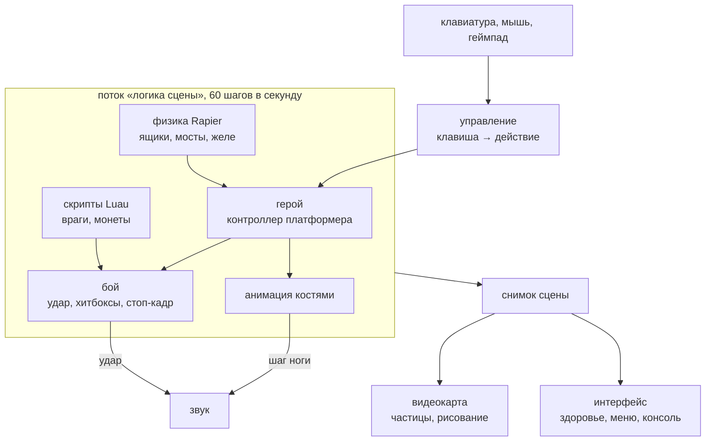

# 6. Игровые системы

[← Оглавление](README.md)

## Суть в двух словах

Это всё, что превращает красивую картинку в **игру**: герой бегает и прыгает, бьёт врагов, ящики падают, искры летят, шаги звучат, а в углу экрана видно здоровье.

Каждая система — отдельный «кирпичик». Большая часть из них — чистые расчёты без видеокарты и окна, поэтому их легко проверять автотестами.

## Схема

## Простыми словами

**🎮 Управление.** Игра никогда не знает про конкретные клавиши. Она знает **действия**: «влево», «прыжок», «удар». А какая клавиша, кнопка мыши или геймпада к действию привязана — решает игрок в меню (Esc → «Управление»). Для меню, игры, консоли и песочницы свои **схемы**, они не мешают друг другу.

**🏃 Герой.** Это не физическое тело, а специальный «контроллер платформера», который движется так, как **удобно игроку**, а не как настоящий ящик. В нём все приёмы, без которых платформер кажется деревянным:
- разгон и торможение (на земле тормозит сильнее, в воздухе управление слабее);
- высота прыжка зависит от длины нажатия;
- «время койота»: прыжок срабатывает, даже если нажал чуть позже, чем сошёл с края;
- нажал прыжок чуть раньше приземления — прыжок случится в момент касания;
- рывок, скольжение по стене и прыжок от неё, склоны, ступеньки, вис на краю.

**⚔️ Бой.** Удар идёт по фазам: замах → удар (только тут хитбокс бьёт) → возврат. При попадании игра на миг замирает (стоп-кадр), камера трясётся, цель вспыхивает. Манекенов отбрасывает, и через время они появляются снова.

**📦 Физика.** Ящики, мосты на шарнирах, маятники, желе, верёвки — это **Rapier**, готовая физическая библиотека. Её копия лежит прямо в репозитории, чтобы обновления не ломали движок внезапно. Посмотреть на всё сразу: полигон физики (N, потом ещё раз N), держи **Q** — тащишь тело мышью, **Y** — взрыв.

**🐞 Скрипты.** Поведение врагов и предметов пишется на маленьком языке **Luau** в отдельных файлах (`scenes/scripts/beetle.luau` — жук, `coin.luau` — монета). Каждый шаг игры движок спрашивает скрипт: «вот где ты и где герой — что делаешь?». Поправил скрипт, сохранил — враг ведёт себя по-новому, игра не перезапускается. Ошибка в скрипте игру не роняет.

**✨ Частицы.** Пыль из-под ног, искры от ударов, фонтан. До 100 000 штук одновременно, и считает их **видеокарта**: процессор только говорит «здесь родились 20 искр».

**🔊 Звук.** Шаги, прыжки, удары **синтезируются** (собираются из формул), а не берутся из файлов. Есть музыка (клавиша O).

**🦴 Анимация костями.** Герой собран из «костей»: тело, голова, руки, ноги, плащ. Позы плавно перетекают друг в друга, а удар накладывается поверх бега: ноги бегут, руки бьют. Шаги совпадают с пройденным путём, поэтому ноги не скользят.

**🖥️ Интерфейс и консоль.** Здоровье, монеты, числа урона над целью, меню паузы. Клавиша **~** (Ё) открывает консоль разработчика: переставить героя, бессмертие, замедлить время, показать столкновения. Команды по-русски, «помощь» покажет список.

**🧩 Интерфейс из файла (новый, И.1).** Экраны игры пишутся в файлах `ui/*.rui` на языке, похожем на SwiftUI: `Column { Text("Меню") }.padding(20).background(#171A21)`. В песочнице **F3** показывает пример `ui/demo.rui` — меню и полоску выносливости. Поправил файл и сохранил — окно сразу показывает новое. Ошибка в файле видна плашкой вверху окна с номером строки. С шага И.2а у экрана есть **темы и стили, как CSS**: сверху файла блок `head` подключает тему (`ui/themes/base.rui`) и стили (`ui/styles/demo.rui`), **F4** меняет тему, **Shift+F3** пишет в консоль (~), откуда взялось каждое свойство. Кнопки пока не нажимаются: это шаг И.2б.

## Технические детали

### Где что лежит

| Система | Файл | Видеокарта нужна? |
| --- | --- | --- |
| Действия и ввод | `crates/reyvec-game/src/input.rs`; привязки и схемы — `crates/reyvec-app/src/controls.rs`, геймпад — `gamepad.rs` (`gilrs`) | нет |
| Контроллер героя | `crates/reyvec-game/src/controller.rs` (`Tuning`: `coyote`, `buffer` и др.) | нет |
| Бой | `crates/reyvec-game/src/combat.rs` (`Fighter`, `Dummy`) | нет |
| Анимация | `crates/reyvec-game/src/anim.rs` (`Bone`, `Pose`, `Clip`) | нет |
| Физика | `crates/reyvec-game/src/physics/` (тела, `joints.rs`, `soft.rs`); копия `third_party/rapier2d` 0.36.1 + `parry2d` 0.31.1 | нет |
| Скрипты | `crates/reyvec-script` (`mlua` + Luau, `Scripts::reload_changed`) | нет |
| Звук | `crates/reyvec-audio` (`synth.rs`, `mixer.rs` поверх `cpal`) | нет |
| Частицы | `crates/reyvec-gpu/src/particles.rs`, `shaders/particles.slang` | да |
| Интерфейс игры (старый) | `crates/reyvec-app/src/game_ui.rs` (egui) | да |
| Интерфейс игры из `.rui` (И.1–И.2а) | язык и раскладка — `crates/reyvec-ui` (`syntax.rs`, `model.rs`, `style.rs`, `lib.rs`); видеокарта — `crates/reyvec-gpu/src/game_ui.rs`, `shaders/game_ui.slang`; песочница — `crates/reyvec-app/src/rui_demo.rs`; пример — `ui/demo.rui`, `ui/themes/base.rui`, `ui/styles/demo.rui` | раскладка нет, рисование да |
| Консоль | `crates/reyvec-app/src/console.rs` | да |

### Ввод

Окно пишет нажатия, поток логики читает их на каждом шаге и не теряет короткие нажатия между шагами. Прицел — курсор в координатах сцены (`SceneLogic::set_aim`); нажатие с мыши запоминает, где был курсор (`press_aimed`). Источники привязываются по месту клавиши, а не по букве. Настройки клавиш сохраняются в файл сразу.

### Скрипт Luau

Функция `update(me, hero, dt)` зовётся 60 раз в секунду для каждого предмета со скриптом.

| В `me` пишет движок | В `me` пишет скрипт |
| --- | --- |
| `x`, `y`, `vx`, `vy`, `on_ground`, `wall`, `hp`, `alive`, `touching`, `time` | `move` (−1…1), `jump`, `hidden`, `collected`, свои поля |

`hero` только для чтения. При ошибке работает прошлая версия скрипта, текст ошибки со строкой — на панели.

### Интерфейс из файла `.rui` (И.1)

Устройство описано в [game-ui.md](../game-ui.md) и решении 0022; здесь — что уже сделано.

- **Разбор.** `syntax::parse` превращает текст в дерево `Node` (имя, аргументы, дети, модификаторы); `model::screen` проверяет имена и значения и строит `Element` с раскладкой (`Placement`) и видом (`Look`). Ошибки — `UiError` с местом «строка N, столбец M», на опечатку в модификаторе — подсказка «Может, .padding?». Состояния (`.hover { … }`) уже разбираются, но до И.2 не действуют; `theme.` и `tr()` дают ошибку «шаг И.2».
- **Стили и темы (И.2а).** `UiScreen::load(папка, файл)` читает экран и файлы из его `head` (`theme("…")`, `styles("…")`, путь от `ui/`); у каждого места в файле есть номер файла (`Pos::file`), поэтому ошибка в стиле называет свой файл. `style::StyleSet` разворачивает вложенные стили в пути селекторов и сопоставляет их с блоком по цепочке предков (корень экрана — по имени экрана). Модификаторы применяются по лестнице: стили вида → класса → вложенные (на ступени — по порядку записи), потом значения в скобках у `Column`/`Row`, потом свои модификаторы блока. `var(имя)` подставляется при сборке: переменные темы считаются один раз (цикл — ошибка), `.var(имя: …)` даёт новую область для блока и всего внутри. `.font` и `.color` у контейнера наследуются текстами. Смена темы (`set_theme`) собирает экраны заново и увеличивает `generation`, по нему видеокарта берёт новый атлас букв. «Откуда взялось» — `Element::origins` и `UiScreen::explain`.
- **Раскладка.** `taffy` 0.15: `Column` и `Row` — flex, `Stack` (и `Rect`) — сетка 1×1, где дети лежат друг на друге. Размеры в файле — пиксели экрана 1920×1080, на другом окне всё умножается на `высота / 1080`. Текст раскладывается один раз (`reyvec-text`), при смене размера окна только масштабируется. Раскладка пересчитывается только при смене размера окна или файла.
- **Рисование.** Список `UiDraw` — прямоугольники `UiQuad` двух видов: блок (заливка, скругление, обводка) и буква (место в атласе MSDF). Видеокарта рисует весь список одной командой (6 вершин на прямоугольник), скругление и сглаженный край считает шейдер по расстоянию до скруглённого прямоугольника. Проход «интерфейс» идёт после обработки кадра, в полном разрешении окна, поверх сцены и под панелями egui. Атлас букв загружается заново только при правке файла.
- **Песочница.** `RuiDemo` проверяет время изменения файла экрана и всех подключённых файлов раз в 0,25 с; если файла нет рядом, берёт пример, вшитый в программу. При ошибке разбора рисуется плашка ошибки, прежний экран ждёт исправления.
- **Проверки.** Разбор, раскладка и упаковка прямоугольников проверяются на процессоре (`cargo test -p reyvec-ui`); кадр с блоком и буквой — в CI на lavapipe (`game_ui_draws_blocks_and_text`).

### Частицы

Кольцевой буфер на видеокарте на 131 072 места (`CAPACITY = 1 << 17`), до 16 384 новых за кадр, до 128 твёрдых прямоугольников и склонов для отскока. Вычислительный шейдер двигает только живой отрезок кольца; видеокарта сама собирает список живых для рисования. `step_particle` — зеркало шейдера на процессоре для тестов.

### Физика

Наши надстройки привязаны к Rapier только через `reyvec-game/physics`; остальной движок Rapier не видит. Разрыв сочленений и мотор-качалка — наши. CCD только у выброшенных тел, обломков и `bullet: true` (полный CCD у всех ронял кубики сквозь полку).

### Замеры этапа 6 (ПК Романа)

| Что | RTX 5080 | Radeon |
| --- | --- | --- |
| Нажатие → кадр | 16,7–16,9 мс | 11,6–13,4 мс |
| Проход «частицы», 100 000 | 0,062 мс | 0,008 мс |
| Фонтан 100 000, вся видеокарта | 0,50 мс | 77 кадров (MSAA 2×) |
| Полигон физики (397 тел, 54 сочленения): физика / логика | 1,08 / 1,2 мс из 16,7 | — |

## Слабые места и планы

- **Нет «одного мира столкновений».** Герой и частицы сталкиваются с простыми прямоугольниками уровня, а не с миром физики. Поэтому изредка частица проходит сквозь поверхность, а герой не видит SDF-объекты. План записан в решении 0016.
- **Пирамида кубиков чуть проседает** (на 3 см за первую секунду) — мягкость касаний Rapier, настройками не лечится.
- **Мягкие тела Rapier** (верёвка, желе, сетка) — самое свежее и наименее проверенное в библиотеке.
- **Схема «Игра» одна на все игры, позы и звуки в коде.** Новая игра требует правки кода. План — описание игры из файла, клипы анимации из файла (вместе с инструментами).
- **Геймпад проверен только тестами** — живого геймпада не было.
- **Интерфейс на egui временный**, будет заменён. Новый ([game-ui.md](../game-ui.md)) пока умеет только показывать экран (И.1): со стилями и темами (И.2а), но без нажатий, состояний, данных игры и перевода — это шаги И.2б–И.4. Формулы пока только с одинаковыми единицами (`var(gap) * 2`), `100% - 32` — позже. Шрифт один, встроенный.
- **Логика сцены собрана в одном большом `world.rs`.** По твоему решению — разбирать позже, вместе со свойствами предметов.

## Связанные решения

- [0012. Звук](../decisions/0012-audio.md)
- [0013. Скрипты](../decisions/0013-scripts.md)
- [0014. Интерфейс игры](../decisions/0014-game-ui-and-controls.md)
- [0015. Управление](../decisions/0015-controls-schemes.md)
- [0016. Физика Rapier](../decisions/0016-physics-rapier-local.md)
- [Итог этапа 6](../stage-6-summary.md)

## Заметки Романа

_Пока пусто._
