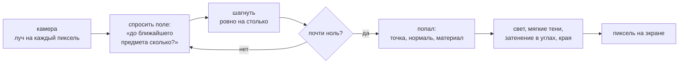

# 7. 3D и вид 2.5D

[← Оглавление](README.md)

## Суть в двух словах

Обычные игры строят 3D-мир из миллионов треугольников. ReyVec умеет и так, но его фирменный способ другой — **реймарчинг**: объёмные предметы описаны **формулами** («шар радиусом 1 м, из него вырезана коробка, углы скруглены»), а картинку получают, пуская лучи из камеры.

Отсюда же **вид 2.5D**: плоский уровень платформера одной клавишей (F2) становится объёмным. Игра при этом та же — те же герой, физика и скрипты, просто мир нарисован в объёме.

## Схема: как луч находит предмет

## Простыми словами

**Как шагает луч.** Представь, что идёшь в тёмной комнате с волшебной палкой, которая говорит «до ближайшей стены 2 метра». Смело шагаешь на 2 метра. Снова спрашиваешь — «0,5 метра». Шагаешь на 0,5. И так, пока не упрёшься. Пустое пространство пролетаешь огромными шагами, а у стены шаги мельчают. Это и есть реймарчинг.

**Формы из данных.** Предметы складываются из кубиков-примитивов: шар, коробка, капсула, цилиндр, тор, плоскость. Их можно объединять (плавно, будто они слиплись), вырезать одно из другого, пересекать. Плоский контур можно выдавить в толщину или провернуть вокруг оси, как на гончарном круге. Всё это пишется в файле сцены, и шейдер пересобирать не нужно.

**Почему это красиво.** Раз форма — формула, у неё **идеальные** скругления и стыки, а мягкие тени и затенение в углах получаются почти бесплатно: луч тени тоже спрашивает «далеко ли до предмета» и сам понимает, насколько густая полутень.

**Почему это дорого.** Каждый шаг каждого луча считает формулы. Пикселей два миллиона, шагов у луча десятки. Поэтому почти весь этап 7 ушёл на **ускорение**:
- 🗺️ **Сетка отсева** — луч спрашивает только о предметах рядом с собой, а не обо всех.
- 👁️ **Только то, что в кадре** — предметы за спиной камеры не считаются (если не бросают тень в кадр).
- 🧊 **Запечённое поле** — расстояния заранее записаны в объёмную «карту» вокруг камеры (как Global Distance Field в Unreal). Тени и углы берут ответ одним взглядом в карту.
- 📄 **Поле слоя** — для 2.5D-уровня: всё неподвижное (стены, мебель, книги) записано в **одну плоскую карту** расстояний. Вместо перебора сотен плит луч смотрит в одну картинку. Это опустило комнату на RTX 5080 с 9,1 до 2,69 мс.

**Без сглаживания по времени.** Многие движки «размазывают» картинку по нескольким кадрам (TAA), чтобы сэкономить. Ты это не любишь, поэтому у нас **каждый кадр честный**: края сглаживаются дополнительными лучами прямо в этом кадре.

**Слабая видеокарта.** Встроенная Radeon рисует 2.5D-уровень **треугольниками** с картами теней — так дешевле. А 3D считает в половину размера и растягивает.

**Где посмотреть:**
- **I** — сцена «3D»: формы, тени, свечение; **X** — сглаживание 3D;
- **N**, затем **F2** — уровень в виде 2.5D; на панели «2.5D рисуется»: поле, треугольники или SDF;
- модели из файлов glTF: `.\run.bat --space-file scenes\3d\models.ron` (станок `models/machine.glb`);
- свои 3D-сцены: `.\run.bat --space-file scenes\3d\mixed.ron` (формы и модели вместе), `vector.ron` (выдавленные векторы), `stress.ron` (200 предметов).

## Технические детали

### Проходы 3D-кадра

| Проход | Что делает |
| --- | --- |
| правка поля уровня | Перепечь куски поля слоя у изменившегося (7.18г) |
| поле | Пересчитать кубики запечённого 3D-поля у сдвинутых предметов и вошедших в слои при полёте камеры |
| лучи 3D грубо | Предварительное шагание конусами: точка на квадрат 8×8 пикселей, даёт старт лучам |
| полигоны 3D | Растеризация моделей с глубиной в тот же буфер геометрии (+ образцы MSAA по числу лучей краёв) |
| реймарчинг | Лучи глаза → буфер геометрии (глубина, нормаль, материал) |
| карты теней ламп | Только в режиме «треугольники»: карты теней от треугольников |
| тени 3D | Мягкие тени и затенение в углах в половинном разрешении (точка на 2×2) |
| края 3D: поиск, края 3D | Найти пиксели краёв, пустить по 4 луча внутри каждого |
| освещение 3D | Свет по буферу геометрии; при уменьшенном разрешении — в свою картинку |

### Формы (`crates/reyvec-sdf`)

| Файл | Что |
| --- | --- |
| `shape3d.rs` | Дерево `Shape3`: `Sphere`, `Box`, `Capsule`, `Cylinder`, `Torus`, `Plane`, `Union`/`Subtract`/`Intersect` (с `smooth`), `Move`, `Paint`, `Extrude`, `Revolve`; `compile` → программа стековой машины (примитив 19 слов, операция 2, глубина стека 8); `Program::distance` — зеркало на процессоре |
| `profile2d.rs` | Контур в записи SVG (метры, y вверх) → сетка расстояний до 64×64 |
| `grid3d.rs` | Сетка отсева: у клетки список объектов ближе `margin` и свободное расстояние `free_mm` |
| `view3d.rs` | Отбор объектов, влияющих на кадр: в пирамиде камеры или бросающих тень в неё |
| `field3d.rs` | Запечённое поле: слои-кольца вокруг камеры, какие кубики пересчитать (`FieldWindow`) |
| `layer_field.rs`, `layer_bake.rs` | Поле слоя 2.5D: минимум полей профилей в полосе B = 1 м, запекание в потоке загрузки |
| `mesh3d.rs` | Полигональные модели и их «заменитель» SDF для теней (`shadow_proxy`, `convex_proxy`) |
| `model3d.rs` | Модели из файлов glTF (8.14): `Mesh3::Model { file, scale }`, узлы со сдвигами и поворотами, цвета материалов файла, нормали вершин (гладкие грани); тени — по заменителю на каждый выпуклый связный кусок (до 32), у невыпуклых пока нет |
| `camera3d.rs`, `space_file.rs` | Камера 3D, файл 3D-сцены |

Видеокарта: `crates/reyvec-gpu/src/level3d.rs`, `field.rs`, `space.rs`; шейдеры `raymarch*.slang`, `field_bake.slang`, `mesh3d.slang`, `mesh_shadow.slang`, общий исполнитель программ `include/sdf3d.slang`.

### Режимы 2.5D

| Режим | Для чего | Неподвижное | Тени |
| --- | --- | --- | --- |
| поле | RTX 5080 | одна карта расстояний слоя + карта цвета | по полю |
| треугольники | встроенная Radeon | треугольники | карты теней ламп с мягкой полутенью |
| SDF | сравнение | сотни отдельных фигур | лучи |

### Итоговые замеры этапа 7 (комната 2.5D, герой у стола)

| Строка панели | RTX 5080, «поле», 100 % | Radeon, «треугольники», 50 %, MSAA 2× |
| --- | --- | --- |
| Вся видеокарта | 2,69 мс | 12,78 мс (77 кадров) |
| реймарчинг | 0,60 | 1,41 |
| тени 3D | 0,83 | 3,13 |
| края 3D (поиск + края) | 0,97 | 3,86 |
| «лучи 3D» вместе (цель 2 мс) | 2,56 | 8,50 |

## Слабые места и планы

- **«Лучи 3D» на RTX 5080 — 2,56 мс при цели 2 мс.** Дороже всего края (0,87) и тени (0,83). Ты решил закрыть этап и перенести ускорение на этап 8.
- **На Radeon поиск краёв стоит 1,43 мс** отдельным проходом. План — искать края там же, где идут лучи (этап 8).
- **Уровни шире 80 м** сделают поле слоя грубее (клетка 2 см вместо 1 см): углы могут чуть скругляться. Таких уровней пока нет.
- **Тени от ламп в 2.5D крупнее, чем в жизни** (тень плиты на стене в 3,7 раза больше плиты), размер лампы не учитывается. Только вид; поправим, если будет мешать.
- **Модели glTF без текстур** (8.14): рисуются цветом материала. Тень бросают только выпуклые куски модели; тень по настоящей форме — «кирпич поля» (8.15).
- **Вершина модели хранит нормаль 10+10 бит** (как буфер геометрии): гладкие грани чуть ступенчаты по яркости на очень крупных плавных поверхностях. Лучи краёв пересекают плоскость по гладкой нормали, а не по грани — ошибка доли пикселя.
- **Слабые полосы в тени шнура лампы на Radeon** — разобрать до этапа 10.
- **Свежего замера сцены на 200 предметов нет** (последний 1,41 мс, 2026-11-06) — первая проверка этапа 8.
- Сознательно отказались: тени с накоплением по кадрам и TAA (твоё решение).

## Связанные решения

- [0002. Сначала 2D, но на 3D-основе](../decisions/0002-2d-first-on-3d.md)
- [0018. Объёмные формы данными](../decisions/0018-sdf-shapes-3d.md)
- [0019. Запечённое поле расстояний](../decisions/0019-baked-distance-field.md)
- [0020. Поле слоя](../decisions/0020-level-field.md)
- [Итог этапа 7](../stage-7-summary.md)

## Заметки Романа

_Пока пусто._
