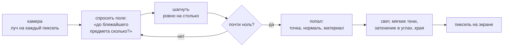

# 7. 3D и вид 2.5D

[← Оглавление](README.md)

## Суть в двух словах

Обычные игры строят 3D-мир из миллионов треугольников. ReyVec умеет и так, но его фирменный способ другой — **реймарчинг**: объёмные предметы описаны **формулами** («шар радиусом 1 м, из него вырезана коробка, углы скруглены»), а картинку получают, пуская лучи из камеры.

Отсюда же **вид 2.5D**: плоский уровень платформера одной клавишей (F2) становится объёмным. Игра при этом та же — те же герой, физика и скрипты, просто мир нарисован в объёме.

## Схема: как луч находит предмет

## Простыми словами

**Как шагает луч.** Представь, что идёшь в тёмной комнате с волшебной палкой, которая говорит «до ближайшей стены 2 метра». Смело шагаешь на 2 метра. Снова спрашиваешь — «0,5 метра». Шагаешь на 0,5. И так, пока не упрёшься. Пустое пространство пролетаешь огромными шагами, а у стены шаги мельчают. Это и есть реймарчинг.

**Формы из данных.** Предметы складываются из кубиков-примитивов: шар, коробка, капсула, цилиндр, тор, плоскость. Их можно объединять (плавно, будто они слиплись), вырезать одно из другого, пересекать. Плоский контур можно выдавить в толщину или провернуть вокруг оси, как на гончарном круге. Всё это пишется в файле сцены, и шейдер пересобирать не нужно.

**Почему это красиво.** Раз форма — формула, у неё **идеальные** скругления и стыки, а мягкие тени и затенение в углах получаются почти бесплатно: луч тени тоже спрашивает «далеко ли до предмета» и сам понимает, насколько густая полутень.

**Почему это дорого.** Каждый шаг каждого луча считает формулы. Пикселей два миллиона, шагов у луча десятки. Поэтому почти весь этап 7 ушёл на **ускорение**:
- 🗺️ **Сетка отсева** — луч спрашивает только о предметах рядом с собой, а не обо всех.
- 👁️ **Только то, что в кадре** — предметы за спиной камеры не считаются (если не бросают тень в кадр).
- 🧊 **Запечённое поле** — расстояния заранее записаны в объёмную «карту» вокруг камеры (как Global Distance Field в Unreal). Тени и углы берут ответ одним взглядом в карту.
- 📄 **Поле слоя** — для 2.5D-уровня: всё неподвижное (стены, мебель, книги) записано в **одну плоскую карту** расстояний. Вместо перебора сотен плит луч смотрит в одну картинку. Это опустило комнату на RTX 5080 с 9,1 до 2,69 мс.

**Без сглаживания по времени.** Многие движки «размазывают» картинку по нескольким кадрам (TAA), чтобы сэкономить. Ты это не любишь, поэтому у нас **каждый кадр честный**: края сглаживаются дополнительными лучами прямо в этом кадре.

**Слабая видеокарта.** Встроенная Radeon рисует 2.5D-уровень **треугольниками** с картами теней — так дешевле. А 3D считает в половину размера и растягивает, и формы сцены «3D» рисует сетками треугольников с картами теней (режим «треугольники» включается на встроенной видеокарте сам).

**Где посмотреть:**
- **I** — сцена «3D»: формы, тени, свечение; **X** — сглаживание 3D;
- на панели справа в «Этап 7: 3D» — кнопка на каждую сцену из папки `scenes/3d` (пример, завод, склад, кузница, эффекты, большой мир, выставка, модели glTF, смесь, нагрузка, векторы в 3D; свои файлы `.ron` из этой папки — по имени). Выбранная сцена открывается сразу и правится на лету, как файл из `--space-file`;
- **N**, затем **F2** — уровень в виде 2.5D; на панели «2.5D рисуется»: поле, треугольники или SDF;
- модели из файлов glTF (кнопка «модели glTF» или `.\run.bat --space-file scenes\3d\models.ron`) (станок `models/machine.glb`);
- свои 3D-сцены: `.\run.bat --space-file scenes\3d\mixed.ron` (формы и модели вместе), `vector.ron` (выдавленные векторы), `stress.ron` (200 предметов).

## Технические детали

### Проходы 3D-кадра

| Проход | Что делает |
| --- | --- |
| правка поля уровня | Перепечь куски поля слоя у изменившегося (7.18г) |
| поле | Пересчитать кубики запечённого 3D-поля у сдвинутых предметов и вошедших в слои при полёте камеры |
| лучи 3D грубо | Предварительное шагание конусами: точка на квадрат 8×8 пикселей, даёт старт лучам |
| лучи 3D средне | Средний уровень конусов (8.10в2): тем же шейдером (`raymarch_cone.slang`, сторона квадрата в `pc.flags`) точка на квадрат 2×2, начинает с длины своего квадрата 8×8. Лучи пикселей и краёв берут старт из него; опыт, по умолчанию выключен (на RTX 5080 проход стоит дороже, чем экономит), включается галочкой «Грубые лучи: средний уровень (опыт)» |
| полигоны 3D | Растеризация моделей с глубиной в тот же буфер геометрии (+ образцы MSAA по числу лучей краёв); при текстурах в кадре ещё картинка «цвет полигонов 3D» (8.14б2). В режиме «треугольники» (8.20б) здесь же рисуются сетки из форм: по вызову на сетку с местами копий (instancing; `firstInstance` ≥ 1, место 0 — модели), номера и вершины — в своём буфере на видеокарте, места — в разделе моделей сцены (`MESH_SHAPES`, по 12 чисел). Формы с сетками уходят из лучей глаза в заменители: тени и углы пока по ним. Нормаль точки сетки «реймарчинг» берёт по наклону самих форм (тот же `normal_at` в `march.slang`, с заменителями; плоскости `normal_at` не считает никогда, R5г: у стыка формы с полом наклон смотрел бы вдоль пола — вызов один, чтобы шейдер не рос), если точка лежит на форме ближе 6 мм и наклон сходится с гранью; точки моделей остаются со своей нормалью |
| реймарчинг | Лучи глаза → буфер геометрии (глубина, нормаль, материал) |
| карты теней ламп | Только в режиме «треугольники»: карты теней от треугольников. Квадраты по 1024 точки рядом: сначала лампы (2.5D — смотрят вдоль −Z; 3D, 8.20в2 — смотрят вниз с углом 140°, `lamp_down_view_proj`, флаг `SCENE_LAMP_MAPS_DOWN`: шейдер поворачивает нормаль и точку в оси вида лампы, внутри карты тень лампы только по ней, а `mesh_shadow.slang` не рисует ничего ближе `LAMP_SHADOW_GAP` = 35 см к лампе — иначе её шарик-лампочка закрыл бы всю карту), за ними солнце (3D, 8.20в1: две карты — ближний кусок взгляда до 16 м и дальний до 80 м, `SUN_SPLITS`; прямоугольная проекция вдоль солнца на шар вокруг куска, `sun_view_proj` в `space.rs`; рисуются модели и сетки форм, видимые солнцу). Экземпляр в `mesh_shadow.slang`: квадрат — с 20-го бита, место сетки — ниже. «Тени 3D» берут солнце из ближней карты, а где точки на ней нет — из дальней (`map_shadow` в `shadow3d.slang`, одна для ламп и солнца: поиск заслоняющих, полутень по их глубине, 25 проб со сравнением по плоскости точки; с 8.20и при узкой полутени до 4 точек карты — 9 проб, а если заслонена вся округа поиска — сразу тень без проб), вне — лучами |
| тени 3D | Мягкие тени и затенение в углах в половинном разрешении (точка на 2×2). Затенение в углах — 11 проб около точки; где запечённое поле говорит, что проба свободна, формы не считаются. Дальние пробы берут само число поля («углы из поля», бит 0 слова 11), в режиме «треугольники» (8.20г, `SCENE_AO_FIELD_ONLY`) — и ближняя, так что внутри поля программы форм для углов не считаются совсем |
| тени 3D: прошлый кадр, тени 3D: запомнить | Только с флажком «Тени из прошлого кадра, пока камера стоит (опыт)» (Р3, `shadow_reuse.rs`): прошлая картинка теней хранится вне графа; если камера, настройки и неподвижное те же, кадр начинается с её копии, а «тени 3D» (без очистки) пропускают квадраты 8×8, которые не могли измениться (раздел изменившихся квадратов, слово `MESH_DIRTY` раздела моделей; какие — `space::dirty_tiles`). После «теней 3D» кадр копирует свои тени в прошлую картинку |
| фильтр: обычные ядра, фильтр: тензорные ядра | Только с флажком «Замер фильтра на тензорных ядрах (опыт)» (Р4, `tensor_bench.rs`, `filter_plain.slang`, `filter_tensor.slang`): одно и то же размытие шума выбранного размера по строкам и по столбцам в буферах замера, обычными ядрами и умножением матриц half 16×16 (8×8 там, где видеокарта умеет только такие). Картинку кадра не трогают; нужны только ради времени в списке проходов |
| кэш солнца | Только с флажком «Кэш солнца неподвижного (опыт)» (Р2, `sun_cache.rs`, `sun_bake.slang`, `sun_envelope.slang`): пока карта не готова, печёт несколько квадратов глубины карты солнца по отдельной сцене из одних неподвижных предметов (луч сверху вдоль −SUN до первой формы, глубина −dot(p, SUN)) в буфер на всю карту и копирует их в левую половину картинки R32F; когда глубина готова — проходы «запаса» (на сколько точка может быть ниже соседей, чтобы их полутень её не задела) в правую половину. Готовую карту «тени 3D» и «края 3D» читают через `sun_static_known` (бит `SCENE_SUN_STATIC` слова 11): «точно свет от неподвижного» — живой луч пропускает неподвижные предметы (`OBJECT_STILL`, `g_skip_still` в `space.slang`), «точно тень» — без луча, иначе — живой луч по всем, как без кэша |
| коробки RT | Только с флажком «Тени через RT-ядра (опыт)» (Р1, `rt.rs`): из коробок предметов в конце слов сцены (раздел RT, начало — слово `MESH_RAY` раздела моделей) строятся три нижних дерева ray query (коробки раздуты на 0,1 / 0,5 / 3 м — ширину полутени своего отрезка луча) и верхнее с тремя экземплярами (маски 1, 2, 4). Тогда «тени 3D» берут вариант `raymarch_shadow_rt`: луч тени (`soft_shadow_rt` в `shadow3d.slang`) на каждом отрезке спрашивает дерево и шагает только по формам предметов, чьи коробки пересёк, полутень — минимум по предметам; плоскости — формулой. Есть только у видеокарт с ray query |
| отражения 3D | Только если в кадре есть блестящий материал (`shine` больше 0) и включён флажок «Отражения 3D» (Л1, `raymarch_reflect.slang`): из каждой блестящей точки буфера геометрии луч идёт по зеркальному направлению и шагает по той же сцене (без конусов, плоскости формулой, до 80 м). Точку попадания освещает тот же `shade_surface` (`include/shade3d.slang`), что и обычные: солнце и две первые лампы с тенями (`shadow_part`), без затенения в углах, без отражения в отражении. Результат — картинка «отражения 3D» (RGBA16F, размер буфера геометрии); её номер плюс 1 лежит в старших 16 битах поля `shadows` констант у «краёв 3D» и «освещения 3D» (`reflect_slot`), и они смешивают цвет поверхности с отражением по доле Френеля (`reflect_share`) |
| отражения 3D: размытие | Только если в кадре есть блестящий шероховатый материал (`rough` больше 0) и включён флажок «Размытые отражения 3D» (Л2, `raymarch_reflect_blur.slang`): у шероховатых «отражения 3D» пускают луч только в левом верхнем пикселе квадрата 2×2 (флаг `REFLECT_FLAG_ROUGH`), а эти два прохода (по строке, потом по столбцу) размывают картинку отражений с оглядкой на края — тот же материал, та же плоскость, та же сторона; ширина — пятно конуса отражения на экране (до 24 пикселей). Освещение берёт размытую картинку |
| эталон 3D | Только с флажком «Эталон 3D: трассировка путей» (путь ReSTIR, R1, `raymarch_path.slang`): вместо всех проходов выше — один, по пути света на пиксель (до 4 отскоков) из случайной точки пикселя. Сумма путей копится в буфере вне графа (`path_ref.rs`), пока стоят камера, размер и сцена; в картинку пишется среднее, её растягивает «вывод» или «сцена». Время сцены на это время замирает |
| свечение 3D | Только с флажком «Свечение и мягкие пересветы» (B, включён по умолчанию; 8.16а): освещённый кадр 3D идёт не сразу в окно, а в картинку «цвет 3D»; из неё те же проходы свечения, что у 2D (`bloom_down.slang` в режиме 2 — свет уже в кадре, потом `bloom_up.slang`), собирают ореол ярких мест. Проход вывода (`raymarch_upscale.slang`, флаг `UPSCALE_FLAG_GLOW`, номер картинки свечения в поле `cone`) прибавляет ореол и мягко сводит всё, что ярче белого, к белому (`include/tonemap.slang`, общий с `present.slang`). Памяти о прошлых кадрах нет |
| путь 3D | Только с флажком «Качество 3D: трассировка путей» (путь ReSTIR, R2): сразу после «реймарчинга» тот же шейдер `raymarch_path.slang` с битом `PATH_LIVE` берёт первую точку из буфера геометрии и пускает от неё один путь света на пиксель, без накопления. Тени, отражения, края и освещение быстрого режима в этом режиме не идут; картинку растягивает «вывод» или «сцена» |
| ReSTIR: кандидаты | В режиме «качество» с флажком «ReSTIR DI» (R3, `raymarch_restir.slang`), перед «путём 3D»: у каждого пикселя — запас одной точки света (`include/restir.slang`): 32 случайные точки ламп по «сколько света дала бы без тени» и запас этого же места в прошлом кадре (матрица камеры прошлого кадра — в разделе моделей слов сцены, `set_prev_view_proj`). «Путь 3D» добавляет запасы соседей и пускает один луч тени к выбранной точке; итог — в буфер запасов для следующего кадра |
| ReSTIR GI: соседи | В режиме «качество» с флажком «ReSTIR GI» (R4, `raymarch_restir.slang` с битом `RESTIR_GI_NEIGHBORS`, `include/restir_gi.slang`), после «пути 3D»: «путь 3D» от первой точки ведёт отдельный рассеянный путь и кладёт найденную им точку со светом (кандидат) вместе с запасом этого места из прошлого кадра в буфер запасов; этот проход берёт запасы 3 соседей, проверяет выбранную точку лучом видимости и добавляет её свет к свету пути. Свет при этом всегда разделён (как для шумодава), картинку собирает «шумодав: сборка» |
| кэш света: сводка | В режиме «качество» с флажком «Кэш света» (R5б, `raymarch_restir.slang` с битом `CACHE_RESOLVE`, `include/light_cache.slang`), до «пути 3D»: по потоку на ячейку таблицы кэша — свет, добавленный учебными путями прошлого кадра, сводится в среднее по 32 кадрам; ячейки, не тронутые 120 кадров, освобождаются; новый буфер или другой размер кадра — таблица стирается. «Путь 3D» в точке отскока берёт свет клетки и обрывается, учебные квадраты 8×8 ведут путь целиком и наполняют клетки |
| шумодав: время, размытие, сборка | В режиме «качество» с флажком «Шумодав» (R5, `raymarch_denoise.slang`), после «пути 3D»: память света по месту (буфер, до 24 кадров) и разброс шума, потом 4 прохода размытия SVGF с оглядкой на края и шум, потом умножение на цвет первой точки и дымка. Чистится только свет; края, сетка пола и текстуры остаются резкими |
| края 3D: поиск, края 3D: тени, края 3D | Найти пиксели краёв, посчитать ненадёжным из них свои точные тени (отдельным проходом: сначала список нужных долей света на весь кадр, потом лучи по нему без пустых мест, 8.22, 8.25), пустить по 4 луча внутри каждого (доп. лучи начинают чуть ближе ближайшей точки соседних пикселей, 8.23). Со «Счётчиками лучей 3D» поиск (`raymarch_edge_find_counted`) ещё считает края по причине — модели, небо, материал, нормаль, глубина — и сколько из них почти не видно глазом (цвет по обе стороны после перевода в экран отличается до 2 или 8 ступеней из 255); раздел «Лучи 3D (счётчики)» на панели, `EdgeCounts` в `counters.rs` (8.11а). Список краёв из четырёх частей: ненадёжные и надёжные (свои лучи тени или нет), с четырьмя и с двумя лучами; раскладка в `include/edges.slang`. Два луча — при уменьшенном разрешении или с опытом «Края: два луча вдали», где пиксель накрывает больше 4 см сцены при высоте кадра 1080 (`EDGE_FAR_METERS`, 8.11б) |
| сглаживание 3D | Вместо двух проходов краёв, если включено «Сглаживание 3D по картинке» (8.12а, для слабых видеокарт): освещение всегда красит «цвет 3D», а этот проход (`raymarch_post_aa.slang`) смягчает ступеньки по перепаду яркости в той же картинке, одним кадром. Дальше «вывод» или «сцена» растягивают её, как при уменьшенном разрешении. С опытом «Края: вдали по картинке» (8.10в1) идёт и вместе с лучами краёв: поиск краёв не кладёт в список дальние края (пиксель накрывает больше `EDGE_FAR_METERS`), а этот проход получает порог в `pc.flags` и смягчает только их |
| освещение 3D | Свет по буферу геометрии; при уменьшенном разрешении — в свою картинку |

### Формы (`crates/reyvec-sdf`)

| Файл | Что |
| --- | --- |
| `shape3d.rs` | Дерево `Shape3`: `Sphere`, `Box`, `Capsule`, `Cylinder`, `Torus`, `Cone` (М.0б), `Plane`, `Mirror` и `Repeat` (М.0б: сборка программы пишет копии частей, зеркальная — с отражённой матрицей), `Union`/`Subtract`/`Intersect` (с `smooth`), `Move`, `Paint`, `Extrude`, `Revolve`; `compile` → программа стековой машины (примитив 19 слов, операция 2, глубина стека 8); граница части (М.1, `op::SKIP`, 6 слов) перед частью объединения из нескольких примитивов: точка дальше от её шара, чем уже найденный итог (плюс шов), — вместо части на стек кладётся расстояние до шара, слова части пропускаются (`union_slots`: у жёстких объединений часть сравнивается с итогами всех объединений снаружи, у плавных — только со своим; флажок `PART_BOUNDS`, `compile_with`); `Program::distance` — зеркало на процессоре, `distance_counted` ещё считает примитивы |
| `profile2d.rs` | Контур в записи SVG (метры, y вверх) → сетка расстояний до 64×64 |
| `grid3d.rs` | Сетка отсева: у клетки список объектов ближе `margin` и свободное расстояние `free_mm`. С 8.8а объекты раскладываются по плотным коробкам (`Program::bounds_box`, пересечение коробки формы и коробки её шара), а не по шарам-границам, и клеток бывает до 131 072 (по шарам — до 32 768, `GridOptions { boxes: false }`, флажок «Сетка отсева по коробкам» на панели). Свободное расстояние клетки с 8.8а считается только до объектов не из её списка (их шаг считает точно): у клетки рядом с предметом оценка больше не падает почти до нуля, углы в открытых местах не темнеют. Объектов в кадре не больше 4096 (`MAX_OBJECTS`, было 1024 до сцены завода 8.7). С 8.8б `Grid::build_cached` с `GridCache`: клетки и свободные расстояния неподвижных объектов (`Program::still`, из `SpaceFrame::still`) хранятся между кадрами и пересчитываются только при смене сетки (начало, клетка, размеры) или набора неподвижных; каждый кадр к ним добавляются только движущиеся. Отсев по взгляду сдвигает номера объектов — кеш сопоставляет их заново (`relocate`) С 8.10б поверх тесной части сцены строится вторая, мелкая сетка (`Grid::fine`): в большом мире клетку крупной сетки растягивают холмы и небо, и у земли в её списках по 10–25 предметов; точка внутри коробки мелкой сетки берёт клетку из неё (слово 19 заголовка сетки — где её заголовок) С 8.10б2 `GridCache` хранит готовые списки клеток неподвижных предметов (`base_cells`): каждый кадр к ним дописываются только движущиеся, а буферы сетки и слов сцены возвращаются в кэш (`recycle`). Программы форм держит `ProgramCache` в `reyvec-gpu/src/space.rs`: собирается только то, чего в нём нет. |
| `view3d.rs` | Отбор объектов, влияющих на кадр: в пирамиде камеры, бросающих тень в неё или видимых в отражении (8.19в: в кадре есть блестящий предмет и объект не дальше луча отражения от него; у блестящего пола — отражение объекта в плоскости попадает в кадр) |
| `field3d.rs` | Запечённое поле: слои-кольца вокруг камеры, какие кубики пересчитать (`FieldWindow`) |
| `layer_field.rs`, `layer_bake.rs` | Поле слоя 2.5D: минимум полей профилей в полосе B = 1 м, запекание в потоке загрузки |
| `mesh3d.rs` | Полигональные модели и их «заменитель» SDF для теней (`shadow_proxy`, `convex_proxy`) |
| `model3d.rs` | Модели из файлов glTF (8.14): `Mesh3::Model { file, scale }`, узлы со сдвигами и поворотами, цвета материалов файла, нормали вершин (гладкие грани), текстура цвета с уменьшенными копиями (8.14б2); прежние заменители из плоскостей — по одному на выпуклый связный кусок (до 32), теперь только для сравнения |
| `brick3d.rs` | «Кирпич поля» (8.15): расстояние до модели, запечённое один раз в сетку до 64 точек по стороне (запас 5 клеток, точное расстояние в полосе 4 клеток, знак — по чётности пересечений столбика с каждым замкнутым куском). Примитив `Shape3::Brick` (вид 9, 8 слов данных); картинка R16F «слои Z друг под другом», в шейдере два сглаженных чтения. Заменитель на клетку внутри модели. Один кирпич на модель (и на размер), их грузит `Demo::sync_space_bricks` до сборки кадра |
| `clay.rs` | Глина (М.9): деталь `Clay(file: "кузница/заготовка.clay")` — кирпич поля из своего файла (`RVCLAY01`, угол, клетка, размеры, числа half float) без отступа внутрь, поэтому видна глазом, а не только в тенях. `Resolver` читает файл один раз и ставит `Shape3::Brick`; кирпичи глины попадают в `SpaceScene::bricks` первыми, видеокарта грузит их, как кирпичи моделей. `Brick::from_shape` печёт любую форму в сетку до 64 точек по стороне, `Brick::brush` — кисти «добавить» и «вдавить» (плавное слияние и вырез шаром, утопленным в поверхность на долю радиуса) и «сгладить» (к среднему соседей). После мазка числа вокруг прижимаются к поверхности так, чтобы соседние отличались не больше чем на клетку: луч не проскочит. Пример — заготовка в `forge.ron` |
| `shape_mesh.rs` | Сетка из формы (8.20а, режим «треугольники» для 3D): двойной контур (dual contouring) по сетке выборок `Program::distance` — вершина в каждой клетке со сменой знака (точка QEF по касательным плоскостям в пересечениях рёбер, поэтому углы коробок острые), четырёхугольник на каждом ребре со сменой знака; нормаль вершины — градиент поля, материал — ближайшей части; вершина двумя шагами ставится на поверхность (иначе скруглённые рёбра выходят острыми), обход четырёхугольника — по номерам клеток. Клетка до 2,5 см, не меньше 24 клеток на длинную сторону, не больше 2 млн узлов на форму. `split_rigid` снимает с формы внешние `Move`, `MeshCache` хранит одну сетку на одинаковую программу. Потом `mesh_simplify.rs` (8.20а2) упрощает: слияние вершин по кратчайшим рёбрам, пока поверхность не дальше 4 мм от формы (`MeshSettings::max_error`, проверка по SDF в семи точках треугольника и по наклону поля внутри него — не больше 20°), и нормали по углам с делением вершин на острых рёбрах. `Demo` строит сетки сцены из файла в фоновом потоке «сетки 3D», только когда включён режим «треугольники» (8.20в1: без него секунды работы всех ядер уходили впустую, а в CI отладочная сборка этим душила lavapipe) и пишет итог в журнал и на панель; рисует их режим «треугольники» (8.20б) |
| `camera3d.rs`, `space_file.rs` | Камера 3D, файл 3D-сцены |
| `shape_model.rs` | Модели форм (М.0): файл `models/<имя>.shape.ron` (формат `reyvec-shape`: свои материалы и дерево `Shape3`), ссылка `Shape3::Use { model }` в сцене. `Resolver` при чтении сцены раскрывает ссылки в деревья (каждый файл читается один раз), дописывает материалы модели к материалам сцены под именами «модель/материал» и сдвигает номера в `Paint`; круги и вложенность глубже 8 — ошибка. Нераскрытая `Use` не собирается в программу (`CompileError::Unresolved`). Прочитанные файлы — `SpaceScene::model_files`, сохранение `.shape.ron` перечитывает сцену |
| `shape_param.rs` | Ручки моделей (М.6): в файле модели `params: [(name, value, min, max, links: [(part, field, per)])]`, в сцене `Use(model: "завод/конвейер", params: {"длина": 2.4})`. `Resolver` берёт копию дерева модели и сдвигает каждое связанное число на `per · (значение − value)` (значение прижимается к `min..max`), до раскрытия вложенных моделей; копии с одинаковыми ручками раскрываются один раз. `part` — путь деталей как в «Иерархии» редактора (сдвиг `Move` и цвет `Paint` вокруг детали — поля самой детали: `at.x`, `turn.y`, `scale`; нет сдвига — добавляется). Числа: размеры примитивов, `smooth`, `count` и `step` повтора. `check` при чтении модели проверяет имена, пределы и что каждая связь находит своё число; шейдер про ручки не знает |

Видеокарта: `crates/reyvec-gpu/src/level3d.rs`, `field.rs`, `space.rs`; шейдеры `raymarch*.slang`, `field_bake.slang`, `mesh3d.slang`, `mesh_shadow.slang`, общий исполнитель программ `include/sdf3d.slang`.

### Режимы 2.5D

| Режим | Для чего | Неподвижное | Тени |
| --- | --- | --- | --- |
| поле | RTX 5080 | одна карта расстояний слоя + карта цвета | по полю |
| треугольники | встроенная Radeon | треугольники | карты теней ламп с мягкой полутенью |
| SDF | сравнение | сотни отдельных фигур | лучи |

### Итоговые замеры этапа 7 (комната 2.5D, герой у стола)

| Строка панели | RTX 5080, «поле», 100 % | Radeon, «треугольники», 50 %, MSAA 2× |
| --- | --- | --- |
| Вся видеокарта | 2,69 мс | 12,78 мс (77 кадров) |
| реймарчинг | 0,60 | 1,41 |
| тени 3D | 0,83 | 3,13 |
| края 3D (поиск + края) | 0,97 | 3,86 |
| «лучи 3D» вместе (цель 2 мс) | 2,56 | 8,50 |

## Слабые места и планы

- **«Лучи 3D» на RTX 5080 — 2,56 мс при цели 2 мс.** Дороже всего края (0,87) и тени (0,83). Ты решил закрыть этап и перенести ускорение на этап 8.
- **На Radeon поиск краёв стоит 1,43 мс** отдельным проходом. План — искать края там же, где идут лучи (этап 8).
- **Уровни шире 80 м** сделают поле слоя грубее (клетка 2 см вместо 1 см): углы могут чуть скругляться. Таких уровней пока нет.
- **Тени от ламп в 2.5D крупнее, чем в жизни** (тень плиты на стене в 3,7 раза больше плиты), размер лампы не учитывается. Только вид; поправим, если будет мешать.
- **Модели glTF: только текстура цвета** (8.14б2): карты нормалей, шероховатости и прозрачность (альфа) не читаются; у модели с своим `material` текстура не рисуется. Текстура берётся без анизотропной фильтрации: на полу под острым углом она мылится раньше, чем могла бы. Тень моделей — от «кирпича поля» (8.15): тонкие детали тоньше двух клеток сетки (у станка клетка около 3 см) тени почти не дают, острые рёбра в тени чуть скруглены. У незамкнутых кусков модели (с дырой в поверхности) тени нет — о них пишет журнал. Кирпич печётся на процессоре при чтении сцены: модель в 16 тыс. граней — доли секунды при открытии.
- **Вершина модели хранит нормаль 10+10 бит** (как буфер геометрии): гладкие грани чуть ступенчаты по яркости на очень крупных плавных поверхностях. Лучи краёв пересекают плоскость по гладкой нормали, а не по грани — ошибка доли пикселя.
- **Сцена завода на 1000+ объектов (8.7, `scenes/3d/factory.ron`).** Замер на ПК до 8.8: 5080 — 21.9 мс кадр (края 13.6), Radeon — 489 мс. Причина — сетка по шарам: у 60-метровой стены шар радиусом 30 м, сетка растягивалась на 120 м вверх и вширь, клетка росла до 3.3 м, а в списке клетки было до 63 объектов. 8.8а: по коробкам клетка 0.69 м, список не длиннее 9. Подготовка на процессоре по коробкам выросла до 3.0–3.3 мс (бюджет 1 мс). 8.8б: неподвижное (сетка, грани моделей, программы форм в `space::PackCache`) больше не пересобирается каждый кадр, в контейнере ~3.5 → ~2.7 мс; остальное — сетка для 308 движущихся и упаковка граней, дальше 8.9 (неподвижное в поле). Внутри списка объект по-прежнему отсеивается шаром, а не коробкой.
- **Слабые полосы в тени шнура лампы на Radeon** — разобрать до этапа 10.
- **Свежего замера сцены на 200 предметов нет** (последний 1,41 мс, 2026-11-06) — первая проверка этапа 8.
- **Края 3D дороже всего на доп. лучах и точных тенях** (замер 8.1: 5080 — 0,40 и 0,22 мс, Radeon — 0,95 и 1,07 мс). 8.2а: на складках (две плоскости) доп. лучи не шагают по сцене, а пересекают плоскости; переключатель «Края: складки без доп. лучей». 8.2б: свои лучи тени у края пускаются только для того света, у которого рядом в картинке теней есть граница тени; переключатель «Края: точные тени только у границы тени». Слабое место: если тонкую освещённую перемычку картинка теней не видит вовсе, а вокруг ровная тень, проверка «есть точка своей поверхности» отправит её на точный расчёт; но если своя точка нашлась, а граница тени уже двух пикселей, её можно не заметить.
- **Режим «треугольники» (8.20б).** По умолчанию включён только на встроенной видеокарте (`space_triangles_for_adapter`, 8.20д), переключается на панели; пока сетки строятся в фоне, кадр рисуется лучами. Формы, части которых движутся друг относительно друга (`Animate` внутри объединения, вычитания или пересечения — например, слизь в примере сцены), сетки не получают и остаются лучам (`Shape3::morphs`, `SpaceScene::morphing`, 8.20е): сетка строится один раз и за ними бы не успевала. Движение целиком (`bob`, `circle`, `spin`) сетке не мешает — едет её место. Детали тоньше клетки (2,5 см) могут пропасть. На заводе 10,9 тыс. разных треугольников и 0,24 млн в кадре; постройка — около 6 с в фоне на 4 ядрах, дольше всего ровные стены (сначала режутся мелко, потом сливаются). Сетка отходит от формы до 4 мм: силуэты сдвигаются на пиксель, на силуэтах цилиндров вблизи видны грани; свет гладкий (по наклону формы). Тени солнца до 80 м вдоль взгляда — по двум картам теней из сеток (8.20в1), дальше — лучами; тени двух первых ламп — по их картам (8.20в2), вне карт — лучами; затенение в углах — по запечённому полю (8.20г; в узких щелях тоньше 3 см чуть грубее, чем по формам). Форма без сетки внутри карты тени солнца не отбрасывает (на заводе это только пол). Точка проверки по карте солнца и ламп поднимается над поверхностью по нормали на 1,5 точки карты, `MAP_NORMAL_OFFSET` в `shadow3d.slang` (8.20з): без этого плоские грани сетки в карте могли затенять сами себя. Нормаль точки сетки переворачивается к камере, только если она с изнанки треугольника (`mesh_point` в `mesh3d.slang`, 8.20к): прежнее сравнение с лучом переворачивало внутрь нормали граней, видных вскользь, — чёрные клинья на ящиках вблизи.
- **Границы частей внутри моделей (М.1)** — только шаром: у длинной тонкой части (балка, раскос) шар большой, и её не пропускают даже там, где до неё далеко. Часть из одного примитива границы не получает (проверка стоила бы столько же, сколько сам примитив). Первую часть плавного объединения не пропустить никогда. Выигрыш на видеокарте ещё не замерен — склад `scenes/3d/warehouse.ron` и флажок «Границы частей внутри моделей» для замера на 5080 и Radeon.
- **Детали тяжёлых моделей — отдельные предметы.** Склад на 5080 был медленным (Роман, 2026-11-24: кадр 60,7 мс): стеллаж из 59 деталей был одним предметом, сетка отсева не могла отбросить ни одну его деталь, и каждый шаг считал около 22 деталей даже с границами частей. Теперь при сборке сцены модель, у которой жёсткое объединение (без плавного шва), зеркало или повтор дают от 8 до 256 деталей, делится на детали-предметы (`shape3d::compile_parts`), и сетка знает каждую деталь отдельно. Склад: 9 → 473 предмета, примитивов на расчёт сцены 22,6 → 6,4 (lavapipe), но предметов, которые шаг проверяет по списку клетки, стало около 17 вместо 1,4 — какая доля выигрыша останется на 5080, покажет замер. Завод не меняется (там нет таких моделей). Плавно сшитые детали не делятся: шов между ними считается только внутри одной программы. Если с делением предметов больше предела сцены, сцена собирается по-старому. Картинка та же, кроме отдельных точек на стыках деталей (луч останавливается в другой точке в пределах точности попадания). Флажок «Детали моделей — отдельные предметы» (по умолчанию включён) — для сравнения. Замер на 5080: склад 60,7 → 9,7 мс.
- **Коробки предметов в шаге луча (М.1в).** Шаг считает предмет, только если точка ближе к нему, чем к уже найденному, — проверка была по шару вокруг предмета, и у длинной доски шар почти на весь стеллаж. Теперь ещё и по коробке вокруг той же середины (слово 3 записи предмета, полуширины с округлением вверх: коробка чуть больше настоящей, никогда не меньше). На складе (lavapipe) форм на расчёт сцены в 3 раза меньше. Слабое место: коробка стоит по осям мира — у наклонной балки она шире самой балки.
- **Резкие отражения (Л1).** Один отскок: в зеркале зеркало видно матовым. Модели из треугольников (полигоны, сетки режима «треугольники») в отражениях не видны — их нет в поле сцены; это закроет Л5. Луч края, попавший на блестящее, берёт отражение середины пикселя (если и середина блестящая): на краях зеркальных предметов отражение чуть мягче, чем могло бы. Пол с сеткой в отражении берёт ширину линий по длине всего пути луча, на кривых зеркалах линии могут чуть рябить. Размытые отражения (Л2) — размытие резкого отражения по картинке, а не конус лучей: на тонких шероховатых предметах (тор) отражение может выйти мягче, чем должно, а там, где соседних точек того же материала нет, — без отражения. Цена — луч и до трёх лучей тени на каждую блестящую точку; замер на 5080 — сцена «зеркала».
- **Эталон 3D (R1).** Медленный и шумный по замыслу: чистая картинка — после сотен кадров неподвижной камеры. Модели из треугольников не видит (их нет в поле сцены). Свет ламп считается лучом к каждой лампе: в сцене с сотнями ламп кадр очень дорог — это закроет ReSTIR DI. Свечение лампочки (BULB_GLOW) немного учитывается дважды: как свет лампы и как светящийся шарик.
- **Большой мир (8.10а, `scenes/3d/world.ron`).** Дымка задаётся в файле сцены полем `haze` (метры; на этом расстоянии даль уходит в цвет неба на 63 %, без поля — 63 м, как в комнатах). Сетка отсева на городе в 400 м держит клетку 11 м: расчётов форм на шаг мало, но проверок коробок — около 11 на расчёт сцены. Упаковка кадра на процессоре — 5 мс на 1900 предметов (бюджет 1 мс): списки сетки и слова сцены собираются каждый кадр целиком. Вещи тоньше пикселя вдали (фонари, столбы) могут мигать при движении камеры.

- **Свечение 3D (8.16а).** Светящийся материал светится сам, но соседние предметы в быстром режиме не освещает: рядом ставят лампу того же цвета (как в сцене «эффекты»). Ореол — размытие кадра: яркое за краем экрана ореола не даёт, а ореол не знает о глубине (ложится и поверх того, что ближе светящегося). Тонкие светящиеся вещи в размытом отражении (один луч на квадрат 2×2) при малом размере кадра дают полоски.

- **Режим «качество» (R2).** Пока без шумодава и переиспользования — картинка шумит, особенно у ламп, в отражениях пола и в тенях. Края берутся из буфера геометрии одним лучом на пиксель (лучей краёв быстрого режима здесь нет), нормаль — из буфера геометрии (10 бит на ось), поэтому на кривых чуть грубее эталона.
- **ReSTIR DI (R3).** «Простой» (biased) ReSTIR: соседи и прошлый кадр берутся без точных поправок, только если поверхность почти та же; вдали и у краёв теней возможны лёгкое потемнение и пятна. Шумный кадр при выводе кажется темнее (яркие точки обрезаются). Отражённый свет (отскоки) пока выбирает свет без переиспользования — его шум уберут ReSTIR GI и шумодав. Буфер запасов — 64 байта на пиксель (133 МБ при 1920×1080).
- **ReSTIR GI (R4).** Тоже «простой» (biased): точки соседей и прошлого кадра берутся с поправкой на угол и расстояние, но слишком большая поправка (больше 3 раз) отбрасывается, а свет кандидата обрезается до 4 — у самых ярких мест (возле ламп) отражённый свет чуть слабее эталона. Свет точки x_s считается как от матовой поверхности (блеск в ней не учитывается направленно). С R5д и зеркала делят первую точку так же: зеркальная доля — своим путём всегда, рассеянная — через запас GI (раньше у зеркал рассеянный путь выбирался случайно, и на шаре в отражении блестели «блёстки»). На блестящих поверхностях путей два — отражённый и рассеянный, кадр там дороже. Запасы — ещё 88 байт на пиксель (183 МБ при 1920×1080).
- **Кэш солнца в пути (R5е).** Путь берёт ту же карту неподвижного, что «тени 3D»: точку, которую карта считает в полной тени неподвижного, он не проверяет лучом. Карта знает это по четырём ближним точкам, а солнце в пути — диск: у самого края тени отдельные точки могут выйти темнее эталона (в сцене «зеркала» 89 точек из 19 200). Без флажка «Кэш солнца» лучи к солнцу идут, как раньше.
- **Кэш света (R5б).** Свет в клетке — среднее по направлениям: блеск в точке отскока учитывается как от матовой поверхности, а свет внутри клетки (до 10 пикселей экрана) один — у тонких щелей и углов возможны пятна. Свет меняется — кэш догоняет за десятки кадров (среднее по 32 кадрам). Клетки без учёбы недостаточно — путь идёт дальше как без кэша. Таблица — ещё 64 МБ.
- **Отскок GI у 1 пикселя из 4 (R5в).** Новый отражённый свет пиксель находит раз в 4 кадра, остальное — из своего прошлого и у соседей: после резкого поворота камеры или у только что открывшихся мест отражённый свет первые кадры шумнее, восьмой кадр шумодава в сцене «зеркала» отличается от эталона на 5,0 вместо 4,5.
- **Шумодав (R5).** Память света даёт «хвост» при быстром изменении света и после движения камеры (первые кадры на открывшемся месте шумные и размываются сильнее). Размытие может смазать мелкие пятна света (круги ламп на потолке) и полутени; на кривых поверхностях при малом разрешении видны полосы. Отражения в зеркалах не размываются; пока камера движется, зеркала помнят только 4 кадра (отражение едет вместе с камерой), а когда камера стоит — столько же, сколько остальное (R5д), и шум в отражении тает за доли секунды. Память — 80 байт на пиксель (166 МБ при 1920×1080).
- Сознательно отказались: тени с накоплением по кадрам и TAA (твоё решение).

## Связанные решения

- [0002. Сначала 2D, но на 3D-основе](../decisions/0002-2d-first-on-3d.md)
- [0018. Объёмные формы данными](../decisions/0018-sdf-shapes-3d.md)
- [0019. Запечённое поле расстояний](../decisions/0019-baked-distance-field.md)
- [0020. Поле слоя](../decisions/0020-level-field.md)
- [Итог этапа 7](../stage-7-summary.md)

## Заметки Романа

_Пока пусто._
