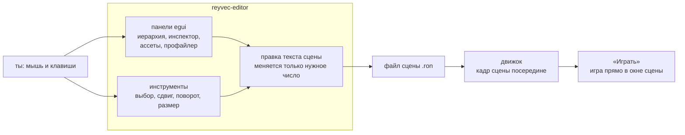

# 8. Редактор

[← Оглавление](README.md)

## Суть в двух словах

Песочница — это стенд для проверки движка. Редактор — это **мастерская**, где собирают игру: мышкой ставят предметы, двигают, крутят, правят цвет и силу света, сохраняют заготовки и тут же нажимают «Играть».

Редактор — отдельная программа (`editor.bat`), но собрана **на том же движке**. Сцена посередине окна — это настоящий кадр ReyVec, а не картинка-подобие.

> 🚧 Редактор идёт параллельно этапам. Задачи Р.1–Р.10 сделаны в коде, но в `docs/roadmap.md` ещё не отмечены проверенными на твоём ПК.

## Схема

## Простыми словами

**Главная идея: редактор правит тот же текстовый файл**, что ты открываешь в блокноте. Сдвинул ящик мышкой — в файле поменялось одно число `at`. Всё остальное, включая твои комментарии, остаётся как было. Поэтому можно спокойно переключаться: часть правок в редакторе, часть в блокноте.

**Рабочие пространства** — вкладки сверху, по этапам создания игры: «Сюжет», «Ассеты», «Мир» и другие. Боковые панели у всех одинаковые по размеру, чтобы глаз не прыгал.

**Что уже умеет:**
- 🖱️ выбрать предмет щелчком (двойной — вложенный), двигать, крутить, менять размер (Q/W/E/R), привязка к сетке и углу;
- 📋 копировать, вырезать, вставлять (Ctrl+C/X/V — даже из блокнота и в блокнот), дублировать (Ctrl+D), удалять;
- 🌳 иерархия с поиском, «глазом» (скрыть) и «замком» (не выбирать);
- 🔍 режимы вида: «Со светом», «Контуры», «Физика», «Слои глубины», метки радиусов света и костей;
- 🧩 части предмета в инспекторе: фигуры, свет, SDF, рисунки, тело — «+ Добавить» и «×»;
- 📐 несколько предметов сразу: выравнивание, группировка (Ctrl+G);
- 📦 заготовки: «Сохранить как заготовку» → файл в `assets/prefabs`, оттуда перетаскиваешь в любую сцену;
- ▶️ «Играть» и «Симуляция» (физика идёт, герой не слушается), «Стоп» возвращает сцену;
- 💾 новая сцена, открыть сцену, автосохранение раз в минуту;
- 🗿 «Формы» (М.2): двойной щелчок по модели формы (`*.shape.ron`) в «Ассетах» ставит её на подставку в окне сцены — мышь вращает камеру, колесо приближает, сохранил файл модели в блокноте — она перечитывается сама; Esc или «Закрыть» — назад к сцене;
- 🧱 правка модели (М.3): слева дерево деталей модели, справа их числа — размеры, положение, поворот, цвет, плавный шов, ось зеркала, копии повтора. «+ Коробка», «+ Шар»… добавляют деталь там же, где выбранная, в режиме «Добавить», «Вырезать» или «Пересечь»; «Убрать деталь». Правки сразу пишутся в файл модели (комментарии остаются), Ctrl+Z / Ctrl+Y отменяют;
- 🎥 камера «Форм»: значки-кубики готовых видов (общий, спереди, сзади, слева, справа, сверху; вращение они не включают), «Деталь крупно» (F или двойной щелчок по детали), правая кнопка вращает, средняя сдвигает, режим «Полёт» — свободная камера на W A S D;
- 🎯 выбор детали прямо на модели (М.4): левый щелчок выбирает деталь (мимо — всю модель), выбранная обведена рамкой, у неё стрелки X, Y, Z — тянешь стрелку, деталь едет вдоль оси (с Ctrl — по сантиметру); правый щелчок по детали — то же меню, что в дереве;
- ⚙️ меню «Качество» на подставке: время кадра на видеокарте и пять самых долгих проходов, разрешение 3D (100 / 75 / 50 %), «Треугольники», «Сглаживание по картинке» (на подставке включено сразу: края лучами стоили 9 мс из 22 на RTX 5080; после закрытия «Форм» у сцены возвращается своё);
- 🔄 ручки детали (М.4в): столбик значков слева в окне подставки и клавиши W / E / R — двигать стрелками, поворачивать кольцами вокруг осей родителя (Ctrl — по 15°), менять размер: квадрат у середины — масштаб всей детали (`scale` сдвига), ручки на осях растягивают по одной оси любую часть, и группу, и всю модель (М.4г): у коробки меняется `size`, у цилиндра, капсулы и конуса — высота (ось Y) или радиус, у вложенных — места `at` и шаги повторов. Поворот пишется в `turn` сдвига детали (углы Z·Y·X, как в движке);
- ✏️ контур выдавливания и выточки (М.5): у выбранного «Выдавливания» или «Выточки» в инспекторе карточка «Контур» — сетка в метрах, контур, точки (оранжевые квадраты) и ручки изгибов (синие круги). Точки тянут мышью (Ctrl — по сантиметру), двойной щелчок по линии ставит точку (изгиб делится без изменения формы), правый щелчок по точке — убрать её или сделать отрезок к ней изгибом / прямым. У выточки пунктир — ось вращения, левее неё точку не утащить. Контур пишется в файл строкой как в SVG (`contour.rs`); «+ Выдавливание» и «+ Выточка» есть в новых деталях, растяжение по осям растягивает и контур;
- 🎛 ручки модели (М.6): карточка «Ручки модели» в инспекторе — «+ Ручка», имя, значение в файле, пределы «от» и «до». «Посмотреть» показывает модель на подставке при другом значении (в файл не пишется; стрелки деталей в это время спрятаны, «↺» — как в файле). «Научить»: ручка встаёт на значение из «Посмотреть» (или на край), детали двигают и растягивают как обычно, «Запомнить» связывает каждое изменённое число с ручкой и возвращает модель в файле к прежнему значению (детали во время обучения не добавлять). «Забыть» убирает связи. В сцене копия получает своё значение: `Use(model: "завод/конвейер", params: {"длина": 2.4})` — так в цеху завода стоят конвейеры 3,6, 3 и 2,4 м (`model_params.rs`);
- 📊 цена модели (М.7): карточка «Цена модели» внизу инспектора — «лёгкая / средняя / тяжёлая» для лучей (до 8 примитивов на шаг луча, до 24, больше), сколько примитивов в программе, сколько из них видеокарта считает за шаг луча рядом с моделью (в среднем и самое большое: далёкие группы пропускаются, М.1), слов программы из 16384, и сетка для режима «Треугольники»: треугольников, клетка (детали тоньше неё могут пропасть), насколько сетка отходит от формы и сколько строится. Считается на процессоре в своём потоке через 0,3 с после последней правки (`cost.rs`). «Как на слабой видеокарте» включает «Треугольники» на подставке, «Снова лучами» — обратно;
- 🏭 сцены 3D (М.8а): двойной щелчок по сцене 3D (`.ron` формата `reyvec-space`, например `scenes/3d/forge.ron`) в «Ассетах» открывает её в окне сцены, как модель на подставке, но без подставки и вращения: камера встаёт по размеру сцены. В иерархии — предметы по именам, внутри них — их детали; щелчок по предмету в окне выбирает деталь, стрелки W / E / R двигают, поворачивают и растягивают (у предмета пишутся его `at` и `turn`). В инспекторе предмета карточка «Предмет» (имя, материал из списка сцены), у ссылки на модель — карточка «Модель» с ручками этой копии (М.6: ползунок пишет `Use(…, params: {…})`). Правки сразу пишутся в файл сцены (песочница её перечитывает), Ctrl+Z отменяет. Ссылки на модели раскрываются при чтении сцены, поэтому выбор и рамка видят детали моделей;
- 🧱 сборка сцены 3D (М.8б, `apps/editor/src/editor/space_edit.rs`, `ui/space.rs`): модель формы перетаскивают из «Ассетов» в окно сцены — появляется предмет `Use(model: "…")` там, куда показывает мышь (на поверхность предмета или на пол), с именем по файлу модели и первым материалом сцены без сетки. Модель берётся только из папки `models` рядом со сценой — иначе подсказка в окне. В инспекторе всей сцены: «Новый предмет» (простые формы, встают на пол посреди окна), «Материалы» (цвет палитрой, имя — переименование правит и предметы, свечение, сетка; занятый материал не убрать), «Лампы» (список и «+ Лампа»). Лампы видны в окне кружками своего цвета и в иерархии под предметами; кружок тянут мышью по полу, с Shift — вверх и вниз (камера смотрит вдоль пола — лампа ходит вбок). У выбранной лампы — место, цвет, сила, дальность; Delete убирает её. Цвета пишутся как `"#rrggbb"`;
- ⏸ анимация сцены (покачивания, круги, вращения предметов и ламп) идёт только в игре и симуляции: в правке и на паузе её часы стоят (`AnimClock` в `editor/mod.rs`), сцена замирает на последнем кадре игры, а движок меньше работает на процессоре: программы движущихся предметов на тех же местах берутся из кэша (8.8б). Видеокарта рисует кадр по-прежнему каждый раз;
- ✂️ «Разделить повтор» в меню детали: повтор становится объединением из настоящих отдельных копий на тех же местах — каждую можно выбрать и сдвинуть, связь между копиями пропадает (Ctrl+Z вернёт повтор);
- 👁 глаз и 🔒 замок у деталей модели: спрятанная деталь пропадает с подставки (в файле остаётся), закреплённую не правят;
- 🌲 режимы новой детали — значками (два круга, круг с вырезом, общая часть); дерево модели сворачивается, правая кнопка по детали — меню: крупно, повторить рядом (Ctrl+D), выше / ниже, обернуть в объединение / зеркало / повтор, снять обёртку, удалить (Delete);
- 🎚 числа модели в сворачиваемых карточках, с кнопками «−» и «+»; любое число и камеру можно тянуть мышью без края экрана: курсор у края перепрыгивает на другую сторону;
- 🎨 файлы в «Ассетах» окрашены по виду: модели форм, сцены, заготовки, рисунки, картинки, сетки, звуки.

**Окно без рамки** — во весь экран, но панель задач видна; свои кнопки «свернуть / развернуть / закрыть».

## Технические детали

### Где лежит

- Программа: `apps/editor`, запуск `editor.bat` → `scripts/editor.ps1`.
- Код: `apps/editor/src/editor/` — весь редактор в своей папке, отдельно от движка (решение 0021).
- Связь с движком: `reyvec_app::for_editor` (`crates/reyvec-app/src/for_editor.rs` — ввод окна, клавиши героя, шрифты, журнал консоли), `reyvec_gpu::WindowRenderer` (кадр; сцена «3D» подставки — `set_space_file_in`), `reyvec_scene` (файлы сцен), `reyvec_sdf` (камера 3D и чтение модели для размеров подставки), `reyvec_app::snapshot`. Больше редактор из движка ничего не берёт.
- Предпросмотр панелей без видеокарты: `cargo test -p reyvec-editor editor_preview -- --ignored` → `target/editor-preview/*.png`.

| Файл | Что |
| --- | --- |
| `mod.rs`, `ui.rs` | Состояние редактора, панели, меню «ReyVec → Файл / Вид / Справка» |
| `layout.rs` | Раскладка рабочих пространств данными; редактор открывается на «Мире» |
| `theme.rs` | Токены стиля: цвета, высоты, ширины, промежутки, шрифты |
| `ron_edit.rs` | Точечная правка текста RON: найти предмет по номеру в `nodes` / `children`, заменить или дописать поле |
| `doc.rs` | Документ сцены, отмена и повтор |
| `geom.rs` | Места предметов с учётом родителей и их прямоугольники для выбора и ручек |
| `viewport.rs` | Окно сцены, камера, инструменты Q/W/E/R |
| `outline.rs` | Дерево предметов для иерархии и инспектора |
| `overlay.rs` | Режимы вида и метки поверх кадра (egui) |
| `parts.rs` | Части предмета в инспекторе |
| `arrange.rs` | Выравнивание и группировка нескольких предметов |
| `endless.rs` | Перетаскивание без края экрана: курсор у края окна переносится на другую сторону, интерфейсу отдаётся положение «дальше края» |
| `assets.rs`, `files.rs` | Дерево папок, плитки файлов (цвет по виду файла), новая / открыть сцену, автосохранение в `.autosave/` |
| `shape_edit.rs` | Дерево частей модели формы по тексту файла (сдвиг `Move` и цвет `Paint` вокруг детали — её «положение» и «цвет», а не отдельные строки), числа частей, точечные правки текста: поле, обернуть в `Move` / `Paint` / `Union` / `Subtract` / `Intersect` / `Mirror` / `Repeat`, снять обёртку, добавить, повторить, переставить и убрать деталь |
| `shapes.rs` | «Формы» (М.2): сцена подставки для модели формы (пол, подставка, две лампы, модель через `Use`, низом на подставку по её коробке), камера вокруг модели или детали (готовые виды, плавный переезд, сдвиг, полёт), коробка детали и место её родителя по дереву `Shape3` со всеми сдвигами вокруг, выбор детали лучом (до поверхности модели, там ближайшая деталь с копиями зеркал и повторов), сцена подставки без спрятанных деталей, проверка времени записи файла раз в 0,3 с |

### Правила устройства

- Редактор и движок развиваются отдельно (0021): работа над графикой не трогает `apps/editor`, работа над редактором не лезет во внутренности движка. `update.bat` собирает редактор отдельно от песочницы: если он не собрался, песочница всё равно обновится, а в `dist` останется прошлый редактор.
- Сцена в редакторе — настоящий кадр движка; «Играть» запускает игру в окне сцены с теми же клавишами, что в песочнице (`controls.ron`).
- Все правки — правки текста файла; заготовка — текст предмета в своём файле, связи с ним у вставленной копии нет.
- Файл поменяли в блокноте, а в редакторе несохранённые правки — правки редактора остаются, в консоли предупреждение; «Файл → Перечитать сцену» берёт файл с диска.
- `egui_dock` не взят: его версия собрана под egui 0.36, у нас 0.37.

## Слабые места и планы

- **Одно окно сцены.** Нельзя открыть четыре вида сразу, как в Unreal. Нужна отрисовка сцены в отдельную картинку под размер окна сцены.
- **Видеокарта рисует и то, что под панелями** — лишняя работа. Тот же шаг исправит.
- **Выбор мышью по примерным границам:** тонкую или вращающуюся фигуру иногда проще выбрать в иерархии.
- **Режимы «Контуры», «Физика» во время игры показывают места из файла**, а не куда предметы упали.
- **В инспекторе правятся главные числа.** Скругления, точки многоугольника, градиенты — пока в файле.
- **Перетащить можно только SVG**; фигуры Motif и сцены — позже.
- **Окно без рамки в Windows капризно** (панель задач, Win+стрелки) — правится по твоим проверкам.
- **«Формы»: ручки** (М.4, М.4в): шар не бывает вытянутым (в движке нет эллипсоида): при растяжении по оси он растёт целиком, цилиндр поперёк своей оси толстеет сразу по X и Z; повёрнутые вложенные части растягиваются по ближайшей своей оси. Поворот кольцом считается по углу курсора вокруг детали: если кольцо видно ребром (ось поперёк взгляда), оно вырождается в линию, и крутить им неудобно. Стрелки идут по осям родителя детали; выбор щелчком считается на процессоре по дереву формы (для моделей в сотни деталей может стать заметен). Правка сразу пишется в файл (у сцены — по Ctrl+S); история отмены живёт, пока модель открыта. Замер Романа на RTX 5080 (22.3 мс кадр): края лучами 8.95, реймарчинг 7.57, тени 4.54 — поэтому на подставке сразу сглаживание по картинке. С М.4б подставка рисуется только в окне просмотра, не под панелями (движок, `set_view_rect`). Движение и поля — без своих чисел в инспекторе, их правят в блокноте. Контур правится по точкам, но окно контура маленькое (в ширину инспектора), а изгибы с двумя ручками (`C`) новые точки не создают — только приходят из файла.
- **«Формы»: ручки модели** (М.6): связь ручки с числом прямая (на сколько на единицу ручки), поэтому изгиб или «сначала растёт одно, потом другое» не научить; контур выдавливания и выточки с ручкой не связывается (его точки не числа детали), материал и вид детали тоже. Связь помнит деталь по номеру в дереве: если потом переставить или убрать деталь выше по списку, связи съедут — тогда «Забыть» и научить заново. Ставить значения копиям в сцене пока можно только в файле сцены: сцены 3D мышью — шаг М.8.
- **«Формы»: цена модели** (М.7) — оценка на процессоре, не замер видеокарты: «на шаг луча» берётся по точкам сеткой вокруг модели, а настоящие лучи чаще ходят у поверхности. Пороги 8 и 24 — по оценке решения 0018, их стоит подправить по замерам на ПК. Сетка стеллажа склада (59 частей) строится секунды (в облаке 3,4 с), а отходит от формы до 1 см при цели 4 мм — это то, что видно в режиме «Треугольники».
- **Сцены 3D в редакторе** (М.8а, М.8б): камеру сцены (`camera` в файле) мышью пока не записать, полигональные модели (`meshes`) в иерархии не видны, у ламп нет покачивания и кругов в инспекторе (только в файле). Модель из чужой папки `models` в сцену не встаёт: её сначала нужно положить рядом со сценой. Иерархия рисует все предметы разом: у завода их тысяча, список прокручивается, но поиска по нему ещё нет. Выбор щелчком считается на процессоре по всем предметам сцены — на заводе это заметная доля секунды. Файл `factory.ron` собран скриптом `factory.py`: правки мышью в нём живут, пока скрипт не запустят снова.
- Режимы «без света», «только свет», «поле SDF» требуют проходов в `reyvec-gpu` и проверки на ПК — отдельный шаг.

## Связанные решения

- [0017. Редактор](../decisions/0017-editor.md)
- [0021. Редактор отдельно от движка](../decisions/0021-editor-separate.md)
- Задачи Р.1–Р.10 в [`docs/roadmap.md`](../roadmap.md)

## Заметки Романа

_Пока пусто._
