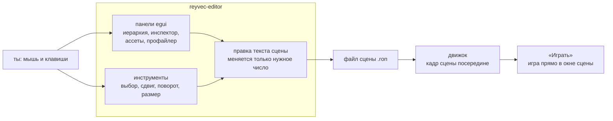

# 8. Редактор

[← Оглавление](README.md)

## Суть в двух словах

Песочница — это стенд для проверки движка. Редактор — это **мастерская**, где собирают игру: мышкой ставят предметы, двигают, крутят, правят цвет и силу света, сохраняют заготовки и тут же нажимают «Играть».

Редактор — отдельная программа (`editor.bat`), но собрана **на том же движке**. Сцена посередине окна — это настоящий кадр ReyVec, а не картинка-подобие.

> 🚧 Редактор идёт параллельно этапам. Задачи Р.1–Р.10 сделаны в коде, но в `docs/roadmap.md` ещё не отмечены проверенными на твоём ПК.

## Схема

## Простыми словами

**Главная идея: редактор правит тот же текстовый файл**, что ты открываешь в блокноте. Сдвинул ящик мышкой — в файле поменялось одно число `at`. Всё остальное, включая твои комментарии, остаётся как было. Поэтому можно спокойно переключаться: часть правок в редакторе, часть в блокноте.

**Рабочие пространства** — вкладки сверху, по этапам создания игры: «Сюжет», «Ассеты», «Мир» и другие. Боковые панели у всех одинаковые по размеру, чтобы глаз не прыгал.

**Что уже умеет:**
- 🖱️ выбрать предмет щелчком (двойной — вложенный), двигать, крутить, менять размер (Q/W/E/R), привязка к сетке и углу;
- 📋 копировать, вырезать, вставлять (Ctrl+C/X/V — даже из блокнота и в блокнот), дублировать (Ctrl+D), удалять;
- 🌳 иерархия с поиском, «глазом» (скрыть) и «замком» (не выбирать);
- 🔍 режимы вида: «Со светом», «Контуры», «Физика», «Слои глубины», метки радиусов света и костей;
- 🧩 части предмета в инспекторе: фигуры, свет, SDF, рисунки, тело — «+ Добавить» и «×»;
- 📐 несколько предметов сразу: выравнивание, группировка (Ctrl+G);
- 📦 заготовки: «Сохранить как заготовку» → файл в `assets/prefabs`, оттуда перетаскиваешь в любую сцену;
- ▶️ «Играть» и «Симуляция» (физика идёт, герой не слушается), «Стоп» возвращает сцену;
- 💾 новая сцена, открыть сцену, автосохранение раз в минуту.

**Окно без рамки** — во весь экран, но панель задач видна; свои кнопки «свернуть / развернуть / закрыть».

## Технические детали

### Где лежит

- Программа: `apps/editor`, запуск `editor.bat` → `scripts/editor.ps1`.
- Код: `crates/reyvec-app/src/editor/`.

| Файл | Что |
| --- | --- |
| `mod.rs`, `ui.rs` | Состояние редактора, панели, меню «ReyVec → Файл / Вид / Справка» |
| `layout.rs` | Раскладка рабочих пространств данными; редактор открывается на «Мире» |
| `theme.rs` | Токены стиля: цвета, высоты, ширины, промежутки, шрифты |
| `ron_edit.rs` | Точечная правка текста RON: найти предмет по номеру в `nodes` / `children`, заменить или дописать поле |
| `doc.rs` | Документ сцены, отмена и повтор |
| `geom.rs` | Места предметов с учётом родителей и их прямоугольники для выбора и ручек |
| `viewport.rs` | Окно сцены, камера, инструменты Q/W/E/R |
| `outline.rs` | Дерево предметов для иерархии и инспектора |
| `overlay.rs` | Режимы вида и метки поверх кадра (egui) |
| `parts.rs` | Части предмета в инспекторе |
| `arrange.rs` | Выравнивание и группировка нескольких предметов |
| `assets.rs`, `files.rs` | Дерево папок, плитки файлов, новая / открыть сцену, автосохранение в `.autosave/` |

### Правила устройства

- Сцена в редакторе — настоящий кадр движка; «Играть» запускает игру в окне сцены с теми же клавишами, что в песочнице (`controls.ron`).
- Все правки — правки текста файла; заготовка — текст предмета в своём файле, связи с ним у вставленной копии нет.
- Файл поменяли в блокноте, а в редакторе несохранённые правки — правки редактора остаются, в консоли предупреждение; «Файл → Перечитать сцену» берёт файл с диска.
- `egui_dock` не взят: его версия собрана под egui 0.36, у нас 0.37.

## Слабые места и планы

- **Одно окно сцены.** Нельзя открыть четыре вида сразу, как в Unreal. Нужна отрисовка сцены в отдельную картинку под размер окна сцены.
- **Видеокарта рисует и то, что под панелями** — лишняя работа. Тот же шаг исправит.
- **Выбор мышью по примерным границам:** тонкую или вращающуюся фигуру иногда проще выбрать в иерархии.
- **Режимы «Контуры», «Физика» во время игры показывают места из файла**, а не куда предметы упали.
- **В инспекторе правятся главные числа.** Скругления, точки многоугольника, градиенты — пока в файле.
- **Перетащить можно только SVG**; фигуры Motif и сцены — позже.
- **Окно без рамки в Windows капризно** (панель задач, Win+стрелки) — правится по твоим проверкам.
- Режимы «без света», «только свет», «поле SDF» требуют проходов в `reyvec-gpu` и проверки на ПК — отдельный шаг.

## Связанные решения

- [0017. Редактор](../decisions/0017-editor.md)
- Задачи Р.1–Р.10 в [`docs/roadmap.md`](../roadmap.md)

## Заметки Романа

_Пока пусто._
