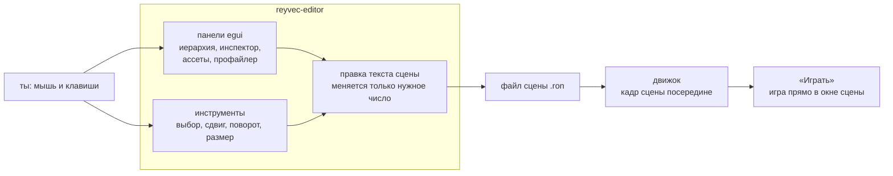

# 8. Редактор

[← Оглавление](README.md)

## Суть в двух словах

Песочница — это стенд для проверки движка. Редактор — это **мастерская**, где собирают игру: мышкой ставят предметы, двигают, крутят, правят цвет и силу света, сохраняют заготовки и тут же нажимают «Играть».

Редактор — отдельная программа (`editor.bat`), но собрана **на том же движке**. Сцена посередине окна — это настоящий кадр ReyVec, а не картинка-подобие.

> 🚧 Редактор идёт параллельно этапам. Задачи Р.1–Р.10 сделаны в коде, но в `docs/roadmap.md` ещё не отмечены проверенными на твоём ПК.

## Схема

## Простыми словами

**Главная идея: редактор правит тот же текстовый файл**, что ты открываешь в блокноте. Сдвинул ящик мышкой — в файле поменялось одно число `at`. Всё остальное, включая твои комментарии, остаётся как было. Поэтому можно спокойно переключаться: часть правок в редакторе, часть в блокноте.

**Рабочие пространства** — вкладки сверху, по этапам создания игры: «Сюжет», «Ассеты», «Мир» и другие. Боковые панели у всех одинаковые по размеру, чтобы глаз не прыгал.

**Что уже умеет:**
- 🖱️ выбрать предмет щелчком (двойной — вложенный), двигать, крутить, менять размер (Q/W/E/R), привязка к сетке и углу;
- 📋 копировать, вырезать, вставлять (Ctrl+C/X/V — даже из блокнота и в блокнот), дублировать (Ctrl+D), удалять;
- 🌳 иерархия с поиском, «глазом» (скрыть) и «замком» (не выбирать);
- 🔍 режимы вида: «Со светом», «Контуры», «Физика», «Слои глубины», метки радиусов света и костей;
- 🧩 части предмета в инспекторе: фигуры, свет, SDF, рисунки, тело — «+ Добавить» и «×»;
- 📐 несколько предметов сразу: выравнивание, группировка (Ctrl+G);
- 📦 заготовки: «Сохранить как заготовку» → файл в `assets/prefabs`, оттуда перетаскиваешь в любую сцену;
- ▶️ «Играть» и «Симуляция» (физика идёт, герой не слушается), «Стоп» возвращает сцену;
- 💾 новая сцена, открыть сцену, автосохранение раз в минуту;
- 📖 «Сюжет» (Сю.2) — заметки сюжета в виде, как у Obsidian: слева полоса значков и дерево (Мир, Персонажи, Диалоги, Задания, Переводы) с поиском по именам и словам реплик, посередине вкладки открытых заметок с крупным заголовком, «Свойствами» и текстом, справа «Ссылки сюда», «Структура» и «Проблемы»; Ctrl+O — быстрый переход, «+» — новый персонаж, диалог или задание; правки сохраняются сами через секунду (Ctrl+S — сразу). Диалог по умолчанию открыт схемой из карточек (Сю.3): цветные кнопки сверху добавляют карточку (среди них «Сгенерировать», Сю.10: задача для модели, предел слов, галочки «модель может» и запасной текст), у выбранной реплики — «✦ Другими словами» и «✦ Ответы игрока» (Сю.11: варианты от модели полосой под кнопками, щелчок берёт вариант), стрелку тянут мышью от кружка справа, карточку переносят за заголовок, колесо — приближение, «Разложить» расставляет карточки столбцами; «Сценарий» — тот же диалог текстом; «Текст» (Сю.13) — весь диалог как пьеса в одном поле: правка без ошибок сразу становится диалогом, ошибки — строкой под полем; «▶ Проиграть» (Сю.4) проходит диалог справа как в игре: варианты — кнопками или цифрами, «Дальше» — пробелом, перед прогоном можно задать, каким мир будет в начале, а в ленте видно, какие переменные и задания поменялись; текущая карточка обведена оранжевым на схеме;
- 🗿 «Формы» (М.2): двойной щелчок по модели формы (`*.shape.ron`) в «Ассетах» ставит её на подставку в окне сцены — мышь вращает камеру, колесо приближает, сохранил файл модели в блокноте — она перечитывается сама; Esc или «Закрыть» — назад к сцене;
- 🧱 правка модели (М.3): слева дерево деталей модели, справа их числа — размеры, положение, поворот, цвет, плавный шов, ось зеркала, копии повтора. «+ Коробка», «+ Шар»… добавляют деталь там же, где выбранная, в режиме «Добавить», «Вырезать» или «Пересечь»; «Убрать деталь». Правки сразу пишутся в файл модели (комментарии остаются), Ctrl+Z / Ctrl+Y отменяют;
- 🎥 камера «Форм»: значки-кубики готовых видов (общий, спереди, сзади, слева, справа, сверху; вращение они не включают), «Деталь крупно» (F или двойной щелчок по детали), правая кнопка вращает, средняя сдвигает, режим «Полёт» — свободная камера на W A S D;
- 🎯 выбор детали прямо на модели (М.4): левый щелчок выбирает деталь (мимо — всю модель), выбранная обведена рамкой, у неё стрелки X, Y, Z — тянешь стрелку, деталь едет вдоль оси (с Ctrl — по сантиметру); правый щелчок по детали — то же меню, что в дереве;
- ⚙️ меню «Качество» на подставке: время кадра на видеокарте и пять самых долгих проходов, разрешение 3D (100 / 75 / 50 %), «Треугольники», «Сглаживание по картинке» (на подставке включено сразу: края лучами стоили 9 мс из 22 на RTX 5080; после закрытия «Форм» у сцены возвращается своё);
- 🔄 ручки детали (М.4в): столбик значков слева в окне подставки и клавиши W / E / R — двигать стрелками, поворачивать кольцами вокруг осей родителя (Ctrl — по 15°), менять размер: квадрат у середины — масштаб всей детали (`scale` сдвига), ручки на осях растягивают по одной оси любую часть, и группу, и всю модель (М.4г): у коробки меняется `size`, у цилиндра, капсулы и конуса — высота (ось Y) или радиус, у вложенных — места `at` и шаги повторов. Поворот пишется в `turn` сдвига детали (углы Z·Y·X, как в движке);
- ✏️ контур выдавливания и выточки (М.5): у выбранного «Выдавливания» или «Выточки» в инспекторе карточка «Контур» — сетка в метрах, контур, точки (оранжевые квадраты) и ручки изгибов (синие круги). Точки тянут мышью (Ctrl — по сантиметру), двойной щелчок по линии ставит точку (изгиб делится без изменения формы), правый щелчок по точке — убрать её или сделать отрезок к ней изгибом / прямым. У выточки пунктир — ось вращения, левее неё точку не утащить. Контур пишется в файл строкой как в SVG (`contour.rs`); «+ Выдавливание» и «+ Выточка» есть в новых деталях, растяжение по осям растягивает и контур;
- 🎛 ручки модели (М.6): карточка «Ручки модели» в инспекторе — «+ Ручка», имя, значение в файле, пределы «от» и «до». «Посмотреть» показывает модель на подставке при другом значении (в файл не пишется; стрелки деталей в это время спрятаны, «↺» — как в файле). «Научить»: ручка встаёт на значение из «Посмотреть» (или на край), детали двигают и растягивают как обычно, «Запомнить» связывает каждое изменённое число с ручкой и возвращает модель в файле к прежнему значению (детали во время обучения не добавлять). «Забыть» убирает связи. В сцене копия получает своё значение: `Use(model: "завод/конвейер", params: {"длина": 2.4})` — так в цеху завода стоят конвейеры 3,6, 3 и 2,4 м (`model_params.rs`);
- 📊 цена модели (М.7): карточка «Цена модели» внизу инспектора — «лёгкая / средняя / тяжёлая» для лучей (до 8 примитивов на шаг луча, до 24, больше), сколько примитивов в программе, сколько из них видеокарта считает за шаг луча рядом с моделью (в среднем и самое большое: далёкие группы пропускаются, М.1), слов программы из 16384, и сетка для режима «Треугольники»: треугольников, клетка (детали тоньше неё могут пропасть), насколько сетка отходит от формы и сколько строится. Считается на процессоре в своём потоке через 0,3 с после последней правки (`cost.rs`). «Как на слабой видеокарте» включает «Треугольники» на подставке, «Снова лучами» — обратно;
- 🏭 сцены 3D (М.8а): двойной щелчок по сцене 3D (`.ron` формата `reyvec-space`, например `scenes/3d/forge.ron`) в «Ассетах» открывает её в окне сцены, как модель на подставке, но без подставки и вращения: камера встаёт по размеру сцены. В иерархии — предметы по именам, внутри них — их детали; щелчок по предмету в окне выбирает деталь, стрелки W / E / R двигают, поворачивают и растягивают (у предмета пишутся его `at` и `turn`). В инспекторе предмета карточка «Предмет» (имя, материал из списка сцены), у ссылки на модель — карточка «Модель» с ручками этой копии (М.6: ползунок пишет `Use(…, params: {…})`). Правки сразу пишутся в файл сцены (песочница её перечитывает), Ctrl+Z отменяет. Ссылки на модели раскрываются при чтении сцены, поэтому выбор и рамка видят детали моделей;
- 🧱 сборка сцены 3D (М.8б, `apps/editor/src/editor/space_edit.rs`, `ui/space.rs`): модель формы перетаскивают из «Ассетов» в окно сцены — появляется предмет `Use(model: "…")` там, куда показывает мышь (на поверхность предмета или на пол), с именем по файлу модели и первым материалом сцены без сетки. Модель берётся только из папки `models` рядом со сценой — иначе подсказка в окне. В инспекторе всей сцены: «Новый предмет» (простые формы, встают на пол посреди окна), «Материалы» (цвет палитрой, имя — переименование правит и предметы, свечение, сетка; занятый материал не убрать), «Лампы» (список и «+ Лампа»). Лампы видны в окне кружками своего цвета и в иерархии под предметами; кружок тянут мышью по полу, с Shift — вверх и вниз (камера смотрит вдоль пола — лампа ходит вбок). У выбранной лампы — место, цвет, сила, дальность; Delete убирает её. Цвета пишутся как `"#rrggbb"`;
- ⏸ анимация сцены (покачивания, круги, вращения предметов и ламп) идёт только в игре и симуляции: в правке и на паузе её часы стоят (`AnimClock` в `editor/mod.rs`), сцена замирает на последнем кадре игры, а движок меньше работает на процессоре: программы движущихся предметов на тех же местах берутся из кэша (8.8б). Видеокарта рисует кадр по-прежнему каждый раз;
- ⌨ в окне «Форм» камера, как в других редакторах: с зажатой правой кнопкой W A S D — лететь, Q E — вниз и вверх, Shift — быстрее (ручки W / E / R в это время не переключаются). Подсказка по клавишам — значок «?» в углу окна: при наведении сразу всплывает список «клавиша — что делает» (мышь или лепка, камера, ещё). Сцена 3D открывается с камерой «Полёт»: правая кнопка поворачивает её на месте, полёт 3 м/с (Shift — втрое), колесо — шаг 0,6 м; модель на подставке — по-прежнему «Вокруг»;
- 🏺 лепка из глины (М.9б, `clay_edit.rs`, `ui/clay.rs`): у детали модели в инспекторе карточка «Глина» → «Превратить в глину»: деталь запекается в сетку расстояний (до 64 точек по длинной стороне) и пишется файлом `models/<модель>-глина.clay`, в тексте модели на её месте `Clay(file: "…")` (сдвиг и цвет те же). Запас коробки вокруг формы («запас», по умолчанию 20 % длинной стороны) задаётся в той же карточке. У глиняной детали наверху инспектора карточка «Лепка»: «Лепить кистью», кисти значками «Нарастить», «Вдавить», «Сгладить» (те же значки в столбике у левого края окна вместо ручек), размер (в сантиметрах) и сила, размер коробки и клетки, «Расширить коробку» на запас (точек столько же — клетка крупнее, Ctrl+Z вернёт). Левая кнопка на глине лепит (кружок показывает кисть: зелёный — нарастить, красный — вдавить), с Ctrl — наоборот, с Shift — сгладить, Alt+колесо — размер; левая мимо глины выбирает другую деталь, ручек у глины, пока лепят, нет. Мазки сразу видны в выборе мышью, файл глины пишется и движок перечитывает его не чаще раза в 60 мс; отпустили кнопку — проход стал одним шагом Ctrl+Z (история хранит файл глины до прохода);
- ✂️ «Разделить повтор» в меню детали: повтор становится объединением из настоящих отдельных копий на тех же местах — каждую можно выбрать и сдвинуть, связь между копиями пропадает (Ctrl+Z вернёт повтор);
- 👁 глаз и 🔒 замок у деталей модели: спрятанная деталь пропадает с подставки (в файле остаётся), закреплённую не правят;
- 🌲 режимы новой детали — значками (два круга, круг с вырезом, общая часть); дерево модели сворачивается, правая кнопка по детали — меню: крупно, повторить рядом (Ctrl+D), выше / ниже, обернуть в объединение / зеркало / повтор, снять обёртку, удалить (Delete);
- 🎚 числа модели в сворачиваемых карточках, с кнопками «−» и «+»; любое число и камеру можно тянуть мышью без края экрана: курсор у края перепрыгивает на другую сторону;
- 🎨 файлы в «Ассетах» окрашены по виду: модели форм, сцены, заготовки, рисунки, картинки, сетки, звуки.
- 🗂 проводник «Ассетов» (Э.1): вкладка «Ассеты» без открытого ассета — файлы проекта на всё окно, как проводник Windows. Слева дерево папок, сверху «назад / вперёд / вверх», адрес и поиск по вложенным папкам, ниже «Создать» (папку, сцену 2D, сцену 3D, модель формы, скрипт Luau), вырезать, копировать, вставить, переименовать (F2), удалить (Delete), отменить (Ctrl+Z), сортировка и вид «плитки / список». Справа свойства выбранного: вид, размер, когда менялся, где лежит и **где используется** (какие сцены и модели на него ссылаются). Файлы перетаскивают мышью на папку в списке, в дереве или в адресе. Двойной щелчок открывает ассет в его редакторе: модель формы — тут же, во «Ассетах» (Esc — назад к файлам), уровень (сцену 2D или 3D) — в «Мире», остальное — программой Windows. **Переименовал или перенёс файл — пути к нему во всех сценах и моделях поправляются сами**; удалённое уезжает в скрытую папку `.trash` проекта, Ctrl+Z возвращает и файлы, и пути.
- 🧭 проводник удобнее (Э.2): правая кнопка по папке в дереве — её меню (открыть, «Создать здесь…», вставить, переименовать, удалить), у папок в списке тоже «Создать здесь…»; «Создать» (Ctrl+N) открывает окошко — вид значком (папка, сцена 2D, сцена 3D, модель, скрипт) и имя, Enter создаёт, занятое имя подсвечивается; Ctrl+Y повторяет отменённое; рамкой мышью с пустого места выбирается сразу несколько файлов (с Ctrl — добавить к выбранным);
- 🖼 миниатюры (Э.3): у моделей форм и сцен 3D на плитке — их общий вид. Снимок делается сам в фоне и хранится в скрытой папке `.thumbs`; новый снимается только после сохранения модели (или её глины, вложенной модели), до тех пор видна прежняя картинка;
- 🗑 корзина (Э.4): строка «Корзина» внизу дерева показывает удалённое — имя, откуда, когда. Двойной щелчок или Enter возвращает на старое место (если имя там занято — рядом с номером), Ctrl+Z уносит обратно; Delete и «Очистить корзину» стирают насовсем после вопроса. Файлы можно бросить мышью на «Корзину» — это удаление. Миниатюра выбранной модели в панели справа растёт вместе с шириной панели, но не крупнее 1,25 своего размера;
- 🏷 метки (Э.5): у файла или папки может быть несколько цветных меток из семи (как в проводнике macOS). Поставить — правая кнопка → «Метки», кружки «Метки» в панели справа или Ctrl+1…7 (второе нажатие снимает); у нескольких выбранных сразу. Метки видны точками в углу плитки и за именем в списке. В дереве под «Корзиной» — раздел «Метки»: щелчок показывает все файлы с меткой из всех папок проекта (Backspace — назад). Названия меток свои у проекта («Готово», «Переделать»): «Метки» → «Названия меток…». Метки едут вместе с файлом при переименовании, переносе, копировании, удалении в корзину и отмене
- 🔁 конвертеры (Э.6): правая кнопка по звуку или картинке → «Конвертировать…» (или кнопка в свойствах). Звук (WAV, OGG, MP3, FLAC) — в OGG Vorbis с качеством на выбор (музыка, длинные звуки) или в WAV (короткие звуки), можно свести в моно. Картинка (PNG, JPEG, BMP, TGA, GIF, WebP) — в PNG или JPEG, можно уменьшить до заданной стороны. Можно выбрать сразу несколько файлов одного вида. Работа идёт в фоне, результат появляется рядом с исходным (имя занято — с номером) и выбирается; Ctrl+Z уносит его в корзину. В свойствах звука — длительность, частота и каналы, у картинки — размер в точках
- 🗺 уровни в «Мире» (Р.12): «Мир» — редактор уровня, и в нём всегда один уровень: сцена 2D или сцена 3D. Открыть уровень (двойным щелчком в проводнике или «ReyVec → Файл → Открыть уровень» — там все уровни из `scenes` проекта, с подпапками) значит заменить прежний, а не положить поверх. С несохранёнными правками редактор спрашивает «Сохранить и открыть / Не сохранять / Отмена». Модель, открытая во «Ассетах», остаётся там: переключили вкладку — в «Мире» снова уровень, вернулись — снова модель (у каждой своя отмена правок). Проект при запуске открывается на уровне, на котором остановились (записано в `settings/projects.ron`).
- 🗺 правка уровня одинаковая для 2D и 3D (Р.13): правки уровня 3D, как и у сцены 2D, сначала только в редакторе (в заголовке «есть несохранённые правки») и попадают в файл по Ctrl+S; без сохранения работают вопрос при закрытии и при открытии другого уровня, автосохранение раз в минуту в `.autosave` и «Файл → Восстановить автосохранение». Ctrl+C, Ctrl+X, Ctrl+V копируют предметы уровня 3D (и детали модели во «Формах»): вставка встаёт сразу за выбранным. Модель во «Ассетах» по-прежнему пишется в файл сразу — это редактор ассета, а не уровня.
- ▶ просмотр уровня 3D (Р.14): F5 в уровне 3D — анимации идут, камера летает (W A S D, Q и E — вниз и вверх, Shift — быстрее, мышь с любой кнопкой — оглядеться), спрятанное «глазом» видно; ручек, ламп и выбора нет, уровень не правится. Esc или F5 — назад к правке: анимации с начала, камера остаётся, где летала. Героя в 3D у движка пока нет — когда появится, F5 запустит его, как в 2D.
- 🗂 проекты (П.1): при запуске — окно «Проекты» (его же открывает «ReyVec → Файл → Проекты…»): недавние проекты с датой, «Создать проект…» и «Открыть папку…». Новый проект — папка с `scenes`, `assets` и `project.ron` (имя, первая сцена, версия движка), начать можно «С героем» (пол, ступеньки, ящик, лампа и герой — F5 сразу бегать) или «Пустой». Папку выбирают своим окошком (путь можно вставить из проводника Windows). Другой проект открывается перезапуском редактора (папку сцен движок берёт при старте), с несохранёнными правками — нельзя. Галочка «Показывать это окно при запуске» снята — редактор сразу открывает последний проект. Сам пример движка — тоже проект (`project.ron` в корне репозитория)
- 📝 редактор скриптов (С.1): двойной щелчок по `.luau` в «Ассетах» открывает код на месте проводника. Номера строк, подсветка, Tab — четыре пробела, Enter держит отступ (после `then`, `do`, начала функции — на шаг больше). Код проверяется прямо при наборе, без запуска: строка с ошибкой подсвечена красным, текст ошибки внизу, щелчок по нему ведёт к строке. После `me.`, `hero.` и `math.` всплывает список полей (стрелки, Enter или Tab). Справа — какие поля даёт движок и какие пишет скрипт, и где скрипт используется. Ctrl+S сохраняет, запущенная игра подхватывает скрипт на лету; Esc или «← Файлы» возвращают к проводнику (с несохранённым спросит). Позже рядом появятся узлы — второй способ собрать ту же логику мышью;
- 💡 помощь при наборе (С.2): слово под курсором подсвечено везде в скрипте, у скобки и у `if`/`function`/`end` видна пара. Наведи мышь на поле или слово — всплывёт, что оно значит. Опечатку в поле движка (`me.mvoe`) подчёркивает волной: «записывается, но нигде не читается… Может, move?», номер строки жёлтый, щелчок по строке внизу ведёт к ней. Подсказка знает и свои имена: `local` скрипта и свои поля вроде `me.home`. Кавычки и скобки закрываются сами, Enter после `then` / `do` / `function` сам ставит `end`, Ctrl+/ — закомментировать строки. Ctrl+F — поиск (совпадения подсвечены, ↑ ↓ между ними), Ctrl+H — замена, Ctrl+G — переход к строке. Ошибки Luau — по-русски;

**Окно без рамки** — во весь экран, но панель задач видна; свои кнопки «свернуть / развернуть / закрыть».

## Технические детали

### Где лежит

- Программа: `apps/editor`, запуск `editor.bat` → `scripts/editor.ps1`.
- Код: `apps/editor/src/editor/` — весь редактор в своей папке, отдельно от движка (решение 0021).
- Связь с движком: `reyvec_app::for_editor` (`crates/reyvec-app/src/for_editor.rs` — ввод окна, клавиши героя, шрифты, журнал консоли), `reyvec_gpu::WindowRenderer` (кадр; сцена «3D» подставки — `set_space_file_in`), `reyvec_scene` (файлы сцен), `reyvec_sdf` (камера 3D и чтение модели для размеров подставки), `reyvec_app::snapshot`. Больше редактор из движка ничего не берёт.
- Предпросмотр панелей без видеокарты: `cargo test -p reyvec-editor editor_preview -- --ignored` → `target/editor-preview/*.png`.

| Файл | Что |
| --- | --- |
| `mod.rs`, `ui.rs` | Состояние редактора, панели, меню «ReyVec → Файл / Вид / Справка» |
| `layout.rs` | Раскладка рабочих пространств данными; редактор открывается на «Мире» |
| `theme.rs` | Токены стиля: цвета, высоты, ширины, промежутки, шрифты |
| `ron_edit.rs` | Точечная правка текста RON: найти предмет по номеру в `nodes` / `children`, заменить или дописать поле |
| `doc.rs` | Документ сцены, отмена и повтор |
| `geom.rs` | Места предметов с учётом родителей и их прямоугольники для выбора и ручек |
| `viewport.rs` | Окно сцены, камера, инструменты Q/W/E/R |
| `outline.rs` | Дерево предметов для иерархии и инспектора |
| `overlay.rs` | Режимы вида и метки поверх кадра (egui) |
| `parts.rs` | Части предмета в инспекторе |
| `arrange.rs` | Выравнивание и группировка нескольких предметов |
| `endless.rs` | Перетаскивание без края экрана: курсор у края окна переносится на другую сторону, интерфейсу отдаётся положение «дальше края» |
| `explorer.rs` | Проводник «Ассетов» на всё окно (Э.1): дерево, адрес, поиск, плитки и список, выбор (Ctrl, Shift, стрелки), буфер, перетаскивание на папки, свойства и «где используется», клавиши |
| `thumbs.rs` | Миниатюры (Э.3): форма файла с раскрытыми моделями и глиной (глине ставится номер-заглушка картинки, чтобы программа читала сетку на процессоре), лучи общего вида 256×256 в потоке «миниатюры», PNG и список файлов-источников в `.thumbs/`; свежесть — по времени записи файлов и размеру картинки; плиткам идёт копия вдвое меньше, панели сведений — целая |
| `story_ui.rs` | «Сюжет» (Сю.2): своё окно на всё место между полосами, как Obsidian — полоса значков, дерево заметок с поиском (по заголовкам, именам и текстам реплик), вкладки заметок, «Назад/Вперёд», заголовок прямо в тексте, «Свойства» (настройки реплик у персонажа и диалога), виды заметок: персонаж (характер, отношения, распорядок дня и разговоры с другими — Сю.12), Мир (таблица переменных), диалог (сценарий, тексты реплик и вариантов правятся), задание (Сю.6: описание, провал по условию, награда, стадии — добавить, удалить, переставить, переименовать, цели с именами в коде, условие стадии, «дальше» выбором, вид журнала «Как увидит игрок»), перевод (основной текст и перевод рядом); справа ссылки сюда/отсюда, структура, проблемы проверки `reyvec-story`; Ctrl+O, Ctrl+W, автосохранение через 1 с и при уходе из «Сюжета». Данные и проверка — `crates/reyvec-story` |
| `story_refs.rs` | Ссылки по именам в «Сюжете» (Сю.8): скрипты `.luau` проекта (перечитываются раз в 2 с, пока видны «Ссылки»), «В скриптах» во вкладке «Ссылки» (щелчок открывает скрипт на строке в «Ассетах»), окно «Переименовать» (✎ у имени в коде диалога, задания, персонажа и у каждой переменной в «Мире»; само переименование — `reyvec_story::rename`, файл заметки переезжает, скрипты переписываются), вкладка «Поиск» справа — по всем текстам сюжета: реплики, варианты, условия, журнал, характеры, переводы |
| `dialog_graph.rs` | Схема диалога (Сю.3): холст `egui::Scene` (приближение 0,25–1,6, сдвиг левой или средней кнопкой по пустому месту), карточки узлов `reyvec-story` с правкой полей внутри, стрелки — кривые Безье от выходов (места выходов и входов берутся с прошлого кадра), новая стрелка тянется от кружка выхода и цепляется к карточке под мышью; «Разложить» — столбцы по шагам от начала; своя отмена схемы (снимки диалога, до 100 на диалог) |
| `story_play.rs` | Проигрыватель «Сюжета» (Сю.4; живая реплика — Сю.10: в ленте видно, написала её модель или прозвучал запасной текст): держит `Talk` и `State` из `reyvec-story`, ведёт `Story::step` до реплики или конца и пишет в ленту реплики, выбор игрока, события, скрипты, паузы и разницу мира (переменные, задания) за каждый шаг; «Мир в начале прогона» — свой `State`, к которому добавляются новые переменные сюжета; у каждого прогона своё зерно случая. Скрипты Luau и события игры здесь только записываются, не выполняются |
| `code.rs` | Редактор скриптов Luau (С.1, С.2): поле кода с подсветкой и номерами строк, свои Tab и Enter с отступом (и сам `end`), автозакрытие скобок и кавычек, Ctrl+/, список подсказки под курсором, подсветка слова и пар, волна под предупреждениями, всплывающая подсказка, строки поиска (Ctrl+F/H) и перехода (Ctrl+G), проверка через полсекунды после набора, окно «Сохранить правки?», подсказка полей справа |
| `luau_text.rs` | Разбор Luau для редактора: слова, числа, строки и комментарии (для цвета), проверка через сам Luau без запуска (байт-код) и поиск `update`, подсказка после точки и свои имена (`local`, свои поля `me`), пары скобок и блоков, нужен ли `end`, предупреждения о полях (опечатка — поле только читается или только пишется, «Может, …?»), всплывающие описания, перевод ошибок Luau на русский, комментирование строк. Список полей `me`/`hero` берётся из `reyvec-script` (`ME_FIELDS`, `HERO_FIELDS`), функции сюжета — оттуда же (`STORY_FUNCS`, `QUEST_FUNCS`, Сю.5). Имена в кавычках у `story.talk("…")`, `quest.add("…")`, `story.get("…")` подсказываются и проверяются по папке `story/` проекта (`StoryNames`, читается при открытии скрипта) |
| `explorer/marks.rs` | Метки в проводнике (Э.5): точки на плитках и в списке, подменю «Метки», кружки в свойствах, раздел «Метки» в дереве и список меченых файлов, окно названий, Ctrl+1…7 |
| `convert.rs` | Конвертеры ассетов (Э.6): звук читается `hound` (WAV), `vorbis_rs` (OGG), `nanomp3` (MP3), `claxon` (FLAC) в общий вид (каналы вперемешку, −1…1) и пишется в WAV 16 бит или OGG Vorbis (качество VBR); картинки — `image` с уменьшением Lanczos, PNG или JPEG; сведения для свойств (длительность, частота, каналы, размер). Образцы MP3 и FLAC для тестов — `apps/editor/testdata` |
| `explorer/convert_ui.rs` | Окно «Конвертировать…» (Э.6), работа в потоке «конвертер», готовое — в отмену как созданное; строка «Звук» / «Размер в точках» в свойствах |
| `files.rs` | Уровни проекта для меню (`list_levels`: сцены 2D и 3D в `scenes` и подпапках, кроме `models` и `scripts`), что за уровень в файле (`level_kind`), новая сцена, автосохранение |
| `project.rs` | Проекты (П.1): `project.ron` (имя, первая сцена, версия), что считать проектом (`project.ron` или папка `scenes`), первая сцена проекта, создание из заготовки (пустая сцена или «с героем»), список недавних `settings/projects.ron` рядом с программой и «не показывать окно при запуске» |
| `ui/projects.rs` | Окно «Проекты»: недавние, создание, свой выбор папки; открытие другого проекта — `Action::OpenProject`, редактор закрывается и `main.rs` запускает себя с `--project <папка>` и теми же флагами видеокарты |
| `labels.rs` | Метки проекта (Э.5): файл `.metki.ron` в папке проекта — свои названия и путь от проекта → номера меток; перенос меток вслед за файлами (папка уносит и вложенное), копия меток у копий, забыть стёртое |
| `explorer/bin.rs` | Корзина в проводнике (Э.4): список удалённого, вернуть, стереть насовсем с вопросом, строка в дереве; шаги отмены, ведущие в стёртое, убираются |
| `project_files.rs` | Действия с файлами проводника и их отмена: создать по образцу, перенести, скопировать, удалить в `.trash` (метки файлов едут следом, `labels.rs`) (в ячейке корзины записка `.откуда` — путь от проекта), вернуть из корзины, стереть насовсем; починка путей в `.ron` проекта при переносе (путь в кавычках ищется от папки файла и папок выше, и от их `models`; у ссылки на модель — без `.shape.ron`); строки в комментариях и имена без «/» и окончания (материалы) не трогаются |
| `assets.rs`, `files.rs` | Дерево папок, плитки файлов (цвет по виду файла), новая / открыть сцену, автосохранение в `.autosave/` |
| `shape_edit.rs` | Дерево частей модели формы по тексту файла (сдвиг `Move` и цвет `Paint` вокруг детали — её «положение» и «цвет», а не отдельные строки), числа частей, точечные правки текста: поле, обернуть в `Move` / `Paint` / `Union` / `Subtract` / `Intersect` / `Mirror` / `Repeat`, снять обёртку, добавить, повторить, переставить и убрать деталь |
| `clay_edit.rs`, `ui/clay.rs` | Глина в «Формах» (М.9б): память прочитанной глины по имени файла (её видят выбор мышью и кисть), превращение детали в глину (кусок текста детали → `Shape3` → `Brick::from_shape` → файл `.clay` и `Clay(file)` на месте детали), проход кистью (копия сетки, мазки, файл до прохода для отмены), запись файла и подставки не чаще 60 мс; карточки «Лепка» и «Глина», кисть мышью и её кружок на подставке |
| `shapes.rs` | «Формы» (М.2): сцена подставки для модели формы (пол, подставка, две лампы, модель через `Use`, низом на подставку по её коробке), камера вокруг модели или детали (готовые виды, плавный переезд, сдвиг, полёт), коробка детали и место её родителя по дереву `Shape3` со всеми сдвигами вокруг, выбор детали лучом (до поверхности модели, там ближайшая деталь с копиями зеркал и повторов), сцена подставки без спрятанных деталей, проверка времени записи файла раз в 0,3 с |

### Правила устройства

- Редактор и движок развиваются отдельно (0021): работа над графикой не трогает `apps/editor`, работа над редактором не лезет во внутренности движка. `update.bat` собирает редактор отдельно от песочницы: если он не собрался, песочница всё равно обновится, а в `dist` останется прошлый редактор.
- Сцена в редакторе — настоящий кадр движка; «Играть» запускает игру в окне сцены с теми же клавишами, что в песочнице (`controls.ron`).
- Все правки — правки текста файла; заготовка — текст предмета в своём файле, связи с ним у вставленной копии нет.
- Файл поменяли в блокноте, а в редакторе несохранённые правки — правки редактора остаются, в консоли предупреждение; «Файл → Перечитать сцену» берёт файл с диска.
- `egui_dock` не взят: его версия собрана под egui 0.36, у нас 0.37.

## Слабые места и планы

- **Одно окно сцены.** Нельзя открыть четыре вида сразу, как в Unreal. Нужна отрисовка сцены в отдельную картинку под размер окна сцены.
- **Видеокарта рисует и то, что под панелями** — лишняя работа. Тот же шаг исправит.
- **Выбор мышью по примерным границам:** тонкую или вращающуюся фигуру иногда проще выбрать в иерархии.
- **Режимы «Контуры», «Физика» во время игры показывают места из файла**, а не куда предметы упали.
- **В инспекторе правятся главные числа.** Скругления, точки многоугольника, градиенты — пока в файле.
- **Перетащить можно только SVG**; фигуры Motif и сцены — позже.
- **Окно без рамки в Windows капризно** (панель задач, Win+стрелки) — правится по твоим проверкам.
- **«Формы»: ручки** (М.4, М.4в): шар не бывает вытянутым (в движке нет эллипсоида): при растяжении по оси он растёт целиком, цилиндр поперёк своей оси толстеет сразу по X и Z; повёрнутые вложенные части растягиваются по ближайшей своей оси. Поворот кольцом считается по углу курсора вокруг детали: если кольцо видно ребром (ось поперёк взгляда), оно вырождается в линию, и крутить им неудобно. Стрелки идут по осям родителя детали; выбор щелчком считается на процессоре по дереву формы (для моделей в сотни деталей может стать заметен). Правка сразу пишется в файл (у сцены — по Ctrl+S); история отмены живёт, пока модель открыта. Замер Романа на RTX 5080 (22.3 мс кадр): края лучами 8.95, реймарчинг 7.57, тени 4.54 — поэтому на подставке сразу сглаживание по картинке. С М.4б подставка рисуется только в окне просмотра, не под панелями (движок, `set_view_rect`). Движение и поля — без своих чисел в инспекторе, их правят в блокноте. Контур правится по точкам, но окно контура маленькое (в ширину инспектора), а изгибы с двумя ручками (`C`) новые точки не создают — только приходят из файла.
- **«Формы»: ручки модели** (М.6): связь ручки с числом прямая (на сколько на единицу ручки), поэтому изгиб или «сначала растёт одно, потом другое» не научить; контур выдавливания и выточки с ручкой не связывается (его точки не числа детали), материал и вид детали тоже. Связь помнит деталь по номеру в дереве: если потом переставить или убрать деталь выше по списку, связи съедут — тогда «Забыть» и научить заново. Ставить значения копиям в сцене пока можно только в файле сцены: сцены 3D мышью — шаг М.8.
- **«Формы»: цена модели** (М.7) — оценка на процессоре, не замер видеокарты: «на шаг луча» берётся по точкам сеткой вокруг модели, а настоящие лучи чаще ходят у поверхности. Пороги 8 и 24 — по оценке решения 0018, их стоит подправить по замерам на ПК. Сетка стеллажа склада (59 частей) строится секунды (в облаке 3,4 с), а отходит от формы до 1 см при цели 4 мм — это то, что видно в режиме «Треугольники».
- **«Формы»: глина** (М.9б): глина нарастает только в своей коробке (запас при превращении и «Расширить коробку»), дальше кисть упирается в край; точек в сетке не больше 64 по стороне, поэтому чем шире коробка, тем крупнее клетка. Лепят только в открытой модели (в сцене 3D глина видна, но кисть — в модели). Каждый мазок перечитывает всю подставку в движке (как ручки): для одной модели незаметно, но в большой модели может подтормаживать. Превращение обратно в детали нет: Ctrl+Z сразу после превращения возвращает деталь (файл глины остаётся на диске).
- **Сцены 3D в редакторе** (М.8а, М.8б): камеру сцены (`camera` в файле) мышью пока не записать, полигональные модели (`meshes`) в иерархии не видны, у ламп нет покачивания и кругов в инспекторе (только в файле). Модель из чужой папки `models` в сцену не встаёт: её сначала нужно положить рядом со сценой. Иерархия рисует все предметы разом: у завода их тысяча, список прокручивается, но поиска по нему ещё нет. Выбор щелчком считается на процессоре по всем предметам сцены — на заводе это заметная доля секунды. Файл `factory.ron` собран скриптом `factory.py`: правки мышью в нём живут, пока скрипт не запустят снова.
- Режимы «без света», «только свет», «поле SDF» требуют проходов в `reyvec-gpu` и проверки на ПК — отдельный шаг.

- **Редактор скриптов** (С.1, С.2): самые частые ошибки Luau переведены, редкие остаются по-английски. Проверка видит ошибки записи (незакрытый `if`, лишнее слово) и опечатки в полях `me`/`hero`, но не ошибки во время игры (поле `nil`, деление на ноль): те видны в консоли, когда игра идёт. Опечатка в своём поле, которое и пишется, и читается одинаково неверно, не видна. Свои имена подсказываются по словам скрипта, без понимания, где переменная видна. Отмена (Ctrl+Z) — та, что встроена в поле egui: она помнит правки, пока скрипт открыт, и автозакрытие скобок отменяется отдельным шагом. Список полей движка теперь живёт в `reyvec-script` рядом с кодом, который их даёт: тест падает, если движок дал скрипту поле без описания. Имена сюжета (Сю.5) читаются, когда скрипт открыт: диалог, добавленный в «Сюжете» после этого, редактор кода узнает, только если открыть скрипт заново. Проверяются только имена, написанные прямо в кавычках; имя, собранное из кусков (`"kuznec." .. who`), не проверяется. Переименование в «Сюжете» (Сю.8) правит в скриптах тоже только такие имена — прямо в кавычках первым аргументом `story.*`/`quest.*`; собранное из кусков имя останется старым, а проверка сюжета этого не увидит (видно станет в игре, ошибкой скрипта). Скрипт, открытый в редакторе кода с несохранёнными правками, переименование перепишет на диске под ним.
- **Правка 3D** (Р.13): глина (кисть по детали) пишет свой файл глины сразу, даже в уровне без Ctrl+S; файл глины без сохранённого уровня просто лежит рядом. Иерархия и инспектор у 2D и 3D пока разные по виду: у 3D свои карточки (материалы, лампы), у 2D — свои; одинаковые клавиши и сохранение важнее. Скопированное в 3D вставляется только в 3D (в 2D — свой буфер).
- **Уровни** (Р.12): F5 в уровне 3D — только просмотр с полётом (Р.14): героя, физики и скриптов в 3D у движка пока нет. Сцена 2D, открытая до уровня 3D, ждёт в памяти, пока не откроют другую. Список уровней перечитывается раз в 3 секунды целиком (каждый `.ron` открывается, чтобы узнать, уровень ли это): на тысячах файлов это станет заметно. Уровень 3D не правится, пока идёт игра, и открывается только из папки, рядом с которой лежит его `models`.
- **Проекты** (П.1): смена проекта — это перезапуск редактора (окно закрывается и открывается снова, пара секунд): движок берёт папку сцен при старте. Песочница (`run.bat`) по-прежнему играет пример движка, не выбранный проект. Новый проект пока не умеет взять модели, скрипты и картинки из примера — заготовка только со своей сценой. Свой выбор папки простой (без избранного и недавних папок Windows).
- **Проводник «Ассетов»** (Э.1): пути чинятся только в `.ron` (сцены, модели, заготовки); путь, собранный в скрипте Luau из кусков, не найти. Корзина сама не чистится (только кнопкой), миниатюры `.thumbs` удалённых файлов тоже остаются. Удалённое до Э.4 не помнит, откуда оно: возвращается в `assets`. Стёртое насовсем не вернуть ничем. Миниатюры только у моделей и сцен 3D (у рисунков и картинок — пока цвет и окончание); свет миниатюры простой, без теней. Открытый в «Мире» файл сцены не переносится и не удаляется — сначала открыть другую сцену. Конвертер (Э.6) не меняет частоту звука (что было 48 кГц, то и останется) и читает файл целиком в память: часовая запись займёт сотни мегабайт на время работы. OGG у WAV-звука длиной в доли секунды может выйти не меньше WAV. Длительность OGG в свойствах не показывается (её не узнать, не прочитав весь файл). Сам движок звуки из файлов пока не играет (звуки игры синтезируются), конвертер готовит ассеты наперёд. Метки (Э.5) знают только переносы, сделанные в проводнике: файл, переименованный программой Windows, свою метку теряет (она остаётся записанной на старое имя и нигде не видна).

- **«Сюжет» (Сю.2):** заметка пишется в файл целиком заново, поэтому комментарии в файлах `story/` при сохранении из редактора пропадают (сами данные — нет). Переименовать персонажа, диалог или задание пока нельзя: на имя ссылаются другие файлы и скрипты, безопасное переименование — Сю.8. Удаления заметок пока нет. Отмена правок — только внутри поля (Ctrl+Z, пока поле в фокусе); на схеме диалога Ctrl+Z отменяет перенос карточек, стрелки, добавление и удаление карточек, но не правку текста внутри карточки (её отменяет само поле). Стрелки рисуются по местам карточек с прошлого кадра, поэтому в первый кадр после открытия их нет — схема сразу перерисовывается второй раз.

## Связанные решения

- [0017. Редактор](../decisions/0017-editor.md)
- [0021. Редактор отдельно от движка](../decisions/0021-editor-separate.md)
- Задачи Р.1–Р.10 в [`docs/roadmap.md`](../roadmap.md)

## Заметки Романа

_Пока пусто._
