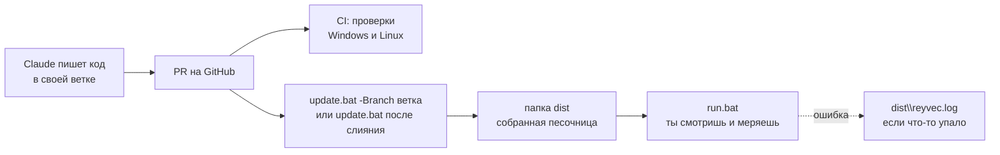

# 9. Инструменты

[← Оглавление](README.md)

## Суть в двух словах

Это всё, чем движок проверяют и чинят: **песочница**, где видно каждый этап, **панель счётчиков** и **Tracy**, которые показывают, куда уходит время, **консоль** для отладки игры, **снимки кадра** и автопроверки на GitHub. А ещё `update.bat` и `run.bat` — твоя кнопка «обновить и запустить».

## Схема: как правка доходит до твоего ПК

## Простыми словами

**🧪 Песочница** (`run.bat`) — набор тестовых сцен, по сцене на каждую возможность движка. Цифры и буквы переключают сцены: 1–9 и 0 — векторы, L/K/J/H — свет, N — сцена из файла, I — 3D. Всё новое в движке обязательно видно в песочнице.

**📊 Панель счётчиков (F1).** Время каждого прохода видеокарты, время процессора, число фигур и ламп, график последних кадров. Главный инструмент замеров: именно её числа ты присылаешь после проверки.

**🔬 Tracy** — отдельная программа-«рентген». Подключается к работающей песочнице и показывает ленту времени: что делал каждый поток и каждый проход видеокарты, вплоть до долей миллисекунды. Нужна, когда панель говорит «медленно», а непонятно почему.

**💬 Консоль (~ или Ё).** Команды по-русски: `телепорт`, `здоровье 5`, `бессмертие`, `пауза`, `шаг`, `медленно`, показ столкновений. `помощь` — список всего.

**📸 Снимок кадра (F12).** Сохраняет текущий кадр в файл. Без окна то же делает флаг `--snapshot`: так CI проверяет, что картинка не «поплыла».

**🤖 CI** — робот на GitHub, который на каждый PR:
- собирает движок на Windows и проверяет оформление кода и тесты;
- запускает `update.bat` как будто на твоём ПК;
- на Linux с программной видеокартой (lavapipe) открывает окно с проверкой ошибок Vulkan и сравнивает кадры с эталонными картинками;
- проверяет лицензии всех библиотек.

> ⚠️ У робота нет настоящей видеокарты. Он ловит **ошибки и изменения картинки**, но **скорость** честно меряется только на твоём ПК.

**🔁 `update.bat` и `run.bat`.** `update.bat` скачивает свежий код, собирает песочницу и редактор и кладёт в `dist`. С `-Branch имя` — берёт ветку PR, чтобы проверить до слияния. `run.bat` запускает песочницу, `editor.bat` — редактор. Если упало — пришли `dist\reyvec.log`.

## Технические детали

### Флаги песочницы (`.\run.bat --help`)

| Флаг | Что |
| --- | --- |
| `--list-gpus`, `--gpu <номер или имя>` | Список видеокарт, выбор (`--gpu radeon`) |
| `--no-vsync` | Без вертикальной синхронизации — предельный FPS |
| `--scene <имя>` | С какой сцены начать: `vector`, `lab`, `file`, `3d` и др. |
| `--scene-file`, `--space-file` | Свой файл 2D-сцены / 3D-сцены (с правкой на лету) |
| `--msaa off\|2\|4\|8`, `--editor-edges`, `--fill shape\|triangles\|stencil` | Сглаживание и способ заливки |
| `--svg`, `--motif` | Свой рисунок SVG / свои фигуры Motif |
| `--validation` | Слои валидации Vulkan (нужен Vulkan SDK) |
| `--frames N`, `--seconds S` | Закрыть окно после N кадров / S секунд |
| `--snapshot файл.png` (+ `--time`, `--size`, `--level-view`) | Кадр без окна в файл |
| `--no-hot-reload`, `--no-tracy`, `--version` | Служебные |

### Замеры

- Метки времени видеокарты после каждого прохода (`crates/reyvec-gpu/src/timing.rs`), первые 32 прохода кадра; сумма проходов = кадр.
- Панель: `crates/reyvec-app/src/panel.rs` (egui 0.37), свой рисовальщик `crates/reyvec-gpu/src/ui.rs` + `ui.slang`, проход «панель» виден в замерах.
- Tracy 0.14.1 ↔ `tracy-client` 0.19.0 (версии закреплены точно: протокол меняется). Функции `manual-lifetime`, `ondemand`, `only-localhost`. Зоны процессора — `reyvec_gpu::cpu_zone!("имя")`, зоны видеокарты — контекст «видеокарта».

### Снимки и эталоны

- F12: проход графа «снимок» копирует кадр; `--snapshot`: тот же кадр в sRGB без панели (`crates/reyvec-gpu/src/headless.rs`).
- Эталоны сняты на lavapipe. Допуск: канал до 8 из 255, сверх этого не больше 0,2 % пикселей.
- Не совпало — CI прикладывает артефакт `reference-failures`. Переснять: `REYVEC_UPDATE_REFERENCES=1 cargo test -p reyvec-app --test reference`.
- SVG сверяются с `resvg` отдельным тестом (`svg_reference.rs`).

### CI (`.github/workflows/ci.yml`)

| Задание | Что |
| --- | --- |
| Windows | `fmt`, `clippy -D warnings`, тесты, `update.ps1` под Windows PowerShell 5.1, обновление поверх правленого файла |
| Linux, программный Vulkan | Тесты видеокарты с валидацией, перезагрузка шейдеров, эталоны, SVG против `resvg`, окно песочницы 7 с, снимки, окно редактора, растягивание окна (оба пути swapchain) |
| Лицензии | `cargo-deny` |

Slang и cargo-deny кешируются в Actions по версии.

### Скрипты

`update.bat` → `scripts/update.ps1` (`-Branch`, `-NoPull`), `run.bat` → `scripts/run.ps1`, `editor.bat` → `scripts/editor.ps1`. Правила: `.ps1` в UTF-8 с BOM, `.bat` и `.ps1` с CRLF, комментарии в `.bat` латиницей.

Консоль: `crates/reyvec-app/src/console.rs`; журнал помнит последние строки, история команд — стрелки вверх и вниз.

## Слабые места и планы

- **CI не меряет скорость** — только твой ПК. Это сознательно: у бесплатных машин GitHub нет видеокарты.
- **Эталоны сняты на программной видеокарте**: настоящие видеокарты сглаживают края чуть иначе, поэтому на ПК сцены проверяются глазами.
- **`update.bat` возвращает файлы `scenes` к исходному виду.** Свои сцены — в другой папке, через `--scene-file` / `--space-file`.
- **Lavapipe плохо предсказывает время на настоящих видеокартах** — урок этапа 7: ускорение, которое у Claude выглядит большим, на RTX 5080 может почти ничего не дать.

## Связанные решения

- [0007. Замеры и Tracy](../decisions/0007-profiling.md)
- [0008. Снимки и эталонные картинки](../decisions/0008-reference-images.md)
- [Установка на Windows](../setup-windows.md)

## Заметки Романа

_Пока пусто._
