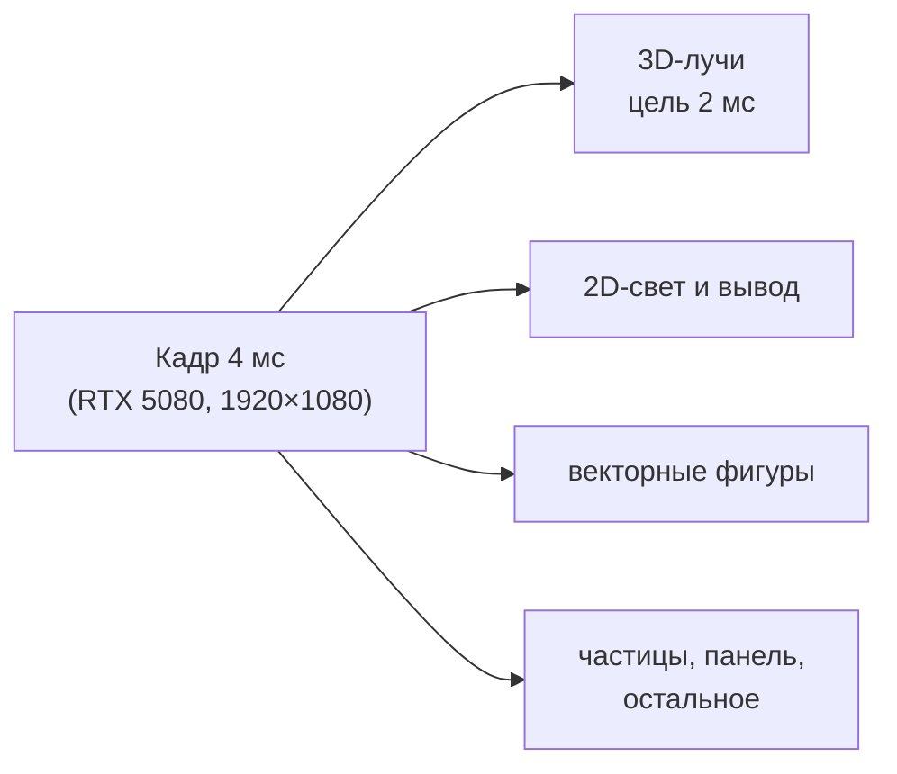

# 10. Скорость

[← Оглавление](README.md)

## Суть в двух словах

Монитор на 144 Гц ждёт новую картинку каждые 6,9 мс. Мы ставим себе цель строже: **весь кадр на RTX 5080 за 4 мс**. Зачем так жёстко? RTX 5080 очень мощная, и «60 кадров на ней» ничего не говорит о слабых ПК. Запас на сильной карте — это гарантия, что игра пойдёт и на обычной.

Для встроенной Radeon правило другое: не «4 мс», а **держать 60 кадров** с лучшим качеством, какое она тянет. Движок сам снижает качество на слабой видеокарте.

## Схема: куда уходит кадр

## Простыми словами

**Бюджет — как семейный бюджет.** Есть 4 мс на кадр, и каждый проход «тратит» свою долю. Панель (F1) показывает расходы по строкам: видно, кто съел больше всех.

**Что сейчас дороже всего — 3D-лучи.** В комнате 2.5D на RTX 5080 они берут 2,56 мс из цели 2 мс. Весь кадр при этом 2,69 мс — в бюджет укладываемся, но лучи — главная задача этапа 8.

**Векторы и 2D-свет — дёшевы.** 10 000 фигур рисуются за десятые доли миллисекунды. Лаборатория мага со всеми лампами — 1,23 мс.

**На Radeon главное — 60 кадров.** Помогают «упрощения для слабых»: меньше MSAA, 2.5D-уровень треугольниками, 3D в половину размера.

**Как мы меряем, чтобы не обманывать себя:**
- числа скорости — **только с твоего ПК**, у Claude программная видеокарта (она ловит ошибки картинки, но врёт о скорости);
- этап закрывается, когда цели подтверждены на **обеих** видеокартах, а каждое узкое место решено или отложено с планом;
- рывок — это кадр **дольше полутора средних**; фоновая работа не должна их давать.

## Технические детали

### Цели (решение 0003)

| Что | Цель |
| --- | --- |
| Весь кадр, RTX 5080, 1920×1080 | ≤ 4 мс |
| Реймарчинг («лучи 3D»), RTX 5080 | ≤ 2 мс |
| Встроенная Radeon | ≥ 60 кадров, качество подбирается |
| RTX 3060 (пример слабого ПК, оценка ×3 медленнее) | ≥ 60 кадров |
| Подготовка кадра на процессоре, 10 000 фигур | ≤ 1 мс |
| Нажатие → экран | ≤ 2 кадров при 60 (33 мс) |
| Рывок | нет кадров дольше 1,5 среднего при фоновой загрузке |

### Последние замеры по этапам (ПК Романа)

| Этап, сцена | RTX 5080 | Radeon |
| --- | --- | --- |
| 3: 10 000 фигур, проход «сцена» | 0,125 мс | кадр 3,6 мс |
| 4: лаборатория мага (H) | 1,23 мс | 8,1 мс (119 кадров) |
| 5: сцена из файла (N) | 1,08 мс | 6,8 мс (141 кадр) |
| 6: фонтан 100 000 частиц | 0,50 мс | 77 кадров |
| 6: полигон физики, логика | 1,2 мс из 16,7 | — |
| 7: комната 2.5D, вся видеокарта | 2,69 мс («поле») | 12,78 мс, 77 кадров («треугольники», 50 %) |
| 7: «лучи 3D» вместе | 2,56 мс (цель 2) | 8,50 мс |

### Где смотреть

| Где | Что |
| --- | --- |
| Заголовок окна | FPS и среднее время видеокарты за полсекунды |
| Панель F1 | Время каждого прохода, процессор «движок» и «сцена», счётчики лучей 3D, физика |
| Tracy 0.14.1 | Потоки и проходы на одной ленте |
| `dist\reyvec.log` | «Видеокарта на кадр в среднем» в конце работы |

### Настройки качества для слабой видеокарты

| Настройка | По умолчанию на встроенной | Где |
| --- | --- | --- |
| MSAA | 2× (на дискретной 4×) | `--msaa`, клавиша M |
| Поле 2D-света | четверть кадра (на дискретной половина) | автоматически |
| 2.5D-уровень | «треугольники» | панель «2.5D рисуется», `--level-view` |
| Разрешение 3D | 100 / 75 / 50 % | панель «Разрешение 3D» |

### Списки узких мест

- Векторы: [`docs/vector-bottlenecks.md`](../vector-bottlenecks.md)
- Свет: [`docs/light-bottlenecks.md`](../light-bottlenecks.md)
- Этапы 5–7: таблицы «Узкие места» в `docs/stage-*-summary.md`

## Слабые места и планы

- **«Лучи 3D» 2,56 мс при цели 2 мс** — перенесено на этап 8: сначала переключатель для замера (сколько стоят края, сколько тени), потом точечное ускорение.
- **Нет замеров на RTX 3060 и Intel** — таких видеокарт нет; оценки для 3060 — догадки (×3 медленнее RTX 5080).
- **Свежего замера сцены на 200 предметов 3D нет** — нужен как точка отсчёта для цели этапа 8 «1000+ SDF-объектов в 4 мс».
- **Встроенная Radeon в 2.5D — 77 кадров**, запас над 60 есть, но небольшой. Следующая экономия — поиск краёв вместе с лучами.
- **2560×1440** пока не меряли: при переходе на него пикселей станет на 78 % больше.

## Связанные решения

- [0003. Эталонный ПК и бюджеты](../decisions/0003-performance-targets.md)
- [0007. Замеры и Tracy](../decisions/0007-profiling.md)
- [0010. Многопоточность: цели](../decisions/0010-multithreading.md)

## Заметки Романа

_Пока пусто._
