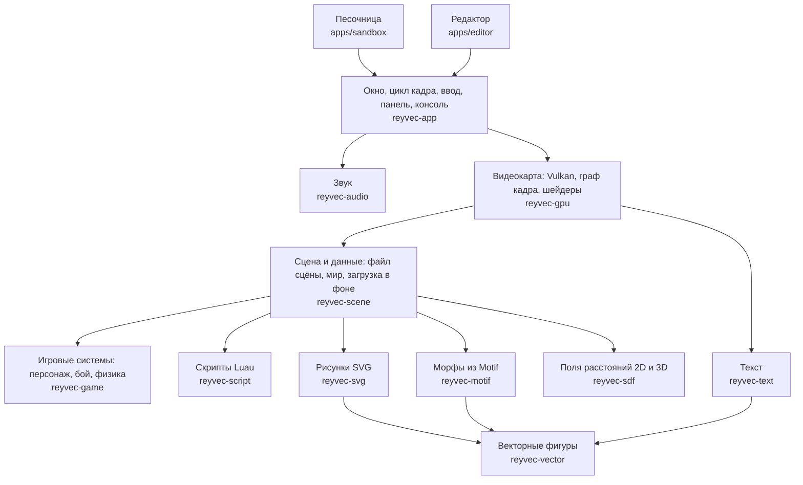

# Документация ReyVec

Это путеводитель по движку. Каждый раздел — отдельная страница. Страница начинается с сути простыми словами и схем, а технические детали идут ниже. Можно читать только верх страницы и уже понимать, что это за часть движка и зачем она нужна.

Внизу каждой страницы есть блок «Заметки Романа» для твоих пометок.

## Карта движка

Движок состоит из частей (в Rust они называются «крейты», по-английски crates). Стрелка показывает, кто кем пользуется: верхние части опираются на нижние.

Схема упрощённая: на ней только главные связи. Например, окно (`reyvec-app`) и видеокарта (`reyvec-gpu`) пользуются векторными фигурами и полями расстояний и напрямую, но эти стрелки не нарисованы, чтобы схема читалась. Полный список связей — в файлах `Cargo.toml` каждой части.

Самые нижние части (`reyvec-vector`, `reyvec-sdf`, `reyvec-game`, `reyvec-script`, `reyvec-audio`) ни от кого в движке не зависят. Это чистые расчёты: фигуры, поля, правила игры. Их можно проверять тестами без окна и без видеокарты.

## Как читать

1. Начни с [пути кадра](01-put-kadra.md): там видно, как все части работают вместе, пока на экране появляется одна картинка.
2. Дальше открывай раздел, который интересен. Каждый раздел можно читать отдельно.
3. Незнакомое слово ищи в [словаре](11-slovar.md).

## Разделы

| № | Раздел | О чём |
| --- | --- | --- |
| 1 | [Путь кадра](01-put-kadra.md) | Как сцена превращается в картинку на экране, какие потоки этим заняты |
| 2 | [Основа видеокарты](02-videokarta.md) | Vulkan, выбор видеокарты, память, граф кадра, шейдеры и их правка на лету |
| 3 | [Векторный слой](03-vektornyy-sloy.md) | Фигуры, заливки, обводки, слои и маски, текст, морфы из Motif |
| 4 | [2D-свет и тени](04-svet-2d.md) | Поле расстояний кадра, лампы, мягкие тени, каскады света, свечение |
| 5 | [Сцена и данные](05-scena-i-dannye.md) | Файл сцены RON, мир `bevy_ecs`, поток логики, загрузка в фоне |
| 6 | [Игровые системы](06-igrovye-sistemy.md) | Управление, герой, бой, физика Rapier, частицы, звук, анимация, скрипты, интерфейс |
| 7 | [3D и вид 2.5D](07-3d-i-25d.md) | Реймарчинг, формы из данных, запечённое поле, поле слоя, тени, края |
| 8 | [Редактор](08-redaktor.md) | Отдельная программа: панели, правка мышью, заготовки, «Играть» |
| 9 | [Инструменты](09-instrumenty.md) | Песочница, панель, Tracy, консоль, снимки, CI, `update.bat` |
| 10 | [Скорость](10-skorost.md) | Бюджеты кадра, последние замеры, где смотреть, настройки для слабых видеокарт |
| 11 | [Словарь](11-slovar.md) | Термины простыми словами |

## Как устроена страница

Все страницы собраны по одному [шаблону](shablon.md):

1. **Суть в двух словах.** Что это и зачем.
2. **Схема.** Как части связаны и куда идут данные.
3. **Простыми словами.** Как это работает, с примерами из песочницы.
4. **Технические детали.** Файлы, алгоритмы, цифры.
5. **Слабые места и планы.** Что работает не идеально и что с этим будем делать.
6. **Связанные решения.** Ссылки на `docs/decisions`.
7. **Заметки Романа.**

## Как оставить заметку

- **Самому на GitHub.** Открой страницу на github.com, нажми карандаш справа сверху («Edit this file»), допиши текст в блок «Заметки Романа» внизу и нажми «Commit changes». Если GitHub предложит, выбери «Create a new branch» и открой PR: так заметка не столкнётся с моими правками.
- **Через меня.** Напиши в чате, к какой странице заметка, и я её внесу.

Когда я обновляю страницу, заметки не стираю. Если заметка устарела (например, вопрос уже решён), я пишу ответ рядом с ней, а удаляешь её ты.

## Чем этот путеводитель отличается от остальных документов

| Где | Что там |
| --- | --- |
| `docs/guide` (здесь) | Как движок устроен сейчас, по частям |
| [`docs/roadmap.md`](../roadmap.md) | Этапы и задачи: что сделано и что дальше |
| [`docs/decisions`](../decisions/README.md) | Почему выбрали именно так: каждое важное решение отдельно |
| `docs/stage-*-summary.md` | Итоги этапов с замерами на ПК |
| [`docs/setup-windows.md`](../setup-windows.md) | Установка программ на ПК |

## Заметки Романа

_Пока пусто._
