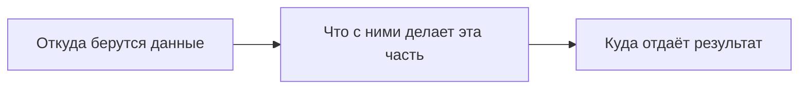

# Шаблон страницы

По этому шаблону собраны все страницы путеводителя. Его используют при добавлении нового раздела.

**Тон.** Верхняя часть (суть, простыми словами) пишется легко и живо: сравнения из жизни, короткие абзацы, выделения, врезки. Технические детали — строго и по делу: таблицы, файлы, цифры, без украшений.

````markdown
# N. Название раздела

[← Оглавление](README.md)

## Суть в двух словах

Два-четыре предложения без терминов: что эта часть делает и зачем она движку.

## Схема



## Простыми словами

Как это работает, по шагам. Пример, который можно увидеть в песочнице: какая сцена, какая клавиша.

## Технические детали

Файлы и крейты, главные типы, алгоритмы, форматы, цифры.

## Слабые места и планы

Что работает не идеально, почему и в каком этапе это исправляем.

## Связанные решения

- [00NN. Название](../decisions/00NN-....md)

## Заметки Романа

_Пока пусто._
````
