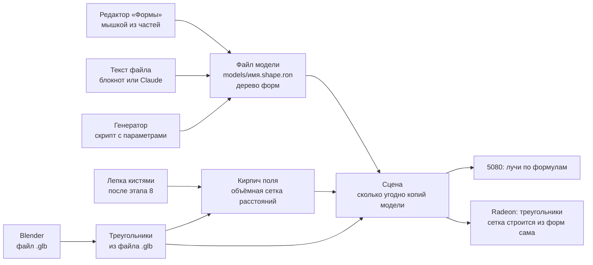

# Как делать 3D-модели для ReyVec и редактор для них

Дата: 2026-11-21. Статус: **принято** 2026-11-21 «по советам» (ответы на вопросы в конце — как советовал). Работа идёт шагами М.0–М.9, статус — в `docs/roadmap.md`, раздел «Модели».

Вопрос Романа: «Как лучше всего делать 3D-модели для нашего типа графики? И можем ли мы сделать для этого визуальный редактор?»

## Коротко

✅ **Главный способ — собирать модели из форм-формул**, как из пластилина: шары, коробки, цилиндры, выдавленные и выточенные контуры, которые плавно слипаются, вырезаются друг из друга и красятся материалами. Движок уже умеет рисовать такие формы (этап 7), просто сейчас их пишут текстом в файле сцены.

✅ **Визуальный редактор сделать можем**, и он ложится в наш редактор как новое рабочее пространство «Формы» (внутри «Ассетов»). Половина нужного там уже есть: выбор мышкой, стрелки сдвига и поворота, отмена, заготовки, правка файла без потери комментариев.

🧰 **Два запасных способа рядом с главным:**
- модели из Blender (`.glb`) — для того, что формулами делать мучительно: персонажи, животные, мелкая резьба. Загрузка уже есть (8.14);
- «лепка» кистями по объёмной сетке — для кузнечного симулятора (раскалённая заготовка, по которой бьют молотом). Это отдельный блок после этапа 8.

⚠️ **Главное слабое место:** сложная модель из сотни частей сейчас дорогая — луч на каждом шаге считает все её части. Перед редактором нужен один шаг движка: «границы частей внутри модели», чтобы луч считал только части рядом с собой.

## Схема: откуда берутся модели



## Простыми словами

### Что вообще такое «модель» в нашем движке

В обычных движках модель — это **сетка из треугольников**, как бумажная маска, склеенная из тысяч маленьких кусочков. Её лепят в Blender, а движок просто показывает.

У нас модель — это **рецепт**. Например, наковальня:

> возьми коробку 40×20×15 см со скруглением 1 см → прилепи сверху рог (вытянутый конус) с плавным швом 3 см → вырежи снизу арку → покрась «тёмным железом».

Движок по рецепту сам считает, где поверхность. Отсюда все наши плюсы:
- 🎯 **идеальные скругления и швы** при любом приближении, никаких граней;
- 🌗 **мягкие тени и затенение углов** получаются из той же формулы почти даром;
- 🔧 **рецепт можно менять на ходу**: сделать наковальню длиннее, вмятину глубже, станок с тремя валами вместо двух — это просто другие числа;
- 🪶 **файл крошечный**: станок — пара килобайт текста, а не мегабайты треугольников;
- 🧠 **рецепт понимают и люди, и код, и Claude**: можно написать «сделай бочку с тремя обручами» и получить готовый рецепт.

Это ровно то, к чему ты стремишься: «графика, синтезированная из кода на лету».

### Способы делать модели — сравнение

| Способ | Как это выглядит | Хорошо для | Плохо для | Наш вердикт |
| --- | --- | --- | --- | --- |
| 🧱 **Формы-формулы** (части + плавные слияния) | Как лепка из пластилиновых деталей. Так работают Dreams на PlayStation, MagicaCSG, Womp | Станки, инструменты, мебель, постройки, оружие, предметы кузницы, всё «сделанное руками» | Лица, ткань, листва, мелкая резьба | **Главный способ** |
| 🎛️ **Генератор с параметрами** (рецепт + ручки) | «Конвейер(длина: 4 м, ножек: 6)», «Дерево(высота, ветвистость)» | Сотни разных копий для завода и мира, разнообразие без ручной работы | Уникальные «авторские» вещи | Надстройка над формулами, второй шаг |
| 🎨 **Модели из Blender** (`.glb`) | Обычный путь игровых студий | Персонажи, звери, сложная органика, готовые бесплатные модели | Не «из кода», не меняется на ходу; тени у нас через «кирпич» и чуть грубее | Есть уже сейчас (8.14), оставляем как запасной |
| 🔨 **Лепка кистями по сетке** (кирпич поля) | Как глина: давишь, тянешь, сглаживаешь | Кузнечная заготовка, вмятины, разрушения, рельеф | Ровные механические детали (кисть их «мнёт») | Для кузницы, после этапа 8 |
| 🟫 **Кубики-воксели** | Как Minecraft или MagicaVoxel | Мир из блоков, «пиксельный» стиль | Модели гладкого вида | Для мира-блоков (поле из сетки блоков), не для моделей |
| 🔁 **Blender → формулы автоматически** | Программа угадывает рецепт по сетке | — | Честно: хорошо это никто не умеет, получается каша из сотен шаров | **Не делаем** |

> 💡 Почему не «всё в Blender»? Потому что тогда мы теряем свою сильную сторону. Модель из треугольников у нас рисуется как в любом другом движке, а не формулой: нет идеальных скруглений, её нельзя сплющить молотом, нельзя поменять длину ручкой. Blender остаётся как запасной путь, а не как основной.

### Как это решает задачу двух видеокарт

- **RTX 5080** рисует модель «честно» — лучами по формулам.
- **Встроенная Radeon** в режиме «треугольники» (8.20) получает сетку, которую движок **сам** строит из той же формулы при загрузке. Художнику ничего делать не надо: одна модель — два способа показа.

### Каким будет редактор «Формы»

Представь окно нашего редактора, вкладка «Ассеты» → «Формы»:

- 🎬 **посередине** — модель одна на подставке, вращается мышкой, с хорошим светом (тот же кадр движка, не картинка-подобие);
- 🌳 **слева** — список частей деревом: «корпус», «рог», «вырез снизу». Глаз (скрыть), замок, перетаскивание;
- 🎚️ **справа** — свойства части: размеры, скругление, материал и **главная ручка — «плавность шва»** (0 — острый стык, 5 см — как будто детали слиплись);
- ➕ **палитра частей**: шар, коробка, цилиндр, капсула, тор, конус, «нарисовать контур и выдавить», «нарисовать контур и выточить» (как гончарный круг);
- ✂️ у каждой части режим: **добавить**, **вырезать**, **оставить пересечение**;
- 🪞 **зеркало** (делаешь половину станка, вторая повторяется) и **повтор** (6 ножек конвейера, 12 зубьев шестерни);
- 📊 **счётчик цены**: сколько частей, сколько это стоит лучу, «зелёный / жёлтый / красный»;
- 👁️ **переключатель «как на Radeon»**: та же модель треугольниками;
- 💾 модель сохраняется в свой файл, его перетаскивают в любую сцену, как заготовку.

Позже туда же — **ручки-параметры** (вынести «длину» наружу, чтобы в сцене ставить конвейеры разной длины) и **кисти** для лепки.

## Технические детали

### Что есть сейчас

| Что | Где | Состояние |
| --- | --- | --- |
| Дерево формы `Shape3`: `Sphere`, `Box`, `Capsule`, `Cylinder`, `Torus`, `Plane`, `Extrude`/`Revolve` по 2D-контуру `Profile`, `Union`/`Subtract`/`Intersect` с `smooth`, `Move`, `Paint`, `Animate` | `crates/reyvec-sdf/src/shape3d.rs`, решение 0018 | Готово, рисуется одним шейдером через стековую машину |
| Зеркало на процессоре (`Shape3::distance`, `Program::distance`) | там же | Готово — пригодится для выбора части щелчком без видеокарты |
| Сетка из формы для слабых видеокарт (двойной контур + упрощение, кэш одинаковых форм) | `shape_mesh.rs`, `mesh_simplify.rs` (8.20а) | Готово |
| Модели `.glb` | `model3d.rs`, `Mesh3::Model` (8.14) | Готово (текстура 8.14б2 в работе) |
| Кирпич поля 64³ из модели | `brick3d.rs` (8.15) | Готово, пока только для теней |
| Редактор: выбор, стрелки Q/W/E/R, привязки, отмена, заготовки, правка RON с сохранением комментариев | `apps/editor/src/editor/` (Р.1–Р.11; с Р.11 редактор отдельно от движка, решение 0021) | Готово, но **только для сцен 2D** (`first-room.ron`); сцены 3D (`scenes/3d/*.ron`) редактор не открывает |

Чего не хватает:
1. **Нет файла модели и ссылки на него.** В `factory.ron` форма конвейера переписана целиком в каждой из 96 копий. Нужна библиотека моделей и ссылка `Use`.
2. **Нет границ внутри модели.** Отсев (сетка 7.6е, коробки 8.8а) работает по предмету целиком. Внутри предмета программа выполняет все примитивы на каждом шаге: модель из 80 частей стоит лучу как 80 предметов в одной клетке. По оценке из 0018 (`0,059 + 0,018 · объектов в клетке` мс) это заметно уже на десятках частей.
3. **Глубина стека 8** (`STACK` в `shape3d.rs`): глубоко вложенные группы `compile` не примет. Для ручной сборки в редакторе вложенность растёт быстро (группа в группе с вырезом).
4. **Нет 3D в редакторе вообще** — ни для моделей, ни для сцен.

### Формат файла модели (предложение)

`models/наковальня.shape.ron`:

```text
(
    format: "reyvec-shape",
    version: 1,
    // Материалы модели по именам; в сцене их можно переопределить.
    materials: [
        (name: "железо", color: "#3a3d42"),
        (name: "окалина", color: "#5a3424"),
    ],
    // Ручки, которые сцена может менять (шаг М.6).
    params: [(name: "длина", value: 0.40, min: 0.25, max: 0.80)],
    shape: Union(smooth: 0.03, shapes: [
        Paint(material: "железо", shape: Box(size: (0.40, 0.20, 0.15), round: 0.01)),
        Move(at: (0.27, 0.07, 0), turn: (0, 0, -90),
            shape: Cone(height: 0.20, radius: 0.06)),
    ]),
)
```

В сцене: `(name: "наковальня 1", at: (1, 0.5, 0), shape: Use(model: "наковальня", params: (длина: 0.5)))`.

- `Use` раскрывается при чтении сцены в обычное дерево, поэтому шейдер не меняется. Одинаковые `Use` с одинаковыми ручками дают одну программу и одну сетку для Radeon (кэш 8.20а уже сравнивает формы).
- Материалы модели — имена, при чтении сцены сливаются со списком материалов сцены (имя модели + имя материала).
- Правка файла модели на лету перечитывает все сцены, где она стоит (как сейчас файл сцены).

### Новые примитивы и операции

Небольшие, каждый — формула из того же набора, что уже в шейдере `include/sdf3d.slang`:
- `Cone` (усечённый конус со скруглением), `Wedge`/`Prism` (клин), `Ellipsoid` — частые в «рукотворных» вещах;
- `Mirror(axis)` — зеркало точки по оси перед формой: даром по цене;
- `Repeat(count, step)` — конечный повтор (ножки, зубья, болты) через ограниченное `mod` пространства: одна формула вместо N копий;
- `Shell(thickness)` — полая оболочка (баки, трубы), `Round(r)` — скругление готовой формы.

### Границы частей внутри модели (шаг движка до редактора)

`compile` расставляет у группы (`Union`, `Repeat`) шар-границу и слово «перепрыгни»: если точка дальше границы на величину больше уже найденного расстояния, на стек кладётся расстояние до шара и программа перескакивает группу. Это то же, что 7.6а делает для предметов, только внутри одного предмета. Для плавного слияния граница расширяется на `smooth`. Точность попадания не меняется: у поверхности группы считаются честно.

Ожидаемый эффект: стоимость шага по модели растёт с числом частей **рядом с точкой**, а не с числом частей вообще. Проверка — счётчик «примитивов на шаг» на процессоре по модели из 50+ частей, как в 7.6е, и замер Романа на обеих видеокартах.

Для неподвижных сложных моделей есть второй путь, уже заложенный в этап 8: запечь в кирпич или в общее поле (8.9) и честно считать только вблизи.

### Редактор «Формы»: устройство

- Код — в `apps/editor/src/editor/`. По решению 0021 редактор не правит внутренности движка: что нужно от `reyvec-app` — через `for_editor.rs`, вывод сцены 3D в окно редактора — отдельной небольшой правкой `reyvec-gpu`.
- Рабочее пространство внутри «Ассетов» (`layout.rs`), панели — те же токены стиля (`theme.rs`).
- Кадр посередине — отдельная маленькая сцена 3D: модель, пол-подставка, солнце и две лампы, камера вращения. Нужен вывод сцены 3D в окно редактора (сейчас редактор показывает сцену 2D на весь экран под панелями).
- Выбор части щелчком — луч на процессоре по `Shape3::distance` с номером части (зеркало уже точное), без чтения с видеокарты.
- Стрелки сдвига и поворота, привязки, отмена — из `viewport.rs` и `doc.rs`, переведённые на 3D (сейчас они плоские).
- Запись в файл — через `ron_edit.rs`: меняется только нужное число, комментарии остаются.
- Рисование контура для `Extrude`/`Revolve` — плоский редактор кривых, рисуется нашим векторным слоем (кривые Безье как в `Profile`).
- Счётчик цены: слов программы, примитивов, глубина стека, примитивов на шаг (модель на процессоре), время сетки для Radeon.

### Этапы

Каждый шаг — один PR, результат виден в редакторе или песочнице.

| Шаг | Что | Что Роман увидит |
| --- | --- | --- |
| М.0 | Файл модели `*.shape.ron`, `Use` в сценах, `Cone`, `Mirror`, `Repeat`; завод переводится на модели | Завод выглядит как раньше; конвейер, вентилятор, стеллаж и погрузчик записаны по одному разу (файл сцены на 22 % короче: основную длину дают простые ящики и бочки); модель правится в блокноте — меняются все её копии сразу |
| М.1 | Границы частей внутри модели + счётчик «примитивов на шаг» | Модель из 60 частей не дороже 3–5 простых предметов (замер на 5080 и Radeon) |
| М.2 | Вкладка «Формы»: модель на подставке, вращение камеры, перечитывание при правке файла | Открываешь модель — видишь её со светом, правишь текст — меняется сразу |
| М.3 | Дерево частей, свойства, палитра «+», режим «добавить / вырезать / пересечь», ручка плавности шва | Модель собирается без текста, числами в панели |
| М.4 | Выбор щелчком, стрелки Q/W/E/R в 3D, привязки, зеркало, повтор, отмена | Модель лепится мышкой |
| М.5 | Рисование контура и выдавливание / выточка | Рисуешь профиль вазы — получается ваза |
| М.6 | Ручки-параметры модели, разные значения у копий в сцене | Один «конвейер», в сцене разной длины |
| М.7 | Счётчик цены и вид «как на Radeon» | Видно, не слишком ли модель тяжела для слабой видеокарты |
| М.8 | Сцены 3D в «Мире»: ставить модели мышкой, перетаскивать из «Ассетов» | Завод собирается мышкой |
| М.9 | Лепка кистями по кирпичу (вдавить, добавить, сгладить) — общий шаг с кузницей | Заготовку можно мять кистью |

М.0 и М.1 — работа движка, их можно делать сразу после согласования. М.2–М.8 — редактор, примерно по PR на шаг, как Р.1–Р.10.

## Слабые места — честно

- 🐢 **Цена сложных моделей.** Без М.1 модели больше пары десятков частей тормозят на Radeon, а с сотней частей — и на 5080. М.1 это лечит, но выигрыш нужно подтвердить замером, не обещаю цифру заранее.
- 🙂 **Формулами трудно делать живое.** Лицо, ткань, шерсть, листву формулами собрать можно (в Dreams собирали), но это долго и требует навыка. Для них — Blender, или сознательный стиль «из деталей» (как игрушечные человечки).
- 🎨 **Мелкая поверхность.** Царапины, швы, текстура дерева — не формой, а материалом. Сейчас материал — цвет, свечение и сетка. Для «рисунка по поверхности» нужны процедурные материалы (шум, полосы, ржавчина) — это отдельная задача, связанная со стилем 8.16–8.18.
- 🦴 **Анимация.** Твёрдые части на костях (рука-рычаг станка, лопасти) делаются просто: часть двигается по кости. Гнущаяся «кожа» формы — сложно, пока не планирую.
- 🔺 **Сетка для Radeon.** Строится автоматически, но тонкие детали тоньше её клетки (2,5 см) могут пропасть, а острые кромки — чуть округлиться. Счётчик М.7 будет это показывать.
- 📏 **Глубина стека 8.** При ручной сборке её легко превысить. В М.0 `compile` научится раскладывать длинные цепочки без роста стека, а вложенность глубже 8 — запрещу в редакторе с понятной подсказкой, а не ошибкой при загрузке.
- 🧭 **3D в редакторе — с нуля.** Вывод сцены 3D в окно редактора, стрелки и выбор в объёме — всё это новое. Это самая большая часть работы, а проверить её можно только на твоём ПК.
- 🚫 **Нет кнопки «превратить модель из Blender в формулы».** Только кирпич (сетка расстояний 64³): годится для теней и лепки, но это не рецепт.

## Вопросы Роману

1. **Что лепим первым?** Мой совет: «рукотворные» вещи — станки, инструменты, кузница, мебель. Персонажей пока через Blender или в стиле «из деталей».
2. **Где живёт редактор моделей?** Мой совет: вкладка «Формы» внутри «Ассетов» нашего редактора, а не отдельная программа — модели сразу перетаскиваются в сцены.
3. **Когда начинать?** Мой совет: М.0 и М.1 сразу после текущих задач этапа 8 (они ускоряют и завод), редактор М.2–М.8 — параллельно этапу 8, как шёл редактор Р.1–Р.10. Лепка М.9 — вместе с блоком кузницы.

## Связанные решения

- [0018. Объёмные формы данными](decisions/0018-sdf-shapes-3d.md)
- [0019. Запечённое поле расстояний](decisions/0019-baked-distance-field.md)
- [0017. Редактор](decisions/0017-editor.md)
- Путеводитель: [7. 3D и вид 2.5D](guide/07-3d-i-25d.md), [8. Редактор](guide/08-redaktor.md)

## Заметки Романа

_Пока пусто._
