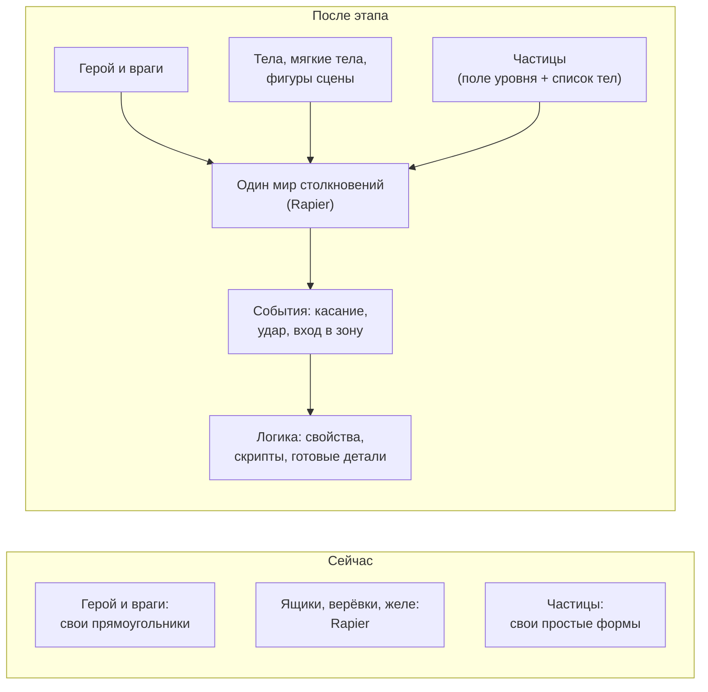

# План этапа «Физика и логика»

Дата: 2026-11-27. Статус: **ждёт согласования Романа**, код по этапу не начат.

Графика закрыта с долгами ([итог этапа 8](stage-8-summary.md)). Роман решил дальше заняться физикой и логикой. Этот документ: что уже есть, что будем делать, как Роман увидит результат и какие решения нужны от него.

## Суть в двух словах

Сейчас в движке физика есть, но живёт «сбоку»: ящики, верёвки и желе считает Rapier, а герой, уровень и частицы сталкиваются по своим упрощённым правилам. Поэтому герой не может встать на желе, а частицы иногда проваливаются в пол. Логика игры почти вся зашита в коде движка: скрипт врага умеет только бегать и прыгать, а дверь, кнопку или сохранение без программиста не сделать.

Этап делает три вещи:

1. **Один мир столкновений.** Всё твёрдое (уровень, герой, враги, ящики, мягкие тела, фигуры сцены, частицы) сталкивается в одном месте и по одним правилам.
2. **Логика из данных и скриптов.** У предметов появляются свойства, предметы обмениваются событиями («меня коснулись», «кнопку нажали»), есть готовые детали (дверь, кнопка, рычаг, зона, таймер, сохранение). Комнату-головоломку можно собрать, не трогая Rust.
3. **Физика в 3D** (если Роман выберет, вопрос 1). Ящики падают со стеллажей склада, конвейер везёт коробки, по цеху можно пройти человечком.

## Схема

## Что уже есть

| Что | Где | Состояние |
| --- | --- | --- |
| Rapier 2D 0.36.1 своей копией | `third_party/`, решение [0016](decisions/0016-physics-rapier-local.md) | Работает, полигон проверен Романом: 397 тел, шаг 1,08 мс на RTX 5080-ПК |
| Тела, сочленения, мягкие тела, выброс | `reyvec-game/src/physics/` | Работает, но мягкие тела не толкают героя |
| Свой контроллер платформера | `reyvec-game/src/controller.rs` | Работает, ощущение одобрено Романом. Сталкивается с прямоугольниками и склонами, не с миром Rapier |
| Мир сцены на `bevy_ecs` | `reyvec-scene/src/world.rs` (2 160 строк) | Всё в одном файле: Роман отложил разделение «до продуманной логики сцены» (это сейчас) |
| Скрипты Luau | `reyvec-script` | Узкие: скрипт видит своё место, скорость, героя, пишет «бег», «прыжок», «скрыт», «подобран» |
| Сюжет | `reyvec-story`, «Сюжет» Сю.1–Сю.13 | Свой поток работы; логика сцены должна отдавать ему события |
| 3D-сцены (`scenes/3d/*.ron`) | `reyvec-sdf`, `reyvec-gpu` | Только показ: ни физики, ни героя, ни скриптов |

## Простыми словами: как Роман увидит результат

- **Новый полигон 2D** (сцена из файла, клавиша N): герой встаёт на желе и на качающийся мост, отталкивает верёвку, стоит на повёрнутой SDF-фигуре; ящик, упавший с высоты, ранит врага и звучит «по-деревянному»; частицы фонтана больше не проходят сквозь пол и лежат на крышках ящиков.
- **Комната-головоломка**: кнопка открывает дверь, ящик на плите держит решётку поднятой, рычаг запускает лифт, три монеты открывают сундук, флажок-контрольная точка, F5/F9 — сохранить и загрузить. Всё собрано в файле сцены и скриптах, без правок движка.
- **Склад с физикой** (если выбран 3D): удар сбивает коробки со стеллажа, погрузчик расталкивает бочки, конвейер везёт коробки, человечек ходит по цеху и прыгает.
- **Строка «Физика» на панели** с числами: тела, касания, шаг физики, шаг логики, скрипты. Консоль: `столкновения` показывает настоящие формы из мира Rapier.

## Задачи

Номер этапа предлагаю **9** (вопрос 4). Каждая задача — один PR. Порядок важен: разделение мира (9.1) идёт первым, потому что всё остальное строится на нём.

### Блок А. Один мир столкновений (2D)

| № | Задача | Что Роман видит |
| --- | --- | --- |
| 9.1 | Разделить `world.rs` на системы (герой, тела, скрипты, бой, частицы, рисование) без изменения поведения | Ничего нового: всё работает как раньше. Тесты те же |
| 9.2 | Уровень в мире Rapier: тайлы, `solids`, склоны и доски-«сквозняки» становятся статичными телами. Свой контроллер героя сталкивается через пробы формой в мире Rapier, ощущение бега и прыжка прежнее | Герой ведёт себя как раньше на всех уровнях (это проверяют старые тесты контроллера), но теперь стоит и на телах Rapier любой формы |
| 9.3 | Фигуры сцены получают форму столкновения: векторный контур и SDF-фигура один раз превращаются в многоугольники (как разбиение на треугольники в 3.1), движущиеся и вращающиеся — кинематические | Герой стоит на повёрнутой звезде, ящик скатывается по дуге |
| 9.4 | Мягкие тела и герой: герой встаёт на желе, проваливается в гамак, толкает верёвку; враги тоже | Видно на полигоне |
| 9.5 | Частицы и мир: видеокарта получает поле расстояний уровня (такие поля уже считаются для света) и короткий список движущихся тел | Частицы не проходят сквозь пол и отскакивают от ящиков |
| 9.6 | События касаний и материалы: начало и конец касания, сила удара; материал (дерево, металл, камень, резина) даёт трение, упругость, звук удара и искры; падающий ящик ранит | Разные звуки удара, ящик с высоты бьёт врага |
| 9.7 | Надёжность и скорость: сцена-нагрузка 2 000 тел, проверка «одинаковый шаг — одинаковый результат», проседание пирамиды, правила CCD, засыпание тел | Числа на панели; цели ниже |

### Блок Б. Логика сцены

| № | Задача | Что Роман видит |
| --- | --- | --- |
| 9.8 | Свойства предметов: `props` и метки (`tags`) в файле сцены — материал, «светится», «можно поднять», «горит», «урон», своё число или текст. Это та «система свойств», которую Роман отложил на этапе 6 вместе с флагом свечения | В файле сцены у предмета список свойств |
| 9.9 | События и сигналы: касание, вход и выход из зоны, удар, «разбит», таймер, «нажата кнопка»; сигнал от одного предмета к другому записывается данными (`кнопка → дверь: открыть`), без скрипта | Кнопка открывает дверь без строчки кода |
| 9.10 | Шире скрипты: найти предмет по имени или метке, читать и менять свойства, толкнуть тело, создать заготовку, звук, частицы, тряска камеры, луч в мире физики, `wait(1.5)` внутри скрипта, обработчики `on_touch`, `on_enter`, `on_signal` | Враг, который бросает бочки; ловушка с задержкой |
| 9.11 | Готовые детали: дверь, кнопка, нажимная плита, рычаг, платформа по пути, зона, точка появления, контрольная точка, счётчик-замок. Комната-головоломка | Комната-головоломка в песочнице |
| 9.12 | Сохранение и загрузка: слот сохранения и контрольная точка; сохраняются свойства, места и скорости тел, состояние скриптов и сюжета | F5 / F9 в песочнице, после загрузки всё на местах |
| 9.13 | Компонент «Управляемый» и своя схема управления игры из файла, клипы анимации из файла (долги этапа 6, отложенные «вместе с логикой сцены») | Второй персонаж с другим управлением и своими позами из файла |
| 9.14 | Логика и сюжет: сюжет видит события сцены («поднял», «открыл», «вошёл в зону») и меняет свойства предметов | Задание сюжета закрывается, когда открыта дверь |

### Блок В. Физика в 3D (только если выбран вопрос 1 «б» или «в»)

| № | Задача | Что Роман видит |
| --- | --- | --- |
| 9.15 | Rapier 3D той же версии своей копией; `body` в 3D-сценах: коробки, бочки, шары; форма столкновения из SDF-фигуры или модели один раз (коробка, капсула, выпуклая оболочка, сетка для неподвижного) | В складе коробки падают со стеллажа от взрыва (Y) |
| 9.16 | Движущиеся тела в рисовании 3D: тела, которые двигает физика, рисуются как подвижные предметы (не в запечённом поле), спят — уходят обратно в поле | Склад с падающими коробками без просадки кадров |
| 9.17 | Человечек в 3D: свой контроллер ходьбы (камера сзади или от первого лица), те же скрипты и детали логики, что в 2D | Ходить по складу, толкать бочки, нажать кнопку |
| 9.18 | Конвейеры и механизмы: лента, которая везёт тела, моторы, шарниры в 3D (основа для игр в духе Factorio и кузницы) | Коробки едут по ленте и падают в ящик |

### Блок Г. Итог

| № | Задача |
| --- | --- |
| 9.19 | Видимость для отладки: формы столкновений, касания, сигналы в консоли и в 2D/3D; данные для режима «Физика» в редакторе через `for_editor` (сам редактор — в своём потоке работы) |
| 9.20 | Итог этапа: замеры Романа, таблица целей и отложенного, страница путеводителя «Физика и логика» |

Без блока В это около 15 PR, с ним около 19. Проверок на ПК Романа — примерно 8–10, собираем их пачками, как на этапе 8.

## Цели этапа (проверка готовности)

Физика и логика считаются на процессоре (в потоке логики, решение 0010), поэтому главные числа — время шага логики. Шаг идёт 60 раз в секунду, то есть у него 16,7 мс.

| Цель | Число | Где мерить |
| --- | --- | --- |
| Полигон 2D (около 400 тел) | шаг физики до 1 мс (сейчас 1,08) | ПК Романа |
| Сцена-нагрузка 2D, 2 000 тел и уровень | шаг физики до 4 мс, весь шаг логики до 6 мс | ПК Романа |
| 200 предметов со скриптами | скрипты до 1 мс за шаг | ПК Романа |
| Частицы с миром столкновений | 100 000 частиц, проход «частицы» до 0,5 мс (как в 6.6) | RTX 5080 и Radeon |
| Весь кадр 2D-полигона | в бюджете 4 мс на RTX 5080, 60 кадров на Radeon | обе видеокарты |
| Склад с физикой (блок В) | 300 движущихся тел, шаг физики до 3 мс, кадр как у склада без физики + до 1 мс | только RTX 5080: 3D на Radeon заморожен решением Романа от 2026-11-22 |
| Сохранение и загрузка | после загрузки тела и скрипты в том же состоянии, проверяется тестом | CI |
| Поведение героя | все старые тесты контроллера проходят без правок | CI |

Числа предложены мной как разумные, Роман может их поменять.

## Слабые места, о которых надо знать заранее

- **Rapier мягкий.** Кубики в пирамиде проседают друг в друга на 3 см (видно с 6.13). Лечится не до конца: можно уменьшить шаг или добавить итераций, это дороже. Если для игры это важно, поищем настройку в 9.7.
- **Мягкие тела в Rapier самые новые** (появились в 0.36) и меньше всего проверены. Если герой на желе будет вести себя странно, это может быть ошибка библиотеки, а не наша. Правку тогда делаем в своей копии.
- **Форма столкновения — приближение.** Круг или звезду физика видит многоугольником. Ошибка около 1 см, глазом не видна, но в редких случаях предмет может «висеть» на миллиметр над кривой поверхностью.
- **Перевод героя на пробы формой в Rapier (9.2) — самое рискованное место.** Ощущение бега одобрено Романом, и его нельзя сломать. Поэтому все старые тесты контроллера должны пройти без правок, а Роман проверяет на ПК до того, как идём дальше.
- **Одинаковый результат на разных ПК не гарантирован.** На одном ПК повтор шага даёт тот же результат. Чтобы совпадало на разных процессорах (нужно для сетевой игры и повторов), у Rapier есть особый режим, он медленнее. Включаем только если Роман скажет, что нужна сетевая игра (вопрос 5).
- **3D: движущиеся тела дороже неподвижных.** Скорость 3D-сцен на этапе 8 держалась на запечённом поле, где всё стоит. Каждая падающая коробка выпадает из поля и рисуется отдельно. Поэтому в 9.16 спящие тела возвращаются в поле, а цель «кадр + до 1 мс» может оказаться трудной.
- **Процессор в больших 3D-сценах уже занят на 1,7–1,9 мс подготовкой кадра** (долг этапа 8). Это другой поток, логике не мешает, но на слабом процессоре сложится.

## Вопросы Роману

1. **Физика в 3D в этом этапе?**
   а) только 2D, 3D позже;
   б) 2D целиком, потом основа 3D: падающие коробки, человечек, конвейер — **советую**: целевые игры в духе Factorio и кузницы трёхмерные, а основа логики общая для 2D и 3D;
   в) сразу 3D, 2D потом.
2. **На чём показывать логику:** комната-головоломка в 2D-платформере (**советую**: ближе к демо этапа 10) или маленький цех, где станок перерабатывает коробки с конвейера (ближе к играм в духе Factorio)? Можно и то и другое, если в вопросе 1 выбран «б».
3. **Сохранения нужны уже сейчас?** Советую да: слот и контрольная точка. Это заставляет держать всё состояние игры в одном месте, потом переделывать дороже.
4. **Номер этапа.** Сейчас этап 9 — «Инструменты» (уровень собирается мышкой без кода), но редактор уже идёт своим потоком параллельно. Советую: этап 9 — «Физика и логика», цель «Инструменты» переходит в поток редактора, этап 10 (вертикальный срез) остаётся.
5. **Будет ли в играх сетевая игра или запись повторов?** Если да, с самого начала включаем режим «одинаковый результат на любом ПК» (медленнее). Если нет или не скоро — не включаем.
6. **Вливать свои зелёные PR сразу, замеры на ПК собирать пачками**, как на этапе 8? Советую да.

## Технические детали

- **Один мир (9.2).** Уровень в Rapier — статичные тела: слитые прямоугольники тайлов (уже сливаются в 6.4), склоны и доски — отрезки (`Polyline`), у досок свой фильтр касаний (сквозь снизу). Герой и враги — кинематические тела; движение считает наш контроллер, а столкновения — `QueryPipeline::cast_shape` по миру Rapier с теми же допусками (кожа, шаг ступеньки, наклон 45°). `KinematicCharacterController` из Rapier не берём: в нём нет нашего виса на краю, досок и подстройки на склонах.
- **Формы фигур (9.3).** Контур фигуры (`reyvec-vector`) после разбиения уже есть — из него выпуклые части (готовое разбиение из Parry или своя склейка треугольников). SDF-фигура — контур по нулевой линии её поля, допуск 1 см. Считается один раз при загрузке в фоне, как разбиение на треугольники (правило этапа 3: на процессоре только разовая работа по фигуре).
- **Частицы (9.5).** Неподвижная часть — поле расстояний твёрдого уровня, запекается один раз при загрузке (тем же путём, что поля света этапа 4 и «поле слоя» 0020), но из форм столкновения, а не из видимых фигур: невидимый пол из `solids` в нём есть. Движущиеся тела — до 256 кругов и повёрнутых прямоугольников в буфере каждого кадра. Мягкие тела — кругами по частицам.
- **Логика (9.8–9.11).** Свойства — компонент `Props` (имя → число, текст, да/нет, цвет) и `Tags`. События — очередь `bevy_ecs` `Events` на шаг; сигналы — компонент `Wires` из файла сцены. Скрипты: события приходят в обработчики, `wait` — сопрограммы Luau, лимиты песочницы те же (решение 0013). Решение будет записано в `docs/decisions/0024-scene-logic.md` в PR 9.8.
- **Сохранение (9.12).** Файл RON рядом с настройками: версия, сцена, для каждого предмета `Props`, место, скорость, состояние скрипта (таблица `state` Luau, только простые значения), сюжет. Тело Rapier восстанавливается по месту и скорости, касания пересобираются за шаг.
- **3D (9.15–9.18).** `rapier3d` и `parry3d` той же версии, копией в `third_party`, через ту же обёртку (`reyvec-game/physics3d`). Подвижные тела в 3D идут по пути «подвижных предметов» рендера (снимок каждого кадра), спящие уходят в запечённое поле при следующей пересборке страницы (8.9/8.10).
- **Что не входит в этап:** вода (этап 10, решение Романа от 2026-11-03), ткань, разрушение на куски по форме, сетевая игра, графы-«ноды» для логики (позже, параллельно скриптам — решение Романа от 2026-11-22), ускорение подготовки кадра 3D (долг этапа 8).

## Заметки Романа

_(место для ответов и замечаний)_
