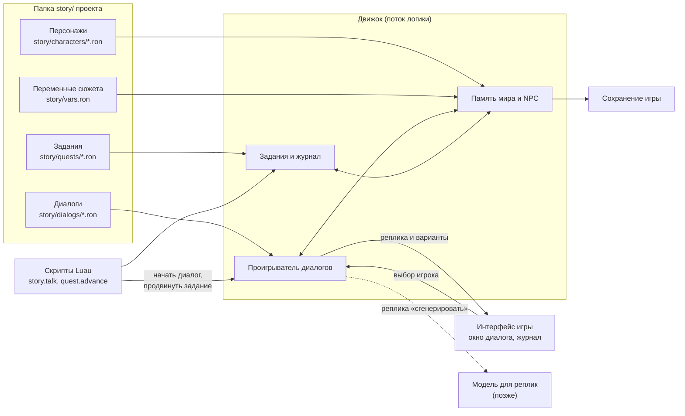
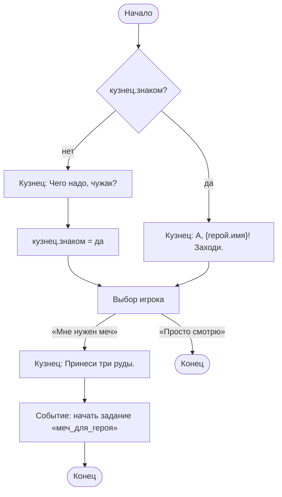
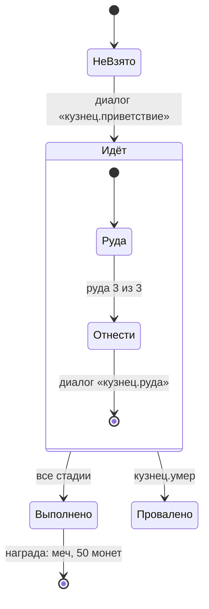

# Сюжет: диалоги, задания и живые персонажи

Дата: 2026-11-26. Статус: **принято**. Роман ответил на вопросы 2026-11-26 (раздел «Ответы Романа»), решение [0023](decisions/0023-story.md). Работа идёт шагами Сю.1–Сю.13.

Задача Романа: «Вкладка „Сюжет“. Там хранится сюжет. Внутри будут вкладки для редактирования и хранения диалогов и квестов. В коде можно на них ссылаться. Позже я дам доступ к модели для создания диалогов из кода. Эта система позволит создавать диалоги для игр с симуляцией жизни NPC».

## Коротко

✅ **Сюжет — это данные проекта, а не код.** Персонажи, диалоги, задания и «память мира» (переменные сюжета) лежат файлами в папке `story/` проекта. Их правят во вкладке «Сюжет» мышью, а при желании и руками в блокноте, как сцены.

✅ **Диалог — граф реплик.** Реплика персонажа, выбор игрока, проверка условия («у героя есть 10 монет?»), изменение мира («кузнец знаком с героем»), событие для игры («выдать меч», «начать задание»). В редакторе это схема из карточек со стрелками, как в Articy или Yarn Spinner.

✅ **Задание — цели и стадии.** «Найти руду (0 из 3) → отнести кузнецу → получить меч». У задания есть состояние (не взято, идёт, выполнено, провалено), запись в журнале игрока и награды.

✅ **Код ссылается по имени, а имя не ломается.** У каждого диалога, задания и персонажа есть постоянное имя: `"kuznec.privet"`, `"mech"`. В Luau: `story.talk("kuznec.privet")`, `quest.add("mech", "ruda", 1)`. Редактор подсказывает имена при наборе, подчёркивает опечатки и показывает, где диалог используется. Переименовал в редакторе — ссылки в скриптах и сценах поправились сами, как уже работает с файлами в «Ассетах».

✅ **Проверка без запуска игры.** Внизу вкладки есть «проигрыватель»: выбираешь диалог, задаёшь значения мира («денег 5, кузнец знаком») и проходишь его, нажимая варианты ответов. Сразу видно, куда ведёт каждая ветка и что меняется в мире.

✅ **Живые NPC — на этом же фундаменте.** У персонажа есть характер, цели, отношения и память («герой помог мне с рудой»). Позже, когда будет доступ к модели, появится реплика-заготовка «сгенерировать»: модель пишет фразу по характеру и памяти NPC, но действовать может только в рамках, которые задал автор (список разрешённых событий и изменений мира). Написанные руками диалоги и сгенерированные живут в одном графе.

⚠️ **Главное слабое место:** генерация моделью в игре — медленная (секунды на ответ) и непредсказуемая. Поэтому сначала делается обычная система с написанными диалогами, а модель подключается как ещё один вид реплики, с запасным написанным текстом на случай, если модель молчит или ответила не по правилам.

## Схема: что из чего состоит



## Простыми словами

### Что хранится во вкладке «Сюжет»

Четыре вида записей, у каждого своя вкладка внутри «Сюжета»:

| Вкладка | Что это | Пример |
|---|---|---|
| Персонажи | Кто есть в игре: имя, роль, портрет, голос, характер, отношения | Кузнец Борис: ворчливый, честный, любит дочь |
| Диалоги | Разговоры: реплики, выборы, условия, последствия | «Кузнец: приветствие», «Кузнец: просьба о руде» |
| Задания | Цели игрока: стадии, счётчики, награды, запись в журнале | «Меч для героя»: найти 3 руды, отнести кузнецу |
| Мир | Переменные сюжета: что произошло и что известно | `кузнец.знаком = да`, `деньги = 12`, `деревня.сгорела = нет` |

Переменные — это «память» игры. Диалоги и задания их читают («если кузнец знаком — поздороваться по имени») и меняют («после разговора кузнец знаком»). Скрипты тоже: монетка прибавляет `деньги`, враг при смерти ставит `волк_убит`.

### Как выглядит диалог

В редакторе — схема из карточек:



А в файле — тот же граф текстом. Файл можно открыть блокнотом, переслать, сравнить версии:

```ron
// Пример «кузнец и руда»: первая встреча и взятие задания «меч».
(
    format: "reyvec-dialog",
    version: 1,
    id: "kuznec.privet",
    title: "Кузнец: приветствие",
    with: ["kuznec", "hero"],
    nodes: [
        Check(id: "nachalo", at: (0, 0), when: "kuznec.znakom", yes: "po_imeni", no: "znakomstvo"),
        Set(id: "znakomstvo", at: (240, 120), changes: [(var: "kuznec.znakom", to: true)], next: "chuzhak"),
        Line(id: "chuzhak", at: (480, 120), who: "kuznec", text: "Чего надо, чужак? Я кузнец, если что.", next: "vopros"),
        Line(id: "po_imeni", at: (480, -120), who: "kuznec", text: "А, {hero.name}! Заходи.", settings: (mood: "dobryi"), next: "vopros"),
        Line(id: "vopros", at: (720, 0), who: "kuznec", text: "Что тебе нужно?", choices: [
            (text: "Мне нужен меч.", when: "quest.mech.state == \"none\"", next: "pro_mech"),
            (text: "Я принёс руду.", when: "quest.mech.stage == \"otnesti\"", next: "k_rude"),
            (text: "Просто смотрю.", next: "proshchai"),
        ]),
        Line(id: "pro_mech", at: (960, -160), who: "kuznec", text: "Меч? Принеси три куска руды — выкую.", settings: (camera: true), next: "vzyat"),
        Event(id: "vzyat", at: (1200, -160), name: "quest.start", args: ["mech"], next: "konec"),
        Jump(id: "k_rude", at: (960, 0), dialog: "kuznec.ruda"),
        Line(id: "proshchai", at: (960, 160), who: "kuznec", text: "Смотри, только руками не трогай.", next: "konec"),
        End(id: "konec", at: (1440, 0)),
    ],
)
```

Целиком пример «кузнец и руда» лежит в папке [`story/`](../story/).

Карточки, которые будут с первого шага:

- **Реплика:** кто говорит, текст (с подстановками `{hero.name}`), настроение для портрета, звук голоса.
- **Выбор игрока:** варианты, у каждого может быть условие («показать, если денег ≥ 10») и пометка «уже выбирали».
- **Условие:** развилка по переменным сюжета.
- **Изменить мир:** поставить или прибавить переменные, поменять отношение NPC к герою.
- **Событие:** сказать игре: выдать предмет, начать или продвинуть задание, открыть дверь, позвать функцию скрипта Luau.
- **Перейти:** в другую точку или в другой диалог.
- **Случай и процент:** пойти по одной из стрелок наугад или с заданной вероятностью (число берётся из генератора сохранения, поэтому загрузка не меняет исход).
- **Пауза:** подождать секунды или нажатия.
- **Выполнить:** позвать функцию Luau.
- **Конец.**

У реплики есть настройки (ответ Романа 2): вид (окно, фраза над головой, за кадром), портрет и настроение, звук голоса, «камера к говорящему», пауза после. По умолчанию они берутся из карточки персонажа и диалога.

Позже добавится **«Сгенерировать»** — реплика, которую пишет модель (раздел «Живые NPC»).

### Как выглядит задание



У задания: название и описание для журнала, стадии с целями (счётчик «руда 0 из 3» или условие на переменные), что открывает стадию, награды и условия провала. Задание тоже лежит файлом в `story/quests/`.

### Как на это ссылаться из кода

В скриптах Luau появляются две таблицы:

```lua
-- Кузнец: при касании героя начинаем разговор.
function update(me, hero, dt)
    if me.touched and not story.busy() then
        story.talk("kuznec.privet", me)
    end
end

-- Руда: подобрали — продвинули цель задания.
function on_collect(me)
    quest.add("mech", "ruda", 1)
    story.set("hero.money", story.get("hero.money") + 2)
end
```

- `story.talk(диалог, кто)`, `story.busy()`, `story.get(имя)`, `story.set(имя, значение)`.
- `quest.start`, `quest.add(задание, цель, сколько)`, `quest.state(задание)`, `quest.complete`, `quest.fail`.
- Подписки: `on_dialog_end(диалог, итог)`, `on_quest(задание, состояние)` — чтобы скрипт мог отреагировать.

В редакторе кода (С.1–С.2): подсказка имён диалогов, заданий и переменных при наборе, подчёркивание опечатки («нет диалога „kuznec.prvet“ — может, „kuznec.privet“?»), переход к диалогу по щелчку с Ctrl. В «Ассетах» у диалога в свойствах — «где используется»: какие скрипты, сцены и другие диалоги на него ссылаются.

### Что увидит Роман в редакторе

Вид и раскладка — как у Obsidian (пожелание Романа 2026-11-26: «для меня Obsidian очень удобен в работе с текстом»); схема карточек остаётся своей. Подробно — в путеводителе, раздел 08.

Вкладка «Сюжет»:

- **слева** — дерево: Персонажи, Диалоги, Задания, Мир. Поиск по имени и по тексту реплик («где кузнец говорит про меч?»);
- **в середине** — схема открытого диалога или задания: карточки, стрелки, мини-карта, выравнивание, как в «Мире». У персонажа — его карточка (портрет, характер, отношения) и все диалоги, где он говорит;
- **справа** — инспектор выбранной карточки: текст реплики, кто говорит, условия, что меняется;
- **внизу** — «Проигрыватель»: пройти диалог прямо в редакторе, с выбором значений переменных, и консоль.

### Образец Романа

Роман показал картинку узлового редактора диалогов, на который хочется равняться. Что из неё берём:

- **Сверху — полоса кнопок-карточек по цветам:** красные — то, что видит игрок (реплика, код, пауза), зелёные — ход разговора (развилка, случай, процент, повтор), синяя — переменная, фиолетовая — фраза над головой. Нажал кнопку — карточка появилась на схеме.
- **Справа сверху — «Переменные», «Персонажи» и выбор языка.** Язык переключается прямо в редакторе: карточки показывают текст на выбранном языке.
- **Карточка реплики:** кто говорит (список персонажей), вид реплики (окно, фраза над головой, голос за кадром), текст с кнопкой «›» для длинного текста, «+ добавить выбор». У каждого варианта ответа своё условие «если» и свой выход-стрелка.
- **Настройки у каждой реплики** галочками и списками: «камера к говорящему», портрет и настроение, звук голоса, пауза. Значения по умолчанию задаются у персонажа и диалога, у реплики — только то, что отличается.
- **Карточка «Выполнить»** зовёт функцию скрипта Luau.

Свой вид делаем в теме редактора (тёмный графит, янтарный акцент), а цвета групп карточек оставляем, как на образце: по цвету сразу видно, что делает карточка.

Схема из карточек — первый «узловой» редактор в движке. Он же потом пригодится для узловых скриптов, о которых Роман говорил раньше (как Blueprints в Unreal).

### Живые NPC и модель (позже)

Цель — игры с симуляцией жизни NPC: персонажи помнят, что было, у них свои дела, и разговор с ними не повторяется слово в слово. Что для этого закладывается сразу:

1. **Карточка персонажа описывает его для модели:** характер, манера речи, цели, что он знает и чего не знает, с кем дружит.
2. **Память NPC:** список фактов с временем и важностью («герой принёс руду», «волк напал на стадо»). Факты пишут диалоги, задания и скрипты. Старые неважные со временем забываются, важные остаются. Так устроены «генеративные агенты» из известной работы Стэнфорда 2023 года: память, выбор важного, план дня.
3. **Реплика «Сгенерировать» в графе:** автор пишет задачу («кузнец жалуется на погоду и намекает, что ему нужна руда»), рамки (длина, настроение) и **запасной текст**. Модель получает характер, память, переменные мира и задачу — и пишет реплику.
4. **Модель не может нарушить сюжет.** Она может только говорить и выбирать из списка разрешённого автором: «можно предложить задание „меч_для_героя“», «можно поменять отношение к герою на ±1». Всё, что вне списка, отбрасывается, и звучит запасной текст. Деньги, предметы и стадии заданий меняет только движок по правилам.
5. **Две скорости.** Модель может работать заранее, в редакторе («сгенерируй 10 вариантов приветствия, я выберу и поправлю» — это просто помощь автору), и во время игры (живая реплика). Во время игры ответ ждётся несколько секунд, поэтому показываем «персонаж думает» и готовим реплики заранее, пока игрок подходит к NPC.

Какую модель брать (своя на ПК или облачная) и как её подключать — решим, когда Роман даст доступ. Система устроена так, что модель — это сменный «поставщик реплик».

## Сравнение подходов

| Подход | Как выглядит | Плюсы | Минусы | Для нас |
|---|---|---|---|---|
| Граф карточек (Articy, Dialogue System для Unity) | Схема в редакторе | Видно все ветки, удобно мышью, подходит для генерации | Длинные линейные диалоги набирать медленнее | ✅ основной вид |
| Текстовый язык (Ink, Yarn Spinner) | Сценарий, как пьеса, с пометками | Быстро писать много текста, удобно сценаристу | Ветвления хуже видно, свой язык разбора | ➕ второй вид того же файла, похожий на Ren'Py (выбор Романа) |
| Диалоги в коде Luau | `say("..."); if choose(...)` | Ничего нового не нужно | Нельзя проиграть в редакторе, нельзя сгенерировать и проверить, тексты не переведёшь | ❌ только для особых случаев |
| Только модель, без написанных диалогов | Всё генерируется | Бесконечное разнообразие | Сюжет разваливается, медленно, нужна сеть или мощный ПК | ❌ модель — дополнение, не замена |

Как с «кодом и визуальным редактором» в интерфейсе игры (0022): один файл, два способа править. Позже текстовый вид, похожий на сценарии Ren'Py, станет вторым способом писать тот же граф (шаг Сю.13).

## Технические детали

### Крейты и где что живёт

- **Новая библиотека движка `reyvec-story`:** форматы `story/*.ron` (serde), проверка (нет ли стрелок в никуда, неизвестных переменных и имён), проигрыватель диалога как машина состояний, задания, память мира и NPC. Без окна и видеокарты: всё проверяется тестами, как `reyvec-scene`.
- **Поток логики:** проигрыватель живёт там же, где скрипты и физика (60 шагов в секунду, решение 0010). Наружу в снимке логики уходит «текущая реплика и варианты», внутрь приходит «выбран вариант N».
- **`reyvec-script`:** таблицы `story` и `quest` в песочнице Luau. Подсказки редактора — из общего списка описаний, как `ME_FIELDS` (тест сверяет список с тем, что движок даёт на самом деле).
- **Редактор (`apps/editor`):** вкладка «Сюжет» (`story_ui.rs`), узловой холст (`graph.rs` — общий, потом для узловых скриптов), проигрыватель. Редактор использует `reyvec-story` напрямую, как `reyvec-scene`.
- **Интерфейс игры (0022):** окно диалога и журнал — экраны `.rui` с привязкой к `game.dialog` и `game.quests`. Пока интерфейса игры нет (шаги И.x), в песочнице будет временное окно диалога на egui.

### Имена и ссылки

- Имя (`id`) — латиница в нижнем регистре, цифры, `_` и `.` (на него ссылаются код и условия Luau, а Luau понимает только латинские имена). Оно постоянное и отдельное от заголовка. Заголовок «Кузнец: приветствие» можно менять как угодно, имя `kuznec.privet` — только через «Переименовать», и тогда редактор правит все ссылки (Luau, сцены, другие диалоги, задания) тем же механизмом, что пути в «Ассетах» (Э.1).
- Переменные сюжета объявляются в `story/vars.ron` с типом (да/нет, число, текст) и значением по умолчанию. Необъявленная переменная — ошибка проверки, а не «тихий ноль».
- Условия пишутся выражением Luau (`hero.money >= 10 and not kuznec.zloy`). Оно разбирается один раз при загрузке, в песочнице только для чтения переменных. Один язык на всё, ошибки — с файлом и строкой.

### Сохранение и повтор

- Состояние сюжета (переменные, стадии заданий, память NPC, где остановился диалог) — часть сохранения игры. Формат с версией, чтобы старые сохранения читались после правки диалогов (пропавшая точка диалога → разговор заканчивается мягко, без падения).
- Проигрыватель детерминирован: одинаковый выбор даёт одинаковый путь. Случайные реплики («кузнец говорит одну из трёх фраз») берут число из общего генератора с зерном сохранения.
- Сгенерированные моделью реплики кэшируются (вопрос и ответ), чтобы загрузка сохранения не меняла уже сказанное.

### Тексты и языки

Переводы будут (ответ Романа 3), поэтому ключи и переключатель языка закладываются с Сю.1, а не потом. Тексты реплик хранятся прямо в файле диалога на основном языке, а у каждой реплики есть свой ключ. Переводы ложатся рядом (`lang/en.ron`) по этим ключам, тем же механизмом, что у интерфейса игры (0022). Переименование и перестановка карточек ключи не ломают.

### Проверки

- Тесты `reyvec-story`: разбор файлов, ошибки проверки (стрелка в никуда, неизвестная переменная, недостижимая карточка), проход диалога с заданным выбором, задания со счётчиками и провалом, сохранение и загрузка состояния.
- Тесты Luau: `story.talk` из скрипта начинает диалог, `quest.add` продвигает задание, неизвестное имя — понятная ошибка, а не падение.
- Тесты редактора: кадры вкладки «Сюжет» без видеокарты (`editor_preview`), проигрыватель, правка карточек и отмена.
- На ПК Романа: пример «кузнец и руда» в песочнице — подойти, поговорить, собрать руду, отнести, получить меч.

### Шаги

| Шаг | Что | Что увидит Роман |
|---|---|---|
| Сю.0 | Ответы Романа, решение 0023 | Готово 2026-11-26 |
| Сю.1 | `reyvec-story`: форматы, проверка, проигрыватель диалогов и заданий, тесты | Пример `story/` в проекте; тесты в CI |
| Сю.2 | Вкладка «Сюжет» в виде Obsidian (пожелание Романа): дерево заметок с поиском, вкладки, «Свойства», ссылки и проблемы справа; правка персонажей, переменных, текстов реплик, заданий и переводов | Список персонажей, диалогов и заданий, правка персонажей и переменных |
| Сю.3 | Узловой холст и редактор диалога: карточки, стрелки, отмена, Ctrl+S. Сделано: поля правятся прямо в карточке (как на образце Романа), отдельного инспектора нет; «Разложить» для диалогов без мест | Схема диалога, правка мышью |
| Сю.4 | Проигрыватель в редакторе | Пройти диалог, нажимая варианты |
| Сю.5 | Luau: `story.*`, `quest.*`, подсказки и проверка имён в редакторе кода | Скрипт кузнеца начинает разговор |
| Сю.6 | Редактор заданий: стадии, цели, награды, журнал | Задание «меч» в редакторе |
| Сю.7 | В игре: временное окно диалога и журнал, сохранение сюжета | Пример «кузнец и руда» в песочнице |
| Сю.8 | Ссылки: «где используется», безопасное переименование, поиск по тексту | Переименовал диалог — скрипты поправились |
| Сю.9 | Память NPC: факты, важность, забывание; отношения | Кузнец помнит, что герой принёс руду |
| Сю.10 | Подключение модели (после доступа от Романа): поставщик реплик во время игры, рамки, запасной текст; первыми — несюжетные NPC | Прохожий отвечает по характеру и памяти |
| Сю.11 | Генерация в редакторе: «предложи варианты», правка и выбор | Помощь автору при написании |
| Сю.12 | Жизнь NPC: распорядок дня, цели, разговоры NPC между собой; около сотни NPC считаются полностью, чем дальше от героя, тем реже и грубее | Деревня живёт, NPC говорят друг с другом |
| Сю.13 | Текстовый вид диалога, похожий на Ren'Py: тот же файл, правка текстом или схемой | Длинный диалог набирается как пьеса |

Сю.1–Сю.8 не зависят от модели и дают законченную систему диалогов и заданий. Сю.9–Сю.12 — путь к живым NPC.

## Слабые места — честно

- **Окно диалога в игре зависит от интерфейса игры (0022).** Пока его нет, в песочнице будет временное окно; настоящее красивое — после шагов И.x.
- **Узловой холст — новая большая часть редактора.** Масштаб, мини-карта, выделение рамкой, автоматическая раскладка — это несколько PR. Зато его же возьмём для узловых скриптов.
- **Модель во время игры — медленно и непредсказуемо.** Секунды на ответ, иногда ответ не по правилам. Отсюда запасной текст, заготовка ответов заранее и жёсткий список разрешённого. Насколько хорошо это будет звучать по-русски, зависит от модели.
- **Своя модель на ПК игрока требует видеопамяти** (несколько гигабайт), а это та же видеокарта, что рисует игру. Облачная модель требует сети и стоит денег за каждую реплику. Выбор — за Романом, когда будет доступ.
- **Сотня NPC, которые говорят друг с другом через модель, — это много запросов.** Модель пишет живой текст только для разговоров рядом с героем, по очереди важности. Дальние разговоры считаются грубо: «кузнец и мельник поговорили о волках» записывается фактом в память обоих, без слов.
- **Память NPC растёт.** Сотни NPC с тысячами фактов — это объём в сохранении и время на выбор важного. Нужны забывание и сжатие («пересказ» старых фактов), это шаг Сю.9.
- **Условия на Luau — сила и риск.** Удобно, но автор может написать слишком сложное условие. Песочница и предел работы те же, что у скриптов (0013).

## Ответы Романа (2026-11-26)

1. **Диалоги — карточками (узлами).** Как второй вариант — текстовый вид, похожий на Ren'Py (шаг Сю.13). Образец вида — картинка выше («Образец Романа»).
2. **Настройки у каждой реплики** удобно сделать прямо в карточке: портрет, голос, камера и прочее.
3. **Переводы будут.** Ключи реплик и переключатель языка — с первого шага.
4. **Модель — для игры.** Автор может дописывать за ней, но главное — она берёт на себя несюжетных персонажей и общается не хуже сюжетных. Помощь автору в редакторе (Сю.11) идёт после.
5. **NPC говорят друг с другом.** Около сотни NPC считаются по-настоящему, при удалении от героя расчёт затухает, далеко — только грубые расчёты.
6. **Первый пример — «кузнец и руда»,** как проверка.

## Связанные решения

- [0013 Скрипты на Luau](decisions/0013-scripts.md) — песочница и пределы работы, на них же условия сюжета.
- [0010 Потоки](decisions/0010-multithreading.md) — проигрыватель живёт в потоке логики.
- [0022 Интерфейс игры](decisions/0022-game-ui.md) — окно диалога и журнал, тексты на языках.
- [0021 Редактор отдельно](decisions/0021-editor-separate.md) — вкладка «Сюжет» в `apps/editor`.
- [0023 Сюжет](decisions/0023-story.md) — что решили по ответам Романа.

## Заметки Романа

_(место для заметок Романа)_
